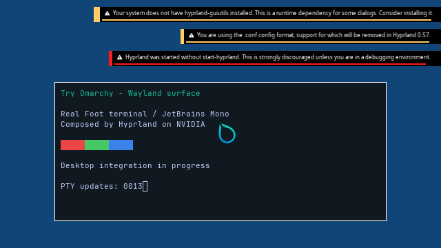

<p align="center">
  
</p>

<h1 align="center">Try Omarchy for Windows</h1>

**7Wdev development fork:** [build and upstream sync](https://github.com/7Wdev/try-omarchy-windows/blob/windows-nvgpu-lab/docs/FORK.md) ·
[Windows NVIDIA investigation](https://github.com/7Wdev/try-omarchy-windows/blob/windows-nvgpu-lab/docs/WINDOWS-NVIDIA-BACKEND.md).
The NVIDIA bridge has demonstrated [4K guest shaders and GPU texture handoffs](https://github.com/7Wdev/try-omarchy-windows/blob/windows-nvgpu-lab/docs/LIVE-GPU-4K.md)
through QEMU/WHPX. Full acceleration of the Omarchy/Hyprland desktop through this new backend remains under development.


**4/8 verification stages demonstrated; 0/4 desktop acceptance gates complete.** These are checklist counts, not percentages of engineering work completed.
Guest graphics integration is in progress. The largest integration work remains. [See the roadmap and evidence](docs/GPU-BACKEND-PROGRESS.md).

**Distance to the GPU-only desktop:** NVIDIA composition now works inside the actual Omarchy OS as ordinary UID 1000.
Two fresh real-root guests each complete **300 frames and 948 GPU commands**, releasing all GPU mappings before shutdown.
The shipped Lua configuration also produces the first actual Omarchy wallpaper/bar image at 1280×720, with a **software-rendered Qt shell**.
That diagnostic later fails and does not establish stable operation or application GPU acceleration.
The next target is **3840×2160 with both Hyprland and Quickshell verified on the GPU**. Mesa's Wayland platform now builds;
hardware-only 4K tests expose GPU-map, reported-usage and CPU-map capacity limits, with no verified 4K backbuffer yet.
Explicit 4K profiles add bounded GPU capacity and a verified 192 MiB kernel/host CPU contract while preserving older profiles.
The next hardware attempt hits the separate 256-slot aperture limit; no 4K pixels are verified. A larger sparse aperture and
safe independent GPU clients remain open. [4K controls and remaining work](docs/LIVE-NORMAL-OMARCHY-4K-CAPACITY.md).
Normal UWSM/launcher/input integration, reliable scanout,
long-run stability and ≥93% matched-native performance remain open. [Actual images, retained failures and scope](docs/LIVE-NORMAL-OMARCHY-GPU.md).

| Desktop gate | Status | Acceptance requirement |
| --- | --- | --- |
| Guest graphics integration | In progress: two 300-frame NVIDIA runs inside the real Omarchy OS; independent GPU apps pending | Hyprland can access a supported guest device path and safely share buffers and synchronization for sustained work. |
| First Hyprland frame | Pending | Independently verify a correctly displayed compositor frame in the Windows app, capture its image and update PR #2 with the result. |
| Interactive desktop | Pending | Continuously display real apps with input, multiple windows, resizing and fullscreen up to 4K. |
| Stable, near-native product | Pending | Pass long runs, bounded-memory and recovery checks, plus matched benchmarks meeting ≥93% of native performance. |

Vulkan, CUDA, video acceleration, NVIDIA-specific features and concurrent Windows/guest GPU use need separate real-application acceptance tests as part of the wider goal.

Latest integration work: [a real Wayland scene through the NVIDIA compositor](docs/LIVE-HYPRLAND-WAYLAND-SCENE.md)
passes two fresh 300-frame runs and independent background/color checks on the first and last GPU backbuffers.
The actual last frame is shown below. This is a short diagnostic with a software-rendered terminal, separate native window and stale final display telemetry;
full Omarchy, application GPU acceleration, normal launcher integration, long-run stability and 4K desktop performance remain open. Counts stay 4/8 and 0/4.



[Normal-image boot groundwork](docs/LIVE-NORMAL-OMARCHY-ROOT-BOOT.md) now passes two fresh QEMU/WHPX boots of the real Omarchy 4.0.4 image.
Its normal systemd starts with the base disk read-only and all writes in a bounded RAM overlay; the complete source-image digest stays unchanged.
The NVIDIA path now connects to a supervised compositor in that OS. Separate GPU clients for Hyprland and Quickshell,
the normal UWSM/launcher session and GPU-only 4K desktop remain pending. [Real-root graphics evidence](docs/LIVE-NORMAL-OMARCHY-GPU.md).

Earlier [repeated Hyprland GPU presentation](docs/LIVE-HYPRLAND-QUEUED-PRESENTATION.md)
passes twelve submissions and explicit cleanup in each of two fresh guests. A three-slot GPU ring moves presentation to its own UI thread;
only the first and twelfth frames use diagnostic readback. The actual later frame, missing-font placeholders and failed controls are retained.
Normal launcher integration, real Omarchy apps/assets, sustained rendering and 4K desktop performance remain open. Counts stay 4/8 and 0/4.

Earlier [paced Hyprland handoff with deferred display evidence](docs/LIVE-HYPRLAND-FRAME-PACING.md)
passes both exact display counts/timings in two fresh guests. The compositor path no longer polls display statistics
or holds each frame for three seconds. An independent trace confirms that a prior second frame displayed while its DXGI statistics stayed stale.
Capture, submission and display remain separate checks. Normal launcher integration, sustained rendering and 4K desktop performance remain open.
**No desktop gate is closed; the counts remain 4/8 and 0/4.**

The earlier [actual Hyprland native Windows test window](docs/LIVE-HYPRLAND-NATIVE-WINDOW.md)
passes two strictly verified presents once. Its repeat fails the second display-statistics check despite correct backbuffer pixels;
**reliable display and normal launcher integration remain unverified**. A fresh capture-only regression passes.
The counts remain 4/8 verification stages and 0/4 desktop gates.

Earlier [actual Hyprland GPU framebuffer capture](docs/LIVE-HYPRLAND-COMPOSITOR-CAPTURE.md)
passes two captures in each of two fresh guests, with 133,120 known background pixels checked per frame
and a changed-background control. The image shows an actual 640×360 compositor output with missing-font placeholders.
Full scene correctness and Windows app presentation remain unverified. **No normal-launcher Hyprland frame is accepted yet.**

The earlier [actual Hyprland output-buffer experiment](docs/LIVE-HYPRLAND-COMPOSITOR-BUFFERS.md)
reached the NVIDIA renderer, allocated a three-buffer 640×360 swapchain and committed owned buffers.
The [shutdown ownership fix](docs/LIVE-HYPRLAND-LOGGING-LIFETIME.md) passes three fresh compositor runs,
including two without fault tracing. Each retires 29 GPU commands and explicitly releases all native mappings and broker views before VM exit.
That checkpoint verified lifecycle rather than pixels. Full scene correctness and Windows presentation remain open.

Earlier rendering checkpoint: [real render node and GBM buffers](docs/LIVE-GPU-GBM-NATIVE-RENDER.md)
passes two fresh ordinary-user guests. Real GBM allocations export owned DMA-BUFs, import into EGL,
retain their textures after the original objects are destroyed, and sample a rendered texture into a distinct GPU buffer.
Each run verifies 954,706 solid-storage pixels and a separate 130×73 sampled shader image, then releases
all 73 DMA-BUF references and 165 memory leases before VM exit. Those runs did not exercise Hyprland startup.
Sustained rendering and reliable Windows presentation remain open. **The counts above remain 4/8 and 0/4.**

Earlier [EGL native-buffer images](docs/LIVE-GPU-EGL-NATIVE-IMAGE.md)
pass actual import/export/reimport and shared-storage shader checks for RGBA, BGRA, RGBX and BGRX.
The RGBA storage test covers 3840×2160; the shader viewport is 130×73. An odd-width export-stride bug is fixed.
All 73 DMA-BUF references release before process exit in each enabled run. The later GBM checkpoint
adds render-node access and imported-texture sampling; desktop acceptance remains open.

Earlier [native resource DMA-BUF ownership](https://github.com/7Wdev/try-omarchy-windows/blob/windows-nvgpu-lab/docs/LIVE-GPU-NATIVE-BUFFER.md)
passes two fresh ordinary-user guests: a real Linux DMA-BUF retains the native GPU texture through FD closure,
and both full 4K storage passes succeed after import. All 72 buffers and 165 memory leases release per run;
the disabled control and EGL fence regression also pass. GBM allocation, EGL image import, DRM/device integration
and stable presentation remain open. **No desktop gate is closed by this diagnostic.**

Earlier [actual EGL native-fence callbacks](https://github.com/7Wdev/try-omarchy-windows/blob/windows-nvgpu-lab/docs/LIVE-GPU-EGL-NATIVE-SYNC.md)
pass two fresh ordinary-user guests, including a GPU wait that gates a subsequently exported EGL fence,
completed-source lifetime, error rejection and full cleanup. The disabled-extension and legacy timeline regressions also pass.
Compositor-compatible DRM/GBM buffers, sustained compositor work and reliable Windows presentation remain the next integration steps.
Earlier [native GPU waits through Linux sync-file import](https://github.com/7Wdev/try-omarchy-windows/blob/windows-nvgpu-lab/docs/LIVE-GPU-NATIVE-SYNC-LINEAGE.md)
passes two fresh ordinary-user guests, including a future GPU dependency and completed import after original source/FD release.
Earlier [GPU-driven Linux sync-file export](https://github.com/7Wdev/try-omarchy-windows/blob/windows-nvgpu-lab/docs/LIVE-GPU-NATIVE-SYNC-FILE.md)
passes two fresh ordinary-user guests, including pending/completed FD transfer, revocation errors and cleanup.
General sync-file interoperability, compositor-compatible buffers and stable presentation still need implementation and testing.
Earlier [ordinary-user 4K frames copied by a separate Windows GPU process](https://github.com/7Wdev/try-omarchy-windows/blob/windows-nvgpu-lab/docs/LIVE-GPU-WINDOWS-WORKER.md)
pass two fresh guest runs. Window presentation passes once and fails on repeat; Hyprland remains pending.
Earlier [OpenGL shader frames](https://github.com/7Wdev/try-omarchy-windows/blob/windows-nvgpu-lab/docs/LIVE-GPU-OPENGL.md)
also pass independent pixel audits through Mesa and the NVIDIA bridge.
The [first guest kernel memory-lease component](https://github.com/7Wdev/try-omarchy-windows/blob/windows-nvgpu-lab/docs/LIVE-GPU-KERNEL-APERTURE.md)
also passes FD isolation/revocation checks and two fresh OpenGL runs. DRM and compositor integration remain pending.
The [native fence-sharing diagnostic](https://github.com/7Wdev/try-omarchy-windows/blob/windows-nvgpu-lab/docs/LIVE-GPU-SYNC-FD.md)
now preserves native fence ownership through guest kernel FDs.
The [guest D3D12 timeline diagnostic](https://github.com/7Wdev/try-omarchy-windows/blob/windows-nvgpu-lab/docs/LIVE-GPU-TIMELINE.md)
also passes native fence import, nonblocking GPU signals and a future queue wait released by a second queue.
The [opt-in Mesa native timeline FD test](https://github.com/7Wdev/try-omarchy-windows/blob/windows-nvgpu-lab/docs/LIVE-GPU-MESA-FENCE-FD.md)
now passes genuine OpenGL semaphore import, GPU signals and a future GPU wait in two fresh guests.
The [process-exit lifetime fix](https://github.com/7Wdev/try-omarchy-windows/blob/windows-nvgpu-lab/docs/LIVE-GPU-EXIT-LIFETIME.md)
also passes three fresh finalizer tests and two Mesa timeline regressions. Compositor synchronization, full desktop integration,
general stability and a separate legacy capacity rejection remain open.
The [native texture-FD diagnostic](https://github.com/7Wdev/try-omarchy-windows/blob/windows-nvgpu-lab/docs/LIVE-GPU-RESOURCE-FD.md)
now passes full 4K storage checks through an imported resource, including after source/FD release, in two fresh guests.
The [CPU aperture capacity fix](https://github.com/7Wdev/try-omarchy-windows/blob/windows-nvgpu-lab/docs/CPU-APERTURE-CAPACITY.md)
now passes that full 33 MB readback in two fresh guests using 256 virtual slots and the same 96 MiB physical mapping limit.
The old 128-slot failure is retained. General fragmentation, DMA-BUF interoperability, GBM and Hyprland integration remain pending.
The [opt-in guest graphics broker](https://github.com/7Wdev/try-omarchy-windows/blob/windows-nvgpu-lab/docs/LIVE-GPU-BROKER-ROUTING.md)
now renders both 130×73 NVIDIA OpenGL shader frames as UID 65534 in two fresh guests.
A third also verifies a real native fence in a library finalizer after channel close; all three exit cleanly.
The [native capability store](https://github.com/7Wdev/try-omarchy-windows/blob/windows-nvgpu-lab/docs/LIVE-GPU-BROKER-OBJECTS.md)
now passes ordinary-user full 4K texture export/import, native timeline GPU ordering,
and two fresh tests retaining a resource FD beyond its producer's exit, with clean last-FD-close cleanup.
Independent guest GPU clients and imports, DRM/GBM and Hyprland remain to be integrated.
The [separate Windows GPU consumer](https://github.com/7Wdev/try-omarchy-windows/blob/windows-nvgpu-lab/docs/LIVE-GPU-WINDOWS-WORKER.md)
now imports and copies both full 4K shader frames from an ordinary guest user in two fresh final-source runs.
One strict two-frame window presentation passes; its repeat fails, so display stability remains open.
Independent guest GPU clients and the actual Hyprland buffer/display path still require integration.

Download links below refer to official upstream releases.

<p align="center">The full Omarchy desktop, running in a window on your Windows PC.</p>

<p align="center">
  <strong><a href="https://github.com/omacom/try-omarchy-windows/releases/latest/download/TryOmarchy.exe">Download TryOmarchy.exe</a></strong>
  &nbsp;·&nbsp; <a href="https://github.com/omacom/try-omarchy-windows/releases/latest/download/TryOmarchy.exe.sha256">SHA256</a>
  &nbsp;·&nbsp; <a href="https://github.com/omacom/try-omarchy-windows/releases/latest">Latest release</a>
</p>

<p align="center">Windows 10 or 11 · x86_64 · Hardware virtualization required</p>

<picture>
  <source media="(prefers-reduced-motion: reduce)" srcset="docs/images/try-omarchy-windows-still.jpg">
  
</picture>

Try Omarchy runs [Omarchy](https://omarchy.org) in a virtual machine. You can explore its apps, themes, and keyboard-first workflow without repartitioning your drive or leaving Windows. Your Linux files persist between sessions.

<a id="try-it"></a>

## Get started

1. **Download and open [TryOmarchy.exe](https://github.com/omacom/try-omarchy-windows/releases/latest/download/TryOmarchy.exe).** The launcher is about 10 MB and is signed by Brandon South. You can check the signature in the file's **Properties > Digital Signatures** tab.
2. **Choose where to keep Omarchy.** The default is `%LOCALAPPDATA%\TryOmarchy`. Setup may enable Windows Hypervisor Platform and request one restart.
3. **Set up your own account, or pick the quick start.** Your own account is the default. The app then downloads and verifies the graphics runtime and guest image, about 2 GB in total, and starts Omarchy. Omarchy's setup asks for your username and password; the quick start skips that form and signs in as `omarchy` / `omarchy`. Once the desktop opens, press **Super+Space** for the Omarchy menu and **Super+K** to see the keybindings.

See the [user guide](docs/USER-GUIDE.md) for updates, shortcuts, storage, settings, and removal.

## What you can do

- **Use the whole desktop.** Hyprland, Omarchy's apps, themes, menus, notifications, and screensavers run inside the window.
- **Move between Windows and Omarchy.** Share text, images, files, and folders through the clipboard and the optional shared folder. Drop Windows files onto an open Files folder or onto an app, such as a browser upload area.
- **Use your hardware.** Supported graphics drivers can render through VirGL and Venus Vulkan. The launcher falls back to CPU rendering when that path is unavailable.
- **Make it yours.** Choose a display, audio devices, resource profile, and optional fullscreen or direct-launch shortcuts. Windows Hello for guest `sudo` is available for personalized accounts.
- **Keep your work.** The guest disk persists, with backup, restore, reset, and update controls.
- **Take it with you.** When you install Omarchy for real, one command brings your settings, apps, files, and projects over from the trial. See [moving to a real install](docs/MIGRATION.md).

[Watch the Windows demo](https://tryomarchy.com/images/try/windows.mp4) or read the [compatibility guide](docs/COMPATIBILITY.md) for the current hardware and application limits.

## Before you start

- You need a **64-bit Windows 10 or 11 PC** with hardware virtualization enabled. ARM64 Windows PCs are not supported.
- Standard installs use a local **NTFS or ReFS** drive. The guest and downloads live in the folder you choose. First setup downloads the guest image and a portable graphics runtime.
- GPU acceleration depends on the Windows GPU, driver, and bundled runtime. CPU rendering remains available. This is a virtual GPU, not physical GPU passthrough; check [graphics and app limits](docs/COMPATIBILITY.md) for specific workloads.
- Keep important guest files backed up outside the VM. [Backups](docs/BACKUP.md) and [moving an installation](docs/MOVING.md) are documented separately.

## Guides

- [Guide index](docs/README.md): find help for a specific task
- [Using Try Omarchy](docs/USER-GUIDE.md): setup, keys, settings, storage, updates, SSH, and troubleshooting
- [Compatibility](docs/COMPATIBILITY.md): supported hosts, graphics paths, and app limits
- [Windows desktop controls](docs/DESKTOP-CONTROLS.md): display, input, and host integration
- [Guest upgrades](docs/GUEST-UPGRADES.md), [backups](docs/BACKUP.md), and [moving your data](docs/MOVING.md)
- [Changelog](CHANGELOG.md) and [releases](https://github.com/omacom/try-omarchy-windows/releases)
- [Contributing](CONTRIBUTING.md): repository layout, build, and test instructions

If something goes wrong, use **Create diagnostics...** in the tray and [open an issue](https://github.com/omacom/try-omarchy-windows/issues/new/choose). The [user guide](docs/USER-GUIDE.md#reporting-a-problem) explains what it contains.

## Under the hood

Try Omarchy uses QEMU on the Windows Hypervisor Platform, an x86_64 Arch guest image, and the [WINQ-EMU](https://github.com/cmspam/winq-emu) graphics runtime. The Go launcher handles setup, updates, VM supervision, and Windows integration. See the [technical findings](docs/FINDINGS.md), [runtime build](runtime-build/README.md), [guest build](guest-build/README.md), and [release process](docs/RELEASING.md).

To build the launcher with Go, run:

```sh
git clone https://github.com/omacom/try-omarchy-windows
cd try-omarchy-windows/app
GOOS=windows GOARCH=amd64 go build -trimpath -ldflags "-H windowsgui -s -w" -o TryOmarchy.exe .
```

## Credits and license

Try Omarchy for Windows builds on [Omarchy](https://github.com/basecamp/omarchy), Eduardo's original Try Omarchy app, Jorge Silva's [Windows guest builder](https://github.com/jorge-huxley/try-omarchy-win), [WINQ-EMU](https://github.com/cmspam/winq-emu), and [Chainfire's Windows GPU work](https://github.com/Chainfire/omarchy-windows-hyperv-gpu). Thanks to the [dockur/windows](https://github.com/dockur/windows) project for the Windows development environment.

Scripts and documentation in this repository are [MIT licensed](LICENSE). Omarchy and the guest image carry their own licenses; see the [third-party notices](THIRD_PARTY_NOTICES.md). The app icon uses the [official Omarchy mark](https://omarchy.org/brand/), which remains subject to Omarchy's trademark rights.

Looking for the Mac version? See [Try Omarchy for macOS](https://github.com/omacom/try-omarchy).
