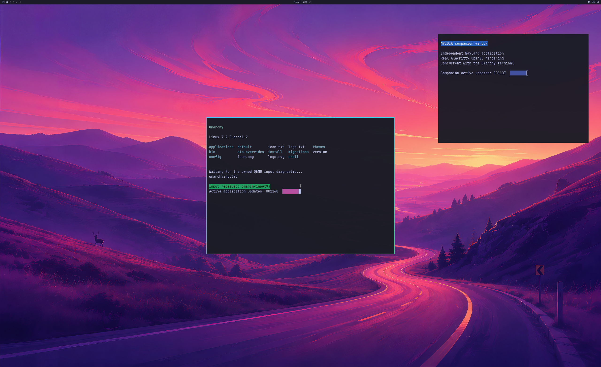

# Explicit GPU memory capacity for applications

The experimental owner and trusted guest controller can now negotiate a shared
**4 GiB reported GPU-usage pool**. Chromium's previous attempt exceeded the
diagnostic 1 GiB limit by about 32 MiB. A larger pool clears that observed
boundary, while browser rendering and daily-use acceptance remain open.

The public-source desktop regression passes **1,800 GPU handoffs over 37.96
seconds**, 5,731 native submissions and 5,724 successful device-health queries.
Complete source and SDL-window pixels, wallpaper, both terminal applications,
rendered input response, focus, resize, application replacement and live cleanup
pass. This bounded workload does **not** exercise deferred eviction under the
larger budget. A separate default-off regression retains positive eviction,
reuse and reclamation coverage. Neither run establishes pressure recovery.

This is an actual **2560×1566 SDL backbuffer** from a **3840×2160 NVIDIA-rendered
guest source**, run 208, handoff 1800. The disposable diagnostic account uses
UWSM/PAM and a RAM overlay over a read-only disk. Normal launcher/account
integration, physical 4K scanout and arbitrary application compatibility remain
unverified.

## Selecting the agreement

The owner explicitly enables `--driver-application-memory` together with
`--driver-mapped-residency-admission`, `--driver-actor-slots 8`,
`--driver-resource-reference-slots 32` and `--driver-deferred-residency`.
Existing guards require the full owned, coordinated, read-only-root SDL desktop.
The guest broker and shim compile with `WDDM_BRIDGE_APPLICATION_MEMORY=1`, plus
the existing application-process, reference and CPU-capacity options.

Both sides must opt in. A new **112-byte initialization** carries a separate
16-byte version-1 memory payload. The **176-byte Info layout is unchanged**;
exact flags 7 identify the combined process, reference and memory agreement.
Older 80-, 88- and 96-byte initialization messages retain the 1 GiB limit, even
when the owner permits the new agreement. Ordinary applications cannot select
it. Their OpenGL capacity must match the authenticated owner agreement exactly;
the broker obtains that agreement from its actor registry rather than accepting
client-supplied capacity as authority. A shim built without the option rejects
the new agreement before OpenGL initialization.

Profile 14/object version 9 and kernel geometry remain unchanged: aggregate CPU
mapping capacity is 384 MiB, standalone GPU mappings remain bounded at 1 GiB,
and native object, queue, sync, lease and group-reference quotas are unchanged.
The memory pool is shared across actors, rather than multiplied per process.

## Native headroom and limits

Before graphics initialization, DXGI must report enough **current available
budget** in both segments. A 3 GiB local application share plus 64 MiB of local
presentation headroom must fit within half of `Budget - CurrentUsage`; the
960 MiB nonlocal share must independently fit within half of its available
segment. Failed queries, underflow or insufficient headroom refuse initialization
before OpenGL/native object setup. Application budget queries expose those same
shares, clamped to the current native budgets. The aggregate usage guard is 4 GiB.

This is **one-time headroom admission**, not a reserved physical GPU partition,
a full allocation-size decoder or a hard physical-memory quota. Other Windows
applications can change the available budget afterward. Mapped-residency
estimates still have uncovered cases; an unexpected post-native guard overrun
still stops the owned VM. No private paging queue or post-native rollback is
introduced. Sustained pressure, device-loss recovery and concurrent Windows/guest
performance need separate acceptance.

## Retained hardware attempts

| Run | Result |
| --- | --- |
| 201 | The new pool is admitted, but an inherited kernel Info validator still assumes 1 GiB. No graphics work completes. Rejected. |
| 204 | Kernel adoption is corrected; the inherited broker capacity validator then rejects the new agreement. No graphics work completes. Rejected. Both adoption layers are corrected in the published source. |
| 205 | A private compound browser/presentation experiment reaches **1,155,870,720 reported bytes**, above the old limit, with zero residency refusals, 1,292 submissions and 1,385 successful health queries. Browser/WebGL/window acceptance does not complete. No desktop frame is accepted. |
| 206 | Default-off legacy regression: **1,800 handoffs**, 5,827 submissions, 5,820 successful health queries, complete pixels, input/lifecycles and live cleanup. The exact residency ledger accounts for 45 retained references: one reused and 44 reclaimed. |
| 207 | Public-source enabled desktop completes 1,800 handoffs and complete pixels. One object-capacity diagnostic incorrectly prints the old limit; actual budget/guard rows use 4 GiB. The diagnostic is corrected in native109; this run is retained with that erratum. |
| 208 | Corrected public-source enabled regression: **1,800 handoffs**, 5,731 submissions, 5,724 successful health queries, complete pixels and live cleanup. Peak reported usage **1,080,971,264 bytes** crosses the old limit. Deferred evictions, retained references, reuse and reclamation are all zero: historical positive residency coverage is explicitly absent. |

All listed attempts exit the owned VM naturally, retire live native and aperture
resources before exit, and pass source-disk/installed-driver guards. In run 205,
the controller's strict browser gate fails; teardown closes Wayland at the time
navigation reports `ERR_ABORTED`. That error does not independently establish a
network failure. The gate withholds frame forwarding until browser proof, so
zero accepted frames alone does not prove the compositor never drew. Optional
unsupported GPU queries remain under investigation. The private Mesa/presentation
overlay used in that attempt is excluded from this public change and from run 208.

Strict Windows default/4K builds and **30 CLI rejection checks per build** pass.
Strict public-source Linux shims compile in default, 4K and application-memory
configurations. Portable agreement/budget tests and authenticated UID-65534
broker tests cover malformed and forged agreements, old payloads, actual CPU
capacity receipts, native-headroom refusal and owner-only adoption. CI adds the
new configuration to existing checks.

The old generic diagnostic verifier is not an acceptance oracle for the new
agreement; its retained exit status is 1. A separate pinned auditor preserves
desktop pixel, input, focus, cadence, ownership and lifetime predicates, changes
explicit memory/identity expectations, and classifies zero-eviction coverage
separately. It does not turn an absent residency test into a pass.
[Structured observations, exact derivations and raw-stream hashes](evidence/APPLICATION-MEMORY-2026-10-26.json)
are published; private raw streams and proprietary assets are not a public replay
archive. Frozen source hashes may differ from the Git checkout only in CRLF/LF
line endings, which are checked after LF normalization.

Backend stages remain **4/8**, desktop product gates **0/4**, diagnostic scene
**3/3**. Next practical acceptance is a sandboxed NVIDIA Chromium window with
verified page/WebGL pixels, followed by real interaction, close/reopen and
sustained multi-window use. Broad OpenGL, Vulkan, CUDA, video, DLSS, ray tracing,
normal launcher integration and ≥93% matched-native performance remain open.
