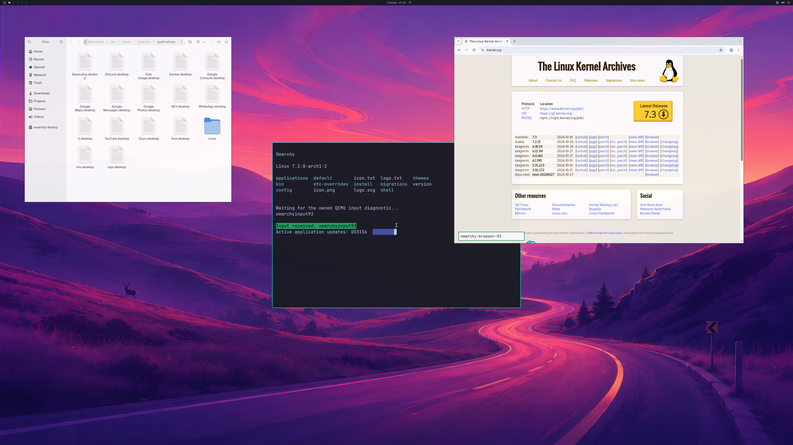

# Three GPU applications and allocation metadata

Private integration run **245**, guest build **204**, native build **111**,
completes **1,800 GPU handoffs** with Nautilus, Chromium and the terminal visible
together. The shipped wallpaper and Omarchy bar remain visible. Nautilus keeps
the same process through browser close/reopen and all four application
checkpoints. Both browser sessions retain GPU compositing, their original
NVIDIA shader and all 17 observed GPU-thread sandbox checks.

The [actual SDL backbuffer](images/omarchy-three-apps-sdl-2026-10-27.png) is
2560×1566. Complete first/final source-to-SDL pixel checks pass with maximum
channel error **one**, within the existing tolerance of two. Physical 4K scanout
is unverified. The file manager displays only the shipped public application
folder; its observer reports a realized **GskGLRenderer**, authenticated actor
10 and nine unambiguous native command enqueues.

The passing run reaches **1,061 live allocation records**, crossing the former
1,024-record limit. It completes **4,530 native submissions** and **4,940 device
health queries**, with zero failed submissions or health queries. Peak reported
GPU usage is **1,375,232,000 bytes** of the unchanged 4 GiB pool. All tracked
native objects and aperture mappings retire before natural VM exit; host exit
is zero. Source-disk, driver, compile-input and QEMU-artifact guards pass.

[Structured observations, source hashes and retained failures](evidence/GTK-APPLICATION-CAPACITY-2026-10-27.json).
This is one bounded three-app fixture. Backend stages remain **4/8**, desktop
product gates **0/4**, and diagnostic scene checks **3/3**.

The three-app integration workload exposed the shared **1,024 allocation-object
limit** while Nautilus and a reopened Chromium GPU process were active. Run 242
retains twelve explicit host admission refusals at exactly 1,024 live objects.
Reported GPU usage peaked at 1,356,402,688 bytes within the existing 4 GiB pool.
Chromium reported a GL allocation failure, lost its GPU context and terminated
when software compositing fallback was refused. Its owned exit status is
SIGTRAP; guest memory observations show 1,106,936 KiB available and zero OOM or
OOM-kill events in the two observed cgroups.

## Explicit metadata agreement

The default-off `--driver-application-objects` host option and
`WDDM_BRIDGE_APPLICATION_OBJECTS=1` guest-controller build select object contract
**version 10**, with **2,048 aggregate native allocation records**. Both owner
permission and the exact controller request are required. It builds on the
existing explicit application-memory, actor and reference agreements. Ordinary
clients cannot change the aggregate capacity. Older requests still select
1,024 records, even when the owner permits the new agreement.

The initialization remains 112 bytes and the returned information remains 176
bytes. Information flags 15 explicitly include the new metadata agreement.
Malformed versions, counts, flags and byte limits are rejected. The guest's
aperture validation and native mapped-admission validation accept the matching
new agreement while preserving their other checks.

Per-actor allocation limits, the 4 GiB reported-usage pool, 384 MiB CPU-mapping
limit, 1 GiB standalone GPU mapping limit, kernel leases, physical aperture
slots, queue/sync limits and reservation limits are unchanged. This expands
metadata capacity; it does not partition physical VRAM or establish complete
pressure recovery.

## Retained failure and cleanup

The earlier three-app run 241 leaves output attached after a browser failure,
then loses its QMP connection and requires an owned VM stop. No successful host
cleanup is claimed for that run. The private integration fixture now requests
the existing GPU output end-of-stream acknowledgement on failure and attempts
file-manager, browser and terminal cleanup independently of success markers.
The original workload remains rejected.

Run 242 fails at 1,266 ordinary handoffs, then receives a real end-of-stream
acknowledgement at frame 1,267. Nautilus exits with a root-owned native-retirement
witness. Host exit and natural VM exit are zero, with verified final native
cleanup and aperture mappings released before VM exit. Four GPU reservations
remain charged until VM exit; this is not complete live application recovery.
Its independent audit preserves the failure and does not count it as a passing
three-app workload.

Two new-contract integration failures are retained: run 243 stops before GPU
work because the guest aperture validator still requires version 9; run 244
reaches native allocation but the mapped-admission guard still requires version
9 and forces an owned VM stop. Both validators are updated, with the byte and
authority checks retained. These attempts establish no rendered-frame success.

## Validation scope

The initial audit of run 245 rejects a missing second browser-retirement journal
print. The final audit uses both existing controller-validated session markers
and root-owned native GPU retirement witnesses instead. The pinned producer
writes a success-only owned marker after joining its observer and observing
its owned keyring exit; the controller validates its exact PID/GPU tuple and
immutable ownership before reporting retirement. Both markers, actual process
exit and empty native actor state are required. The one delivered journal row
must agree with these witnesses. The missing print and initial audit failure
remain recorded; raw traces are not repaired.

Coordinator tests cover owner/controller permission, malformed/truncated
requests, exact returned flags, unchanged byte agreements, and preservation of
the older 1,024-record selection. Authenticated Linux IPC tests exercise the
new agreement with fresh/concurrent aperture observations and reject malformed
flags, object versions and byte limits. Both strict Windows build configurations
and default, 4K and application-object guest shim builds are exercised.

The three-app fixture uses the shipped Nautilus executable with an observed
realized GTK GL renderer, a sandboxed Chromium GPU process and the terminal.
Its integration overlay and proprietary runtime assets remain private. Official
input and the released launcher are unchanged. Product acceptance remains open
for ordinary input/latency, longer sessions, broader applications, normal
account/launcher integration and pressure recovery.
