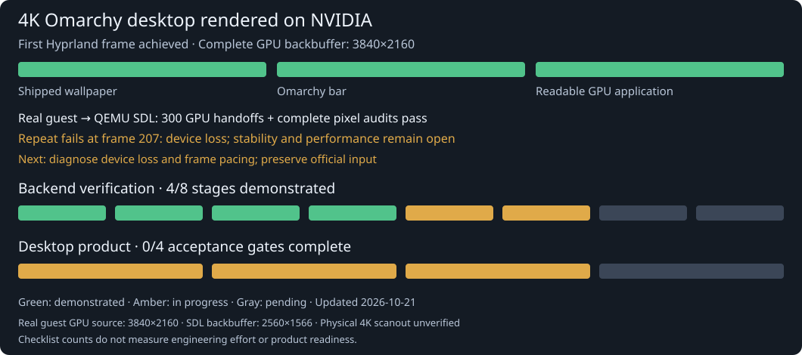

# NVIDIA backend progress

Updated 2026-10-19. **4 of 8 verification stages demonstrated.** This is a
checklist count, not 50% of engineering effort or a product-readiness estimate.
The largest integration tasks are still ahead.

Two fresh guests now pass [readable 4K GPU desktop captures](LIVE-OMARCHY-4K-READABLE-GPU-DESKTOP.md):
the shipped wallpaper, Omarchy bar and a real NVIDIA Alacritty terminal appear
together, with verified raw pixels and bounded shutdown. Actual profile-12
CPU mappings extend beyond the old 512-slot range while mapped data remains
below 192 MiB. A real Bash CRLF control explains the earlier readiness failure.
A later cleaner-child-payload run fails native recipient-reference admission
and aborts Hyprland. Fixing reference lifetimes/recovery, normal launcher/input
and sustained work remains necessary. Counts stay 4/8 and 0/4.

[4K wallpaper and a GPU application surface](LIVE-OMARCHY-4K-DESKTOP-CONTENT.md)
previously appeared in the actual NVIDIA-composed framebuffer. The shipped image matches
689 independent samples; Alacritty reports the NVIDIA D3D12 renderer. At that
checkpoint, glyph rendering and the complete desktop lifecycle failed. A mapped
window alone did not close a desktop gate. That experiment identified the sparse
CPU mapping-slot limit addressed by profile 12; its original failure is retained.

The earlier [GPU shell-bar checkpoint](LIVE-OMARCHY-4K-GPU-SHELL.md) verifies the
bar in two fresh guests. The new wallpaper/application capture is a retained
partial failure, with readable application content, clean lifetimes, normal
launcher/input and sustained presentation still required.

[Normal-image boot groundwork](LIVE-NORMAL-OMARCHY-ROOT-BOOT.md) passes two fresh
QEMU/WHPX boots of the real Omarchy 4.0.4 root image. Its normal systemd 262
starts with a read-only base and a bounded RAM overlay, then powers off cleanly;
full before/after image hashes match. A missing-disk control fails before the
root switch. This proves the OS boot prerequisite only. Connecting the NVIDIA
backend to the normal Lua/UWSM session and completing wallpaper, application windows and the lifetimes of separate Hyprland
and Quickshell GPU clients are the next integration work. Counts stay 4/8 and 0/4.

[A real Wayland scene](LIVE-HYPRLAND-WAYLAND-SCENE.md) now passes two fresh
300-frame runs at 640×360: readable fonts, an actual Foot terminal and changing
PTY content composed by Hyprland on NVIDIA. 298 ordinary frames per run avoid
CPU readback; 948/951 guest GPU commands retire and all mappings release before
VM exit. A separately negotiated rolling profile replaces the 256-command
lifetime limit and raises the live vendor-object cap to 512; live-work and byte
limits remain. The retained 256-object exhaustion and Foot startup failures
explain these changes. Final DXGI counts are stale at 297/117, so display remains
unverified. Foot uses software rendering; independent guest GPU applications,
the normal Omarchy session/assets, launcher/input integration, long runs and
4K desktop acceptance remain open. Counts stay 4/8 stages and 0/4 desktop gates.

Earlier [repeated Hyprland GPU presentation](LIVE-HYPRLAND-QUEUED-PRESENTATION.md)
passes twelve real compositor submissions per fresh guest, twice. Ten ordinary
frames have no CPU readback; a three-slot GPU ring and dedicated Windows UI
thread handle presentation. The two audited backbuffers pass scoped background
checks. Final-frame display is verified once and unverified on the other run;
all-frame display remains unverified. Real Omarchy assets/apps, independent guest
GPU clients, normal launcher integration and sustained capacity remain required.
The diagnostic peaks at 253/256 allocations. Counts stay 4/8 stages and 0/4
desktop gates, with no reliable time-to-completion estimate.

[Paced compositor handoff](LIVE-HYPRLAND-FRAME-PACING.md) now passes exact deferred
display observations for both frames in two fresh guests. A targeted ETW trace
confirms that a prior second frame displayed while its DXGI statistics stayed
on frame one. The compositor handoff no longer polls display statistics or holds
each frame for three seconds; strict immediate audits and their failures remain.
The normal launcher, sustained rendering, full scene correctness and performance
remain unverified. Counts stay 4/8 stages and 0/4 desktop gates.

[Actual Hyprland native-window presentation](LIVE-HYPRLAND-NATIVE-WINDOW.md)
now passes both strict DXGI display checks once, with exact backbuffer bytes.
Its immediate repeat fails the second statistics check; that failure is retained.
A fresh capture-only regression passes. This is an experimental native window,
not the normal Try Omarchy launcher integration. Reliable presentation remains
open; no stage or desktop gate is closed.

[Actual Hyprland GPU framebuffer capture](LIVE-HYPRLAND-COMPOSITOR-CAPTURE.md)
now passes two captures in each of two fresh guests. Each frame independently
matches 133,120 background-reference pixels, including a changed-background
control, and all mappings release before exit. The image is a real 640×360
compositor readback with missing-font placeholders. Full scene correctness and
Windows app presentation remain unverified. No desktop gate is closed.

Earlier [actual Hyprland output buffers](LIVE-HYPRLAND-COMPOSITOR-BUFFERS.md) pass
renderer initialization, native swapchain allocation and import into a separate
renderer device. The [logging ownership fix](LIVE-HYPRLAND-LOGGING-LIFETIME.md)
passes three fresh compositor runs, including two without fault tracing.
Each records seven output-buffer commits, 29 retired GPU commands and explicit
resource cleanup before VM exit. That checkpoint did not verify pixels or presentation.
No normal-launcher compositor frame or desktop gate is accepted.

Latest [real render-node/GBM development checkpoint](LIVE-GPU-GBM-NATIVE-RENDER.md)
passes two fresh ordinary-user guests. The real render node selects the private
D3D12 Gallium backend; GBM allocates two simultaneous native buffers and exports
owned DMA-BUFs for EGL import. GPU texture sampling into a distinct buffer passes
an independent 130×73 pixel oracle. Every run releases all 73 buffers and 165
memory leases before VM exit. General DRM/PRIME/KMS, a Hyprland session,
sustained work and reliable Windows presentation remain unverified.
**This advances stage 5; the counts remain 4/8 stages and 0/4 desktop gates.**

Earlier [EGL native-image development checkpoint](LIVE-GPU-EGL-NATIVE-IMAGE.md)
passes actual owned-buffer import/export/reimport, source-release lifetime and
shared-storage shader checks for RGBA/BGRA/RGBX/BGRX. RGBA storage is checked
at 3840×2160; the shader viewport is 130×73. The other formats use odd-sized
1281×719 buffers. Every enabled run releases all 73 DMA-BUF references before
process exit; the disabled-feature control also passes. These captures retain
their exact working-tree source hashes and the earlier failures. The later GBM
checkpoint adds a real render node and owned imported-texture sampling; sustained
work and reliable Windows presentation remain open. **No stage or desktop gate is
completed by this development checkpoint.**

Earlier [native resource DMA-BUF ownership](https://github.com/7Wdev/try-omarchy-windows/blob/windows-nvgpu-lab/docs/LIVE-GPU-NATIVE-BUFFER.md)
passes two fresh ordinary-user guests. Genuine Linux DMA-BUF files retain a
native GPU texture through FD closure and import; both full 4K storage rounds
pass, including after source release. Each run releases 72 buffers and all
165 memory leases. Disabled-feature and EGL regressions pass. This proves the
owned buffer boundary; actual GBM allocation, EGL image import, DRM/device
integration, implicit synchronization and a Hyprland session remain open.
Stage 5 advances; the desktop acceptance count remains **0/4**.

Earlier [actual EGL native-fence callbacks](https://github.com/7Wdev/try-omarchy-windows/blob/windows-nvgpu-lab/docs/LIVE-GPU-EGL-NATIVE-SYNC.md)
pass two fresh ordinary-user guests. An EGL server wait gates a subsequently
exported EGL fence and a native acknowledgement until independent GPU release.
Completed-source lifetime, error rejection and full cleanup pass; a disabled
extension control and the legacy timeline regression also pass. Compositor
DRM/GBM buffers, sustained work and reliable Windows presentation remain open.
This advances stage 5 without closing a desktop gate.

Earlier [native GPU waits through Linux sync-file import](https://github.com/7Wdev/try-omarchy-windows/blob/windows-nvgpu-lab/docs/LIVE-GPU-NATIVE-SYNC-LINEAGE.md)
passes two fresh ordinary-user guests. A pending import gates real GPU work
until an independent queue releases it; a completed import retains its native
reference after original source/FD release. General sync-file interoperability,
DRM/GBM buffers and continuous display remain open.

Earlier [native GPU progress exported as Linux sync-files](https://github.com/7Wdev/try-omarchy-windows/blob/windows-nvgpu-lab/docs/LIVE-GPU-NATIVE-SYNC-FILE.md)
passes two fresh ordinary-user guests. Standard FD polling and transfer observe
an actual GPU signal above 32 bits; revocation, timeout and cleanup checks pass.
General sync-file interoperability and compositor integration remain open. This is
part of stage 5 and closes no desktop gate.

Earlier [a separate Windows GPU process](https://github.com/7Wdev/try-omarchy-windows/blob/windows-nvgpu-lab/docs/LIVE-GPU-WINDOWS-WORKER.md)
imports and copies both ordinary-user 4K shader frames in two fresh guests.
Strict window presentation passes once and fails on repeat. This advances the
buffer handoff work; it does not complete a roadmap stage or a desktop gate.
Earlier [Mesa OpenGL shader rendering](https://github.com/7Wdev/try-omarchy-windows/blob/windows-nvgpu-lab/docs/LIVE-GPU-OPENGL.md)
also passes two independent 130×73 pixel audits through the Windows NVIDIA bridge.

The [first guest kernel memory-lease component](https://github.com/7Wdev/try-omarchy-windows/blob/windows-nvgpu-lab/docs/LIVE-GPU-KERNEL-APERTURE.md)
now passes 581 isolation checks and two fresh OpenGL runs with complete kernel
lease cleanup. It supplies restricted CPU-view FDs, not DRM or dma-buf buffers;
stage 5 still requires the graphics ioctl/device and compositor integration.

The [native fence-sharing diagnostic](https://github.com/7Wdev/try-omarchy-windows/blob/windows-nvgpu-lab/docs/LIVE-GPU-SYNC-FD.md)
also passes two fresh guest runs: kernel FDs retain a native fence after its
original object/device are destroyed, allow import and re-export, and clean up
every reference. Separate native probes verify 16 GPU queue signals.
The [genuine guest D3D12 timeline diagnostic](https://github.com/7Wdev/try-omarchy-windows/blob/windows-nvgpu-lab/docs/LIVE-GPU-TIMELINE.md)
now also passes two fresh runs with native fence import, eight retired GPU
signals, and a future queue wait that gates a dependent signal until a second
queue releases it. Two separate OpenGL/FD regressions pass with this change.
The [opt-in Mesa native timeline FD test](https://github.com/7Wdev/try-omarchy-windows/blob/windows-nvgpu-lab/docs/LIVE-GPU-MESA-FENCE-FD.md)
also passes genuine OpenGL semaphore imports, signals and a future GPU wait in
two fresh guests. The later native sync-file lineage test covers our owned
single-fence import; the later EGL callback test covers owned native fences.
General EGL conformance, binary Vulkan interoperability and compositor
integration remain pending. This advances stage 5 without completing it.

The [process-exit lifetime fix](https://github.com/7Wdev/try-omarchy-windows/blob/windows-nvgpu-lab/docs/LIVE-GPU-EXIT-LIFETIME.md)
now passes three fresh late-finalizer tests and two further Mesa regressions.
The old bridge segfaults in the deterministic control. General desktop stability
and a separate legacy V1 capacity rejection remain open; no new gate is closed.

The [native texture-FD diagnostic](https://github.com/7Wdev/try-omarchy-windows/blob/windows-nvgpu-lab/docs/LIVE-GPU-RESOURCE-FD.md)
now passes two full 4K shared-storage rounds in two fresh guests, including after
source and FD release. An actual wrong-color GPU control is rejected. This is
connection-scoped NT-backed resource sharing; dma-buf/DRM PRIME, GBM and
cross-process compositor/client ownership remain pending. A separate
[CPU aperture capacity comparison](https://github.com/7Wdev/try-omarchy-windows/blob/windows-nvgpu-lab/docs/CPU-APERTURE-CAPACITY.md)
now passes the full 33 MB readback in two fresh 256-slot guests, retaining the
128-slot failure and the same 96 MiB physical mapping limit. General aperture
fragmentation, desktop stability and performance remain unverified.

The [opt-in guest graphics broker](https://github.com/7Wdev/try-omarchy-windows/blob/windows-nvgpu-lab/docs/LIVE-GPU-BROKER-ROUTING.md)
now routes real NVIDIA OpenGL shaders from UID 65534 through restricted memory
FDs in two fresh guests. A third verifies a native fence in a late library
finalizer after channel close. Both 130×73 frames and all 18 native commands
pass independent audits in each run, with full guest/native/VM cleanup.
Independent guest GPU workers and imports, and compositor integration remain
open; this is part of stage 5 and closes no desktop gate.

The [broker capability store](https://github.com/7Wdev/try-omarchy-windows/blob/windows-nvgpu-lab/docs/LIVE-GPU-BROKER-OBJECTS.md)
now also passes ordinary-user full 4K texture export/import and native timeline
GPU ordering. Two fresh guests retain a native resource reference beyond its
producer's exit until a separate FD recipient closes it. That recipient does no
GPU work; independent guest GPU clients and imports still require a coordinator.
DRM/GBM and Hyprland remain pending, with no new desktop gate closed.

A [separate Windows GPU consumer](https://github.com/7Wdev/try-omarchy-windows/blob/windows-nvgpu-lab/docs/LIVE-GPU-WINDOWS-WORKER.md)
now imports and copies the ordinary guest user's two full 4K shader frames.
Two final-source fresh guests pass independent pixel and process-lifetime audits.
A strict two-frame window display check passes once and fails on its repeat;
continuous display and stability remain unverified. This is a host consumer
boundary, with independent guest GPU clients and compositor DRM/GBM still open.

The normal upstream Try Omarchy desktop is already available. This roadmap
tracks the new QEMU/Windows-native NVIDIA backend requested for this fork.
Its results currently come from isolated diagnostic workloads.

| Stage | Status | Evidence or exit criteria |
| --- | --- | --- |
| 1. Fork and upstream maintenance | Demonstrated | Preserve upstream history and fixes on `master`; keep experimental work reviewable in [PR #2](https://github.com/7Wdev/try-omarchy-windows/pull/2). |
| 2. Windows bridge and D3D12 initialization | Demonstrated in the lab | Genuine Linux NVIDIA runtime initializes through QEMU and creates owned Windows KMT objects. |
| 3. 4K guest shaders and shared GPU textures | Demonstrated in the lab | [Independent 4K pixel checks, GPU copies and fence retirement](https://github.com/7Wdev/try-omarchy-windows/blob/windows-nvgpu-lab/docs/LIVE-GPU-4K.md). |
| 4. Repeated guest rendering | Demonstrated in the bounded lab | [64-frame guest runs](https://github.com/7Wdev/try-omarchy-windows/blob/windows-nvgpu-lab/docs/LIVE-GPU-GUEST-STREAM.md), safe allocator/texture reuse, first/last audits and complete cleanup. This does not establish long-run stability or all-frame display. |
| 5. Guest graphics/device integration | In progress: native GBM buffers, EGL fences and actual Hyprland readback pass | Replace the diagnostic interposer with a supported guest device/driver path; sustain graphics buffers, memory ownership, synchronization and compositor display requirements. |
| 6. Interactive Omarchy/Hyprland desktop | Pending | Capture the first correctly displayed Hyprland session and update PR #2, then validate real apps, cursor/keyboard input, focus, resizing, fullscreen, multiple windows and correct continuously displayed frames. |
| 7. Required APIs and NVIDIA features | Pending | Test OpenGL, Vulkan, CUDA, video acceleration and NVIDIA-specific capabilities in real guest applications. Device identity and D3D12 shader success do not establish feature support. |
| 8. Reliability and ≥93% native performance | Pending | Matched guest/native benchmarks across resolutions up to 4K, concurrent Windows/guest GPU workloads, long runs, stable memory use, and device/VM failure recovery. |

## How much work remains?

Real Hyprland now renders through the NVIDIA bridge into native GBM buffers.
The Windows GPU captures four actual 640×360 compositor frames across two fresh
guests, with independently checked background regions and complete cleanup.
Full scene correctness and display in the Windows app remain unverified.

The next work is reliable GPU presentation into the Windows app, normal Omarchy
fonts/themes/configuration and a real application scene, plus resource and queue
capacity that can start and sustain that workload. Bare compositor startup
already peaks at 252 of 256 guest allocations. The finite 256-command /
50,000-request diagnostic profile cannot sustain a desktop; simply capturing
more images does not solve that capacity limit. Input, recovery, compositor 4K
operation and performance need real-session acceptance afterward.

**0 of 4 desktop acceptance gates are complete.** Guest graphics integration is
in progress. The gates below are not equally sized, and some implementation can
overlap. Amber in the progress graphic marks work in progress without assigning
an unmeasured partial percentage.

| Gate | Current evidence | What closes the gate |
| --- | --- | --- |
| Guest graphics device, buffers and synchronization | In progress: native render node, GBM allocation/import, EGL fences, actual Hyprland output and explicit cleanup pass in a bounded prototype. | The compositor can access the backend through a supported guest device path, import/export its buffers, and synchronize sustained use correctly. |
| First Hyprland frame | Actual compositor framebuffer readback passes; full scene correctness and Windows app presentation are pending. | Boot the real guest session and independently verify a correctly displayed compositor frame in the Windows app. |
| Usable interactive desktop | Pending. The small compositor capture guest lacks normal Omarchy assets and real apps; finite resource/command limits cannot sustain desktop use. | Continuously display real apps and multiple windows, with working input, focus, resizing and fullscreen up to 4K. |
| Stable and performant product | Pending. No matched near-native result or long desktop run has passed. | Sustain desktop workloads, recover from failures, keep memory bounded, and meet ≥93% of matched native performance on the agreed workloads. |

The first three gates describe the route to a usable desktop. The fourth is
required for the stable, near-native product goal. Vulkan, CUDA and video
acceleration also need separate implementation and real application tests;
a visible desktop alone will not complete those API requirements.

There is no defensible completion date yet. Kernel/device integration and the
guest graphics APIs are substantial systems work; their compatibility has not
been established by the current diagnostic. Counting completed stages cannot
estimate the duration of those tasks.

Before calling the desktop usable, the backend must correctly present
continuous frames, handle buffer lifetime and synchronization, and survive
normal desktop operations. Before calling it stable or near native, it must
pass longer workloads and matched performance tests. CUDA and video require
their own implementation and application evidence as well.

## Current unresolved findings

- **Display proof:** DXGI statistics vary between otherwise successful runs.
  Present acceptance and retired work are tracked separately from scanout.
- **Memory:** the bounded stream retains fixed pending-work limits, but a hard
  whole-process GPU memory quota is not implemented. The native consumer and
  swapchain also consume GPU memory. Long-run accounting needs work.
- **Throughput:** the first guest stream serializes host consumption and guest
  reuse. It is a correctness baseline; the proven GPU-side waits still need
  integration into a synchronized buffer ring before measuring near-native throughput.
- **Synchronization frontend:** a pinned, opt-in Mesa patch now passes the
  private native D3D12 timeline FD diagnostic. Owned Linux sync-file lineage
  and actual EGL callbacks now pass native GPU import/wait tests. Foreign/merged
  sync-files, post-import cancellation recovery and compositor synchronization
  remain open.
- **Teardown:** a confirmed premature CPU-view teardown bug is fixed and passes
  three fresh late-finalizer tests plus two Mesa regressions. The original
  intermittent legacy exit-128 run had no signal receipt, so its attribution
  remains unproven. General teardown and long-run stability still need testing.
- **Legacy capacity:** an unchanged V1 OpenGL/FD image reached the 256 aggregate
  object limit in a separate run. Its rejection is retained as a failure;
  reliable capacity/lifetime handling for that workload remains open.
- **Compositor capacity:** bare Hyprland startup peaks at 252 of 256 guest
  allocations. The retained guest CPU-map attempt hits that bound and aborts;
  host GPU capture avoids the extra guest allocations without raising it.
  The finite startup command/request limits still cannot sustain a desktop.
- **Resource buffers:** native texture FDs pass all-pixel 4K storage checks,
  source/FD-release lifetime and a wrong-color control. They are scoped to one
  connection and are not dma-buf/DRM PRIME. The explicit 256-slot virtual layout
  now passes a full 33 MB CPU readback in two fresh guests with unchanged physical
  quotas. This fixes that reproduced workload; general fragmentation remains open.
- **Product integration:** no accelerated Hyprland desktop, general OpenGL,
  Vulkan, CUDA or video test has passed through this backend yet.
- **Multiple GPU clients:** the broker now validates actual kernel capability
  FDs for native imports and retains references beyond producer exit. It still
  has one native worker. Independent client process contexts, cross-process
  GPU imports and compositor-compatible buffer/sync integration remain open.

The [experimental PR](https://github.com/7Wdev/try-omarchy-windows/pull/2) retains
the implementation and detailed evidence. The released app continues using the
upstream graphics runtime while this backend is developed.
