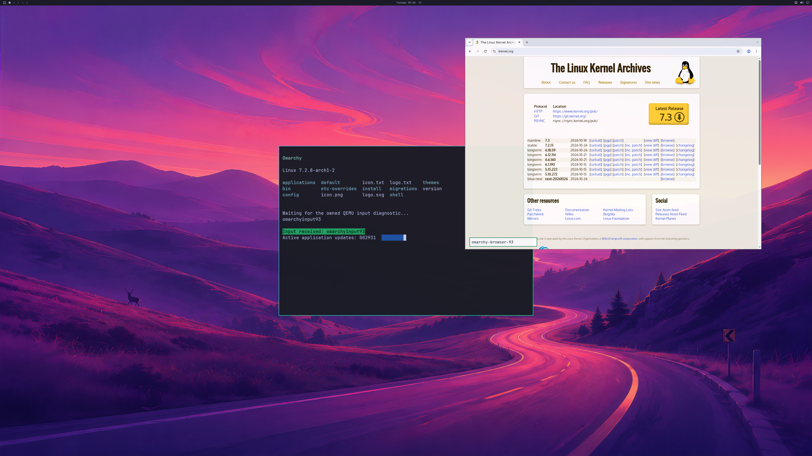

# Bounded GPU browser interactions through CDP

Private integration run **237**, guest build **196**, completes **1,800 GPU
handoffs**, with the shipped wallpaper, Omarchy bar, terminal input response,
floating Chromium window, browser close/reopen and live native/aperture cleanup.
Both browser sessions additionally pass controlled wheel, text and tab checks
through owned Chrome DevTools Protocol pipes. This is not physical input or
normal daily-browsing acceptance.

The actual browser input contains `omarchy-browser-93`; the terminal independently
displays `omarchyinput93`. The [actual SDL backbuffer](images/omarchy-browser-interaction-sdl-2026-10-27.png)
is **2560×1566**. Complete first/final source-to-SDL pixel checks both pass with
maximum channel error **one** using QEMU's compiled scaling operation. Physical
4K scanout remains unverified.

## Interaction checks in each browser session

- A CDP wheel event scrolls the real HTTPS page from **y=0 to y=500**, then a
  second event restores **y=0**. The observed content viewport is **1400×913**
  with 702 pixels of available vertical scroll.
- CDP text insertion writes **omarchy-browser-93** into the actual focused,
  owned page input. Its DOM value is checked; the value is visible in the final
  rendered frame.
- A fresh `about:blank` page target opens, reports a complete document, closes,
  and leaves the original page target set restored. This checks a disposable
  tab, not a second public website or browser-chrome keyboard shortcuts.
- The actual GPU PID remains unchanged across these operations. GPU compositing
  and WebGL stay enabled. The original NVIDIA shader still returns
  **[128,128,64,255]**, GL error zero, context not lost.

The fixture uses the documented [Chromium input commands](https://raw.githubusercontent.com/ChromeDevTools/devtools-protocol/master/pdl/domains/Input.pdl)
and [target commands](https://raw.githubusercontent.com/ChromeDevTools/devtools-protocol/master/pdl/domains/Target.pdl).
It exercises browser behavior directly. It does not establish ordinary SDL/OS
keyboard and wheel routing, physical latency or displayed scrolling cadence.
Official input implementation is unchanged.

## Combined hardware observation and retained limitations

Both launches retain their actual floating geometry, public HTTPS page, NVIDIA
shader, GPU compositing and all **17 observed GPU-thread** sandbox checks.
Actual GPU PIDs authenticate as actors **9** and **11**; unambiguous tagged rows
contain **69** and **82** native command enqueues. Terminal typing/cursor response,
three sizes, four focus checkpoints and both live GPU retirements pass.
There are **4,465 native submissions**, **4,823 successful device-health queries**,
zero failed submissions/health queries, host exit zero and natural VM exit.
Peak reported usage is **1,336,270,848 bytes** in the shared 4 GiB pool.
Source-disk, installed-driver, native/guest source and QEMU-artifact guards pass.

The first audit rejects one journal readiness line interleaved with an unrelated
native diagnostic. The raw trace remains byte-identical. The corrected audit uses
**six intact controller copies of the owned readiness files**, three identical
copies per browser session, and retains all shader, sandbox, native correlation,
input, full-pixel and lifecycle predicates. The diagnostic logging collision
remains a reliability issue to fix; it is not silently repaired or discarded.
The historical fixed two-terminal general verifier remains **exit 1**.
Guest build 195 was not run: source review caught non-atomic request publication,
and build 196 publishes both request and completion markers atomically.

[Structured observations, images and raw-stream hashes](evidence/GPU-BROWSER-CDP-INTERACTIONS-2026-10-27.json)
· [Earlier lifecycle and floating-layout checks](GPU-BROWSER-LIFECYCLE.md).
Private helper/Mesa/presentation overlays, proprietary NVIDIA libraries, raw
research streams, disks and initrds remain excluded from the public repository.
This follow-up publishes documentation, observations and actual images.

Daily use still requires official browser input/latency, actual browser resize,
longer interactive sessions, additional applications, memory-pressure recovery
and normal launcher/account integration. Broad OpenGL/Vulkan/CUDA/video support,
DLSS, hardware ray tracing and ≥93% matched-native performance remain open.
Counts stay **backend 4/8, desktop product 0/4, diagnostic scene 3/3**.
