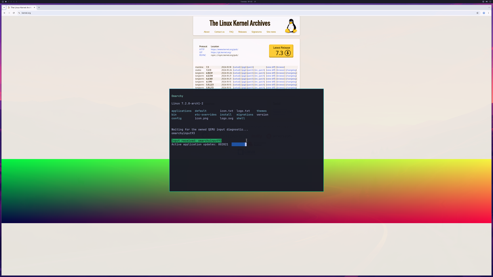

# Bounded NVIDIA browser lifecycle

Private integration run **234**, guest build **193**, completes **1,800 GPU
handoffs** with a readable Chromium HTTPS page, NVIDIA shader, a responsive
terminal and browser close/reopen. This is a bounded diagnostic observation;
normal Omarchy launcher integration and daily-use acceptance remain incomplete.

The [actual final SDL backbuffer](images/omarchy-browser-reopened-sdl-2026-10-27.png)
is **2560×1566**. Complete first/final source-to-SDL checks use QEMU's compiled
GL_LINEAR scaling operation with the readback Y origin normalized. Maximum
channel errors are **two** and **one**, within the existing tolerance of two.
Physical 4K scanout remains unverified. The browser is tiled across the desktop;
correct floating layout with exposed wallpaper is the next display check.

## What passed together

- Both Chromium sessions load the real Linux Kernel Archives HTTPS page and
  report GPU compositing and WebGL enabled. Software rasterizer and compositor
  fallback are forbidden.
- Both shaders return **[128, 128, 64, 255]**, GL error zero, context not lost.
  ANGLE reports D3D12 on the NVIDIA RTX 5090 Laptop GPU.
- All **17 observed GPU threads per session** have Seccomp 2, NoNewPrivs 1 and
  UID 1000. Actual GPU PIDs authenticate as actors **9** and **11**, with **42**
  and **48** native command enqueues respectively.
- The unchanged synthetic channel-input fixture receives the real terminal PTY
  token `omarchyinput93`, acknowledges **33 events**, and moves the guest cursor
  to **[2343, 1318]**. The response barrier observes three later compositor
  commits; the input banner is visible in the actual final frame.
- Terminal sizes **1440×960 → 1600×1000 → 1200×800**, four browser/terminal focus
  checkpoints and both browser GPU retirements pass while the desktop is live.
- Both owned browser observers join and their disposable encrypted keyring
  daemons exit before session retirement. The first session retires before the
  second starts.
- **4,400 native submissions**, **4,657 successful device-health queries**, zero
  failed submissions or health queries, host exit zero, natural VM exit, and
  native/aperture cleanup before VM exit. Peak reported GPU usage is
  **1,284,694,016 bytes** in the shared 4 GiB pool.
- The read-only source-disk hash, installed NVIDIA runtime, frozen native compile
  inputs, guest sources and QEMU artifact pass before/after guards.

## What changed and which failures remain

Run 231 displayed the first readable page but stopped after two handoffs. The
terminal's existing 30-second input timer started before browser initialization
finished. Build 192 adds an owned startup gate and starts that same timer only
after browser GPU proof and terminal focus. This explicitly changes fixture
startup synchronization, not the official keyboard/cursor implementation.

Run **232** then reaches **1,799** handoffs and passes terminal input, resize and
focus checks, but its second browser helper queries the Secret Service before
registration. It remains rejected. Build 193 bounds name-readiness polling to
eight seconds, verifies the daemon's private control directory and requires
completed session retirement before reopening. Sandbox, shader, hardware
compositing and GPU retirement predicates are retained. Run **233** stops before
VM launch because the sandbox cannot execute the installed-driver guard; its
failure is retained separately from the completed hardware run 234.

The general historical verifier stays **exit 1**: its fixed two-terminal workload
oracle does not describe this browser fixture. A separate pinned audit checks
the browser sessions, authenticated GPU work, complete handoff sequence, full
pixels, terminal input, focus, resize, lifecycle, natural exit and cleanup.
Its initial text-mode stream comparison normalized standalone carriage returns;
the corrected audit compares the merged UTF-8 bytes exactly. Earlier evidence
and failures are retained. This observation does not replace every historical
acceptance gate.

[Structured observations, image and raw-stream hashes](evidence/GPU-BROWSER-LIFECYCLE-2026-10-27.json).
Raw research streams, proprietary NVIDIA libraries, VM disks/initrds and private
helper/Mesa/presentation overlays remain excluded from the public repository.
The published host runtime and official input sources are unchanged.

## Remaining daily-use work

Browser scrolling, browser text entry and tabs, actual browser resizing, longer
interactive multi-window sessions and additional applications need evidence.
The current workload has zero evictions and does not establish positive
eviction/reuse coverage or recovery from memory pressure. Normal account/launcher
integration, physical input latency and displayed cadence are unverified.
Broader OpenGL/Vulkan/CUDA/video support, DLSS, hardware ray tracing and
**≥93% matched-native performance** remain open. A Chromium feature-status string
alone does not certify WebGPU or hardware video decoding.

Counts remain **backend 4/8, desktop product 0/4, diagnostic scene 3/3**.
They are acceptance checklists, not engineering percentages. All updates stay
in **PR #2 / windows-nvgpu-lab**; master is unchanged.
