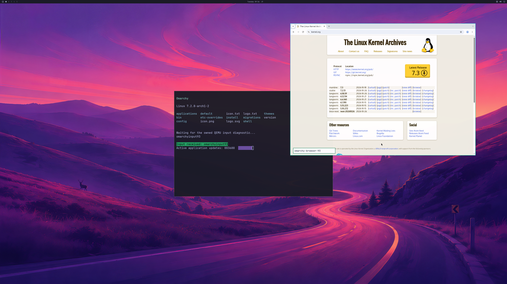

# NVIDIA browser resize and controlled interactions

Private integration run **239**, guest build **198**, completes **1,800 GPU
handoffs** while resizing and restoring both Chromium sessions. The actual
compositor geometry and browser viewport agree, and the original NVIDIA shader
survives all four changes. Controlled CDP wheel/text/tab checks, browser
close/reopen, terminal input/resize/focus and live cleanup pass in the same run.

The shipped wallpaper, bar, HTTPS browser and responsive terminal are visible.
The [actual final SDL backbuffer](images/omarchy-browser-resize-sdl-2026-10-27.png)
is **2560×1566**. Complete first/final source-to-SDL checks pass QEMU's compiled
scaling operation with maximum channel errors **one** and **two**, within the
existing tolerance of two. Physical 4K scanout remains unverified.

## Actual resize checks

Each browser session follows the same cycle through the existing Hyprland API:

| Window size | Actual Chromium content viewport |
| --- | --- |
| 1400×1000 | 1400×913 |
| 1600×1100 | 1600×1013 |
| 1400×1000 | 1400×913 |

The compositor observes the requested geometry and at least three later
commits. Chromium then reports its actual changed viewport. Its GPU PID stays
unchanged, GPU compositing and WebGL remain enabled, and the original shader
still returns **[128,128,64,255]**, GL error zero, context not lost. This verifies
compositor-driven resizing; a physical mouse drag on the window border is not
part of the observation.

Both browser sessions also pass the existing controlled wheel/text/tab checks.
All **17 observed GPU threads per session** retain Seccomp 2, NoNewPrivs 1 and
UID 1000. Actual GPU PIDs authenticate as actors 9 and 11, with **79** and **76**
native command enqueues in unambiguous tagged rows. There are **4,403 native
submissions**, **4,839 successful device-health queries**, zero failed
submissions/health queries, host exit zero, natural VM exit and native/aperture
cleanup before exit. Source-disk, installed-driver, native/guest compile-input
and QEMU-artifact guards pass. Peak reported GPU usage is **1,333,731,328 bytes**.

## Diagnostic and input boundaries

Interaction and resize proofs now use atomic owned files copied by the
controller into bounded hex receipts. The audit checks those complete records,
instead of depending on journal prefix/body writes remaining contiguous with
other graphics writers. The readiness journal rows have zero parse errors in
this run. Earlier run 237's interleaved row remains retained; raw traces are not
repaired. This addresses the critical interaction/resize evidence path, not all
multi-writer diagnostic logging.

Separate Windows-to-SDL input trial **238** remains **rejected**. The host UI
tool can list QEMU but cannot inspect/capture the window; no input is sent. The
guest's 35-second wait receives no text, keys or wheel events and withholds the
final handoff at **1,799**. Host and VM exit naturally with live cleanup and zero
failed native submissions/health queries. A secondary success-path retirement
assertion also fails after the failed browser probe; it does not establish a
native resource leak. The complete failure and hashes remain in the evidence.
This trial establishes no conclusion about whether ordinary browser input works.

[Structured resize observations and retained input trial](evidence/GPU-BROWSER-RESIZE-2026-10-27.json)
· [Earlier controlled browser interactions](GPU-BROWSER-INTERACTIONS.md).
The historical fixed two-terminal general verifier remains **exit 1**; the
separate pinned audit passes the scoped resize, full-pixel, GPU, input and
lifecycle observations. Private integration overlays, proprietary libraries,
raw streams, VM disks and initrds remain unpublished. Official input code and
the published host runtime are unchanged by this follow-up.

Daily-use acceptance remains open: ordinary Windows/SDL browser input and
latency, longer interactive sessions, additional applications, memory-pressure
recovery and normal account/launcher integration. Broad GL/Vulkan/CUDA/video,
DLSS, hardware ray tracing and ≥93% matched-native performance require separate
evidence. Counts remain **backend 4/8, desktop product 0/4, diagnostic scene 3/3**.
