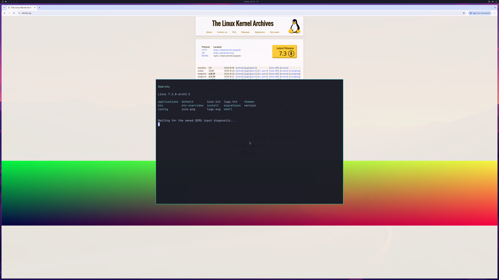

# First GPU-composited Chromium frame

On October 26, 2026, private integration run 231 displays the Linux Kernel
Archives HTTPS page and a real NVIDIA WebGL shader inside the Omarchy/Hyprland
desktop. Chromium reports **GPU compositing enabled** and **WebGL enabled**.
Software rasterizer and software compositor fallback are forbidden. All **17
observed GPU threads** have Seccomp 2, NoNewPrivs 1 and UID 1000.

## Actual 4K GPU source

This is the actual **3840×2160 GPU source**, with the Omarchy bar, a readable
browser page, shader canvas and terminal window. The corresponding
[2560×1566 QEMU SDL window capture](images/omarchy-gpu-browser-sdl-2026-10-26.png)
matches the complete source after QEMU's compiled GL_LINEAR scaling, with
maximum channel error **one**. GL readback's row origin is normalized when
encoding the SDL PNG. No page or shader contents were pasted into the capture.
The larger source does not prove physical 4K scanout.

The actual GPU PID is authenticated as native actor 9, with
**39 native command enqueues**. The WebGL shader returns center pixel
**[128, 128, 64, 255]**, GL error zero and no context loss. The visible page header,
links and shader are inspected in the captured frame. A complete automated
browser-content oracle remains open.

## Why the previous page was missing

The earlier [shader/sandbox observation](SANDBOXED-BROWSER-SHADER.md) had
GPU compositing disabled and no readable page body. Chromium's Wayland buffer
manager could not obtain its render-node descriptor. The private helper now
handles the actual fortified **__open64_2** import, demonstrated by the running
browser's dynamic symbol table, as well as ordinary open/open64. It duplicates
the already prepared descriptor for the exact render node and valid flags.
The existing ioctl shim remains present. No sandbox policy or kernel
render-only identity check is relaxed. Earlier failed ordinary-open and
preload-order attempts remain retained.

The helper also retains exact trusted-library preparation, explicit EPERM for
the D3D12-core priority request and the bounded original libdrm metadata pool.
That bounded pool is an integration experiment, not a finished daily-use cache.

## What still fails

Only **two of 1,800 target handoffs** complete. The input/sustained fixture fails;
the general verifier remains **exit 1**. This run does not establish scrolling,
typing, tabs, resize, close/reopen, continuous browsing or daily-use stability.
The official keyboard/cursor implementation is unchanged; the next work is to
diagnose the failed input-response gate and sustain the browser desktop.

The host completes **740 native submissions** and
**842 successful device-health queries**, with zero
failed health queries. The VM exits naturally and native/aperture resources
release before VM exit. Source-disk, installed-driver, native compile-input and
QEMU guards pass. Native BGRA binary capture is unavailable in this short run;
the independent first-frame audit checks the complete QEMU source/SDL blit.

This is a diagnostic Omarchy session. Normal account/launcher integration,
pressure recovery, broader APIs and matched-native performance remain open.
Private Mesa/presentation/helper overlays, proprietary libraries, guest images
and raw streams remain excluded. [Structured observations, image and stream
hashes](evidence/GPU-COMPOSITED-BROWSER-FRAME-2026-10-26.json) form an audit summary,
not a complete replay archive.

Counts remain **backend 4/8, desktop product 0/4, diagnostic scene 3/3**.
