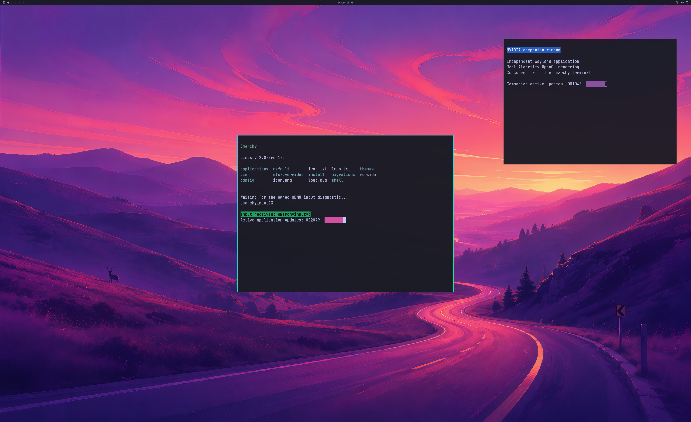

# Native GPU execution state

The guest now forwards execution-state queries to the owned Windows device through
`D3DKMTGetDeviceState`. NVIDIA previously received an unsupported-operation error
for this query thousands of times during a desktop run. Replies now preserve the
actual active, reset, hung, stopped and GPU fault states. Device removal and other
native errors propagate to the guest. No healthy state is fabricated or cached.

The optional wire operation accepts only an actor-owned device. The Linux bridge
writes only the four-byte execution-state union arm, leaving inputs, other union
bytes and padding untouched. Other state types remain unsupported. An older host
backend still produces the earlier unsupported result without poisoning the
connection. These semantics follow the documented
[device-state API](https://learn.microsoft.com/en-us/windows-hardware/drivers/ddi/d3dkmthk/ns-d3dkmthk-_d3dkmt_getdevicestate).

## Hardware observation

An isolated build of the published runtime plus this health-query change passed
the full 1,800-handoff desktop oracle in 35.93 seconds: wallpaper, bar, two NVIDIA
applications, complete first/final source and SDL pixels, input response, resizing,
four focus checkpoints and live cleanup before natural VM exit. The companion
application closed and reopened with a new authenticated process while the
primary application and compositor continued rendering. The replacement was ready
by handoff 799 after the relaunch began at handoff 600.

The native backend completed **5,786 health queries** and **5,792 GPU submissions**,
with no health-query failures or retained health-state records after cleanup.
The 3840×2160 GPU source matched the actual 2560×1566 SDL window within one channel
value after the compiled QEMU scaling operation. Physical scanout and input latency
were not measured. This is a single bounded hardware observation, not a native
performance comparison or normal-launcher acceptance.

[Observation summaries and raw-stream hashes](evidence/GPU-DEVICE-EXECUTION-OBSERVATIONS-2026-10-25.json)
include the accepted desktop observation and the rejected cases. Raw byte streams
remain local; the summary file is not a complete replay archive.

## Pressure recovery remains open

A separate build containing the uncommitted private residency rollback reached
1,081,954,304 bytes of reported GPU usage against the unchanged 1 GiB guard. It
refused one compositor residency request; the guest broker and ioctl trace both
recorded the out-of-memory response. Device loss followed after 600 handoffs,
native cleanup failed and the VM required a forced stop. This result is rejected.
The health-query change alone is published; that rollback implementation remains
excluded. The precise cause of the limit crossing and loss is not established.

## Validation and scope

Strict Windows default and 4K builds passed, as did the default wire ownership
suite, 217 guest fault cases, 12 dedicated 4K health-query cases and the desktop
4K transport checks. Tests cover device ownership, malformed replies, all known
execution-state values, native errors, unchanged output bytes and older backends.

Counts remain **backend 4/8, desktop product 0/4, diagnostic scene 3/3**. Longer
stability, memory-pressure recovery, normal launcher integration, physical input
acceptance, matched-native 93% performance and the broader graphics/compute/video
feature set remain open.
