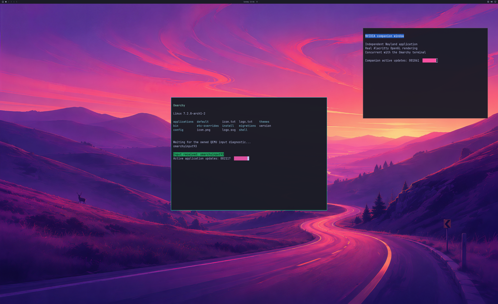

# Guest networking and Chromium progress

The diagnostic Omarchy guest now resolves DNS and loads a public HTTPS page
with certificate verification, then completes the 4K NVIDIA desktop workload.
Chromium acceleration remains unverified. Explicit process and buffer agreements
clear its initial admission failures, but page navigation still times out.
This is progress toward browsing, not daily-use acceptance.

The SDL QEMU candidate includes libslirp. Its CI and local checks realize an
actual virtio NIC; the native owner independently checks the NIC's attached
backend through QMP. `--driver-user-network` explicitly enables NAT on the owned
SDL/read-only-root desktop. Default graphics fixtures stay offline, and this
option creates no host port forwards.

An early guest test obtained DHCP and a default route but failed DNS. The
resolver's actual journal showed `200/CHDIR` and directory access failures.
The disposable overlay upper root had been created with private-directory
permissions. Preserving the read-only source root's mode and ownership restores
normal system-service access; the source image stays read-only. The fixture
starts the existing NetworkManager and systemd-resolved services and requires
DNS and ordinary TLS verification before rendering.

## Accepted networked desktop observation

Run 184 completes 1,800 GPU handoffs over 36.75 seconds, 5,816 native submissions
and 5,809 real device-health queries. DNS and certificate-verified HTTPS return
HTTP 200 before the desktop workload. The independent audit retains the prior
pixel, wallpaper, input-response, resize, focus, application-replacement,
ownership and live-cleanup predicates, with exact new runtime identity pins.
Complete first/final source and SDL pixel comparisons have maximum channel error
one. The VM exits naturally and the disk and installed NVIDIA driver guards pass.

[Observation summaries and stream hashes](evidence/GUEST-NETWORK-DESKTOP-2026-10-25.json)
include the failed prerequisites and browser attempt. Raw streams and private
fixtures remain local; this summary is not a full replay archive. Proprietary
libraries, disks, initrds and compiled binaries are not published.

## Chromium boundary

Run 185 starts the shipped Chromium 153 using Wayland, its sandbox retained,
software GPU fallback disabled and DevTools over owned pipes. The first GPU
process fails EGL initialization and the page-navigation check times out. The
run remains rejected for browser rendering; it shuts down cleanly. GPU-process
environment, broker admission and sandbox compatibility need further diagnosis.
No browser shader success or daily-use readiness is claimed.

## Application capacity follow-up

The real four-process admission limit was observed with an incoming connection
pending. An explicit eight-process agreement admits Chromium's actual GPU
process. The next failure was the compositor's sixteen live resource references.
The new 32-reference agreement is enforced consistently by the native owner,
guest capability store and client ioctl bridge. Each layer retains its default
limit when the extended agreement is absent. The group resource pool stays at 64,
fence references stay at sixteen per process, and memory budgets are not
multiplied. [Protocol and lifetime details](APPLICATION-GPU-CAPACITY.md).

| Attempt | Observation | Browser acceptance |
| --- | --- | --- |
| 186 | Four active processes leave an incoming connection pending; EGL initialization fails. | Rejected |
| 187 | Chromium GPU process is admitted; compositor exhausts sixteen live native references. | Rejected |
| 189 | Host accepts more references; guest capability store retains the older limit. | Rejected |
| 191 | Guest store accepts the alias; client ioctl tracking retains the older limit. | Rejected |
| 192 | All layers accept the agreement and the client holds eighteen resource references; page navigation times out. | Rejected |

Run 192 has no observed alias refusal or broker protocol rejection and shuts down
cleanly, with 941 native submissions and 1,000 successful device-health queries.
Chromium also reports `Cannot create bo with format=RGBA_8888 and
usage=Scanout|Rendering|Texturing`. The current Mesa render-node patch explicitly
rejects scanout usage. Supporting the application's presentation requirements and
diagnosing the navigation wait are the next boundaries; this observation does
not establish that the allocation failure is the sole navigation cause. Video
initialization also fails and remains unaccepted. The browser keeps its sandbox
flags and disables software rasterization; independent sandbox, WebGL shader
pixels and displayed-browser acceptance have not completed.

The new host separately passes the full legacy networked desktop regression:
1,800 handoffs over 43.42 seconds, 5,076 native submissions and 5,069 real health
queries. Complete first/final source and SDL pixels have maximum channel error
one. Wallpaper, input response, resizing, focus, application replacement and live
cleanup pass; the VM exits naturally and source-disk/installed-driver guards pass.
The source is 3840×2160; the actual SDL capture below is 2560×1566. It shows the
desktop regression, with two terminal applications.

[Structured observations and raw-stream hashes](evidence/APPLICATION-GPU-CAPACITY-2026-10-25.json)
retain the rejected attempts. Raw private runtime streams remain local. Unit
checks cover malformed agreements, namespace isolation, bounded admission,
last-FD close and slot reuse; mock checks are identified separately from GPU
observations. Both strict Windows builds and default/4K/application guest shim
builds pass. CI includes the explicit application profile.

The next acceptance requires an actual Chromium window with NVIDIA WebGL shader
pixels, authenticated GPU-process/native-work correlation, the sandbox active,
HTTPS browsing, scrolling, tabs, ordinary input, resizing and close/reopen
cleanup. Normal launcher/account integration, broader applications, longer
sessions, failure recovery and performance measurements remain open. Backend
4/8 and desktop product 0/4 counts stay unchanged.
