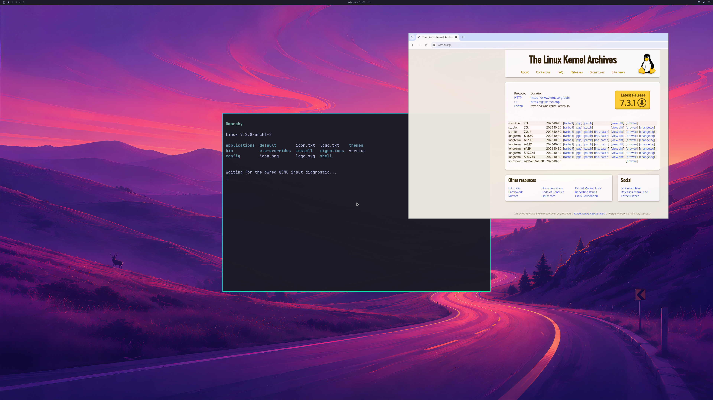

# Guest graphics startup through the original launcher profile

**October 31, 2026:** the original Go argument profile now boots a private
RAM-overlay guest, authenticates its PAM/UWSM compositor and produces an actual
**3840×2160 NVIDIA frame through QEMU SDL**. The complete source/backbuffer
comparison passes with **maximum channel error zero**.

The full desktop regression remains **rejected**: run 10 completes only **three
handoffs**, against the existing target of **1,800**. It is still a bounded,
forced-account probe; normal account startup and released launcher activation
are unimplemented. Backend/product/scene counts remain **4/8, 0/4, 3/3**.

This PNG is a lossless encoding of the actual first GPU source. The
terminal still displays its diagnostic input prompt. The browser's complete
shader/sandbox/interaction/lifecycle workload is not accepted by this run. The
earlier three-application milestone remains separate.

## Changes

The preserved launcher command contains upstream camera and authentication
devices before the added graphics transport. Linux exposes the graphics port
as `/dev/vport6p1` in the observed configuration. The previous guest service and
compositor wrapper both assumed `/dev/vport0p1`.

`guest_graphics_port.h` searches the bounded sysfs port set for exactly
`org.7wdev.wddm`, validates canonical major/minor identity and requires the
matching character node. Missing, ambiguous, malformed, symlinked or mismatched
devices fail. It never opens camera, authentication or input ports. The startup
wait remains bounded. Linux's
[virtio console implementation](https://github.com/torvalds/linux/blob/master/drivers/char/virtio_console.c)
derives node names from the virtio device index and port; systemd's
[standard udev rule](https://github.com/systemd/systemd/blob/main/rules.d/50-udev-default.rules.in)
also uses the advertised port name.

The compositor wrapper resolves that same graphics device before checking that
the ordinary user cannot open either privileged graphics endpoint. Capability,
NoNewPrivileges, session, literal environment and privilege-denial checks stay
in place. Windows keyboard, mouse, SDL and original QMP input code are unchanged.

The new guest generators replace the dedicated diagnostic trace carrier with
ordinary journald output. They reproduce the **composed multiapp supervisor**,
preserving profile 14, companion-renderer logging and kernel admission reporting.
Exact inverse transformations check the intended edits. Terminal compositor
status and up to 160 unit journal lines are captured before stopping the guest
user manager. Journal ordering and complete receipt retention are not certified.

The private build first reproduces the previous supervisor ELF **byte for byte**
(`9116d3b9e758a3a72040d251b2b570c8b80bd705834bf548f06ce2a676d16fd6`).
Only the root-service and compositor-wrapper archive payloads are replaced;
other archive bytes and entry metadata are checked. Shader, browser, input
fixture, GPU protocol, kernel and physical-memory guards are retained.

## Retained attempts and evidence

| Attempt | Observation | Acceptance |
| --- | --- | --- |
| 5 | Fixed QEMU boots Linux and HTTPS; old service requires absent diagnostic trace device | No graphics |
| 6 | Journal-only service reaches the obsolete fixed port assumption | No graphics |
| 7 | Named port and kernel/broker initialization pass; old wrapper retains fixed ordinal | No graphics |
| 8–9 | Updated wrapper authenticates; raw-source rebuild drops composed profile 14; targeted journal exposes negotiation failure | No graphics; excluded as a logging-only comparison |
| 10 | Matching composed supervisor, named port, real NVIDIA work, three handoffs and exact first 4K source/SDL pixels | First-frame proof only; full workload rejected |

All six attempts retain immutable source, host, guest and isolation log hashes.
Zero guest/launcher exit codes are explicitly insufficient: attempts 8–9 exit
successfully while creating no GPU work. No earlier failure is converted into a
passing desktop test.

| Bounded run-10 observation | Result |
| --- | ---: |
| Frame handoffs / required regression count | 3 / 1,800 |
| Complete first source and SDL backbuffer | 3840×2160 each |
| Maximum channel error, existing full GL_LINEAR oracle | 0 |
| Native submissions / failures | 772 / 0 |
| Device-health queries / failures | 898 / 0 |
| Peak allocation records / negotiated limit | 902 / 2,048 |
| Peak reported GPU usage / unchanged pool | 1,275,924,480 / 4,294,967,296 bytes |
| Final tracked native objects, allocations and aperture mappings | 0 |
| Forced VM stop | No |
| Physical input / physical scanout / sustained desktop | Unverified |

The first frame is bound to authenticated native fences, complete readback
digests and QEMU's NVIDIA adapter identity. The existing independent
`verify_real_sdl_desktop.pixel_audit` function checks every pixel; the full
historical desktop auditor is **not** declared passing. There is no final-frame
capture or complete input, resizing, browser-lifecycle or 1,800-frame proof for
this combination. The precise stop after three handoffs still needs diagnosis.

Fourteen Linux discovery controls pass, including moved graphics alongside
camera/authentication, duplicate identity, wrong character identity, symlinks,
malformed attributes and bounded scanning. Temporary character fixtures are
never opened. The existing UWSM literal-environment parser passes. Strict C11
compilation passes for both the frozen hardware-test closure and, separately,
the generated service against current public runtime headers. The latter is a
compile check, not an additional hardware result.

The QEMU reconnect fix also passes both Windows variants in
[run 40916650181](https://github.com/7Wdev/try-omarchy-windows/actions/runs/40916650181).
That paused QMP-frontend control does not establish ordinary camera/authentication
reconnect acceptance.

All VM surfaces stayed on newly owned **inactive Windows desktops**, with no
desktop switch or host input. Owned jobs were empty before their desktop handles
closed; the caller's desktop stayed unchanged. The 7 GiB source image was held
read-only and hashed before/after, as were the installed NVIDIA driver files.
Private guest images and NVIDIA binaries are not distributed.

Next are the incomplete workload and normal guest account/session integration,
then official input and continuous browsing/multiple windows through 4K.
Sustained resource bounds, active-GPU recovery, broad OpenGL/Vulkan/CUDA/video,
DLSS/hardware ray tracing and **≥93% matched native performance** remain required.

[Structured evidence and retained failure hashes](evidence/LAUNCHER-GUEST-GRAPHICS-BOOTSTRAP-2026-10-31.json).
