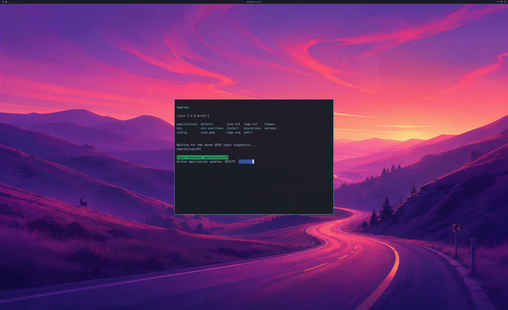

# Active Omarchy application and GPU transport measurements

The active desktop probe drives a real NVIDIA-rendered Alacritty application
through the guest PTY. It requests 60 updates per second, skips missed update
slots and changes a coloured strip and counter. This is a workload target;
it does not establish 60 displayed frames per second. The normal keyboard,
cursor, QEMU SDL frontend and reserved-key QMP route are unchanged.



This is run 109, frame 300: the actual 2560×1566 SDL pre-swap backbuffer.
The complete GPU source is 3840×2160. The wallpaper, Quickshell bar, original
terminal, green input confirmation and animated application counter appear
together. Physical 4K scanout and continuous display of every frame remain open.

## Results and limits

Three active-workload runs pass all 300 guest-to-SDL handoffs, full first/final
pixel audits, five application lifecycles, application resizing and live GPU
reference cleanup. Runs 106 and 110 use the frozen Native72 baseline; run 109
uses Native74 with gathered replies and TCP_NODELAY on the GPU data connection.
All use the byte-identical guest payload and original QEMU artifact. Every
complete SDL source equals its guest GPU buffer exactly; every full window
channel differs by at most one code value from the independent scaling reference.
The unchanged tolerance is two. Peak reported GPU usage stays below 1 GiB.

| Run | GPU bridge | Full pixel audit | Median queue round trip | Median frame interval | Frame interval p95 |
| --- | --- | --- | --- | --- | --- |
| 106 | Native72 baseline | Pass | 2.2071 ms | 37.3333 ms | 176.4569 ms |
| 107 | Native73 initial guard | Rejected before rendering | — | — | — |
| 108 | Native74 | **Rejected: both window buffers all zero** | 1.4461 ms | 33.5604 ms | 235.9356 ms |
| 109 | Native74 | Pass | 1.7423 ms | 41.3827 ms | 157.7863 ms |
| 110 | Native72 baseline repeat | Pass | 1.6075 ms | 38.1047 ms | 192.4735 ms |

These are CPU wall-clock observations at the guest submission hook, including
blocking, scheduling and diagnostic overhead. Steady windows **20–45, 80–140
and 200–280** were selected from the resize phases before the candidate capture.
Frame-interval statistics use only consecutive frames within those windows.
They are not GPU timestamps, physical input latency, scanout cadence or a
matched-native benchmark. **No performance gain is established:** the second
baseline has a shorter median queue round trip than the accepted candidate.
The rejected run 108 cannot count as a quality-passing comparison.

The earlier fixture deliberately requested notification repaints with a
50 ms sleep. Its reported 69.15 ms interval must not be treated as interactive
desktop FPS or a clean throughput benchmark. The active fixture removes that
repaint loop; its controller polls progress every 2 ms without driving damage.

## Retained failures and diagnostics

The instrumented QEMU **run 111** also passes 300 handoffs, exact full 4K sources,
both complete window comparisons and live cleanup. Both captures report a shown,
maximized window, matching 2560×1566 logical/drawable dimensions, no GL error,
and all 4,008,960 window pixels with opaque alpha. Its QEMU build differs from
the three accepted timing-comparison runs above, so it is a separate diagnostic
follow-up. The evidence therefore retains **four accepted runs and two rejected
attempts**. This result does not determine the cause of run 108's zero buffer.

Run 107 failed a newly added configuration guard before rendering. Winsock
returned a one-byte boolean option; the initial code incorrectly required four
bytes. Native74 accepts the valid one-to-four-byte extent, validates the enabled
value and retains strict partial-write handling. Windows and Linux controls
cover truncated writes, zero/oversized results and invalid frame lengths.

Run 108 reached 300 GPU handoffs and natural shutdown, and both 4K GPU sources
are exact, but **both complete SDL window captures contain only zero bytes**.
The cause remains unconfirmed. Window visibility was not recorded and the user
is unsure whether the window was minimized or covered. OpenGL's default
framebuffer has pixel-ownership limitations; that is a possible explanation,
not a finding about this run. [Khronos default framebuffer documentation](https://wikis.khronos.org/opengl/Default_Framebuffer).
The next repeat, run 109, passes the complete window audit.

QEMU now records logical/drawable size, SDL visibility/focus flags, viewport,
scissor, framebuffer bindings, colour-write mask, GL errors and zero/opaque
pixel counts beside the actual audit captures. These queries occur only on
explicit diagnostic frames; ordinary GPU-only handoffs keep their existing
path. Visibility flags alone cannot establish valid pixel ownership, and the
independent full pixel comparison remains mandatory. The original device-loss
failure at frame 207 remains unresolved; later passing runs do not erase it.

## Reconstructable evidence

[Lossless evidence](evidence/OMARCHY-ACTIVE-SDL-TRANSPORT-2026-10-21.json)
has SHA-256 `33773dba4ee8d31b6fe391049e68d1290605660e08e958a14c7d35c6dfd77075` and
retains every attempt, raw logs/captures, exact native compiled inputs and build
scripts, original/generated guest sources, runner and observer source. It
references the separately checksummed earlier SDL evidence for shared blobs.
Private NVIDIA/WSL binaries, disk and initramfs are excluded.

Replay the seven acceptance and rejection tests with:

```text
python -m unittest discover -s experimental/windows-native-gpu -p test_active_sdl_transport_milestone.py -v
```

Native74 passes strict MSVC `/W4 /WX /O2` builds in both the 4K and default
profiles, the default CLI suite and Linux transport controls. The prior 450
milestone tests and seven new evidence tests pass. Backend stages remain **4/8**;
desktop product gates remain **0/4**. Normal launcher integration, sustained
multi-window interaction, recovery, general API coverage and ≥93% matched-native
performance still require acceptance work.
