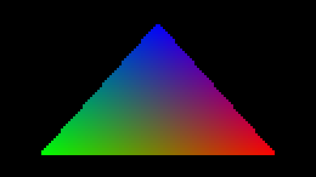

# EGL native-image development checkpoint

The owned QEMU/WHPX guest now imports a genuine Linux DMA-BUF as an EGL image,
exports it through EGL, and reimports it while retaining the same native GPU
storage. Four fresh ordinary-user guests pass RGBA, BGRA, RGBX and BGRX buffer
checks on the NVIDIA GeForce RTX 5090 Laptop GPU. A fifth passes with the feature
disabled. These are working-tree development captures with exact source hashes,
not a completed graphics-device or desktop acceptance milestone.

RGBA storage is verified at **3840×2160**; the other formats use **1281×719**.
Native D3D12 clears red, then OpenGL clears green through one imported texture
and reads the result through its exported/reimported sibling. Both checks read
every pixel. The original D3D12 resource and first EGL image are destroyed while
the texture sibling remains usable. All 73 DMA-BUF references release before
process exit, after EGL context/display teardown.

The shared-storage shader draw covers a **130×73 viewport** inside the larger
texture. Its 9,490 pixels pass the independent triangle oracle with maximum
channel error 1. This image is a nearest-neighbor enlargement of those actual
GPU pixels. It is not a Hyprland screenshot or a full 4K shader benchmark.

The opt-in Mesa patch advertises only four 8-bit RGB formats and an implicit
opaque layout. It does not advertise an explicit linear modifier. BGRX uses
BGRA native storage with Mesa's existing opaque view behavior; typed DXGI BGRX
import failed in the retained control. Raw capability FDs, foreign FDs, wrong
stride/offset/dimensions/format, and explicit linear imports are rejected while
retaining the caller's FD. Texture-sampling conformance remains unverified.

The new bounded native resource factory is separate from the existing fixed
RGBA texture/stream/presentation contract. A read-only kernel capability query
and exact Windows-host capability response gate Mesa's opt-in support. Native
resource declarations belong to the calling thread and are canceled if SDK
allocation fails before reaching KMT. The automatic Mesa shared-allocation hook
is implemented but still needs validation through the real GBM path.

Two failures found during implementation are fixed: EGL exported the padded
readback stride because a later callback assignment overwrote the native-image
callback; and the diagnostic's lifetime hardware-signal budget was exhausted
at 16. The explicitly negotiated OpenGL fence profile now permits 64 lifetime
signals, matching its 64-command budget, while retaining a maximum of 16 pending
signals. Older/default profiles retain their 16-signal budget. This is still a
bounded diagnostic, not a sustained compositor session.

[Retained evidence](evidence/EGL-NATIVE-IMAGE-DEVELOPMENT-2026-10-14.json) includes
all four enabled captures, the disabled control, three actual failures, raw
capture hashes, native/guest/VM cleanup, the Mesa patch manifest and source
snapshots. The first retained failure exhausted the signal budget, the second
exposed the odd-width stride error, and the third failed typed BGRX import.
An independent auditor and eight corruption-test groups reject damaged pixels,
export metadata, lifetime ordering, native descriptions, incomplete retirement,
leaks and false provenance. The earlier 195 milestone tests also pass.

The native bridge SHA256 is
`9725c7aa403afd393b48574eadfa1a50bb8407667019265785b835f729b9ca55`.
The pinned Mesa 26.0.8 additive patch SHA256 is
`8590be1d2b36eda92cec4bfd77c52d42a98b033754993d1dbee46693e108f12e`.
The immutable guest kernel is 7.2.8-arch1-2; its hash and the exact QEMU,
initramfs, Mesa library and per-file source hashes are in each evidence snapshot.
Private NVIDIA binaries and guest images are excluded.

Remaining work is GBM/render-node access, an actual Hyprland session, independent
guest GPU clients, compositor sampling and synchronization, sustained rendering,
reliable Windows presentation, interaction and long-run performance. Progress
remains **4/8 verification stages and 0/4 desktop gates**. The first verified
Hyprland frame will be captured and added to PR #2 immediately.
