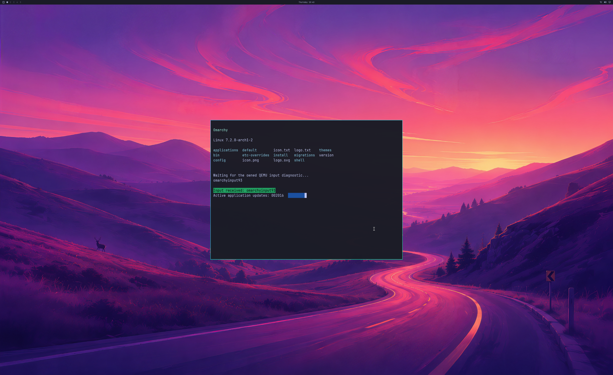

# GPU address pressure followed by the 4K desktop

Two fresh guests pass a real D3D12 buffer-copy/eviction diagnostic, then each
complete **1,800 NVIDIA desktop handoffs**. Their peak GPU virtual mappings
exceed **2 GiB** before the first frame, exercising the old 1 GiB address
boundary while the **1 GiB reported resident-usage** and **192 MiB CPU mapping**
guards remain unchanged. This closes a bounded address-pressure check, not
long-run memory-pressure recovery or full desktop acceptance.



The actual **2560×1566 SDL pre-swap backbuffer** contains the shipped wallpaper,
Omarchy bar, readable application, green input response and active counter.
Its complete **3840×2160 NVIDIA GPU source** matches the guest buffer exactly.
Every window pixel passes the independent GL_LINEAR reference, with maximum
channel error one under the unchanged tolerance of two. Physical 4K scanout
remains unverified.

| Bounded observation | Run 135 | Run 136 |
| --- | --- | --- |
| Peak virtual mappings before frame one | 2,222,080,000 B | 2,189,221,888 B |
| Diagnostic heaps / copy-evict cycles | 28 / 56 | 28 / 56 |
| Desktop handoffs after the diagnostic | 1,800 | 1,800 |
| Desktop stream duration | 35.283 s | 34.519 s |
| Median steady CPU handoff interval | 17.457 ms | 17.301 ms |
| p95 steady CPU interval | 31.618 ms | 25.014 ms |
| Deferred → reused / reclaimed references | 104 → 2 / 102 | 63 → 1 / 62 |
| Retained references after cleanup | 0 | 0 |
| Peak reported GPU usage | 967,475,200 B | 934,617,088 B |

These fixed-window CPU measurements include instrumentation and scheduling.
Frame one's timing also includes the additional diagnostic. They do not
establish displayed FPS, GPU execution time, physical input latency or ≥93%
matched-native performance. Both p95 values exceed a 60 Hz frame period.

## What the diagnostic exercises

The explicit guest-only probe borrows the real compositor's Mesa D3D12 device
and direct queue after `glFinish`. It allocates **28 separate 48 MiB default
heaps**, totalling **1,409,286,144 virtual bytes**, with
`D3D12_HEAP_FLAG_CREATE_NOT_RESIDENT`. Each placed buffer has a stable,
non-overlapping GPU address. Each pass makes one heap resident, submits GPU
copies, waits for actual GPU fence completion and evicts only after retirement.

On the first pass, three distinct 4 KiB blocks at the beginning, middle and end
of every buffer are copied through the GPU and read back. The second pass
checks the previous contents after eviction/reuse, then writes and checks a
different pattern. A separate Python oracle verifies **56 new-buffer and
28 retained-content checksums**, exact address/fence order and the complete
diagnostic log. The diagnostic adds **688,128 upload bytes** and **1,032,192
readback bytes**. It is SDK buffer-copy coverage; it adds no shader/API or
performance acceptance.

These are D3D12 `Evict`/`MakeResident` cycles. The opt-in host can retain a real
residency reference until CPU mappings and tracked work retire; the complete
ownership ledger verifies subsequent reuse/reclamation. The result establishes
extended virtual-address coverage and correct contents through those cycles,
without claiming every buffer was physically paged out.

Microsoft documents that `CREATE_NOT_RESIDENT` requires explicit residency
management and that residency uses references. [Heap flags](https://learn.microsoft.com/en-us/windows/win32/api/d3d12/ne-d3d12-d3d12_heap_flags),
[MakeResident](https://learn.microsoft.com/en-us/windows/win32/api/d3d12/nf-d3d12-id3d12device-makeresident).

All objects owned by the probe are released before desktop handoff one. The
usual **1,798 ordinary handoffs** still use GPU copies without CPU texture
upload or diagnostic readback; first/final full-frame audits remain separate.
Five application lifecycles, three resize phases and the isolated QMP/PTY
input response pass. Independent producer/consumer fences reach 1,800, SDL
detaches before the final guest reply, and native objects and backing mappings
retire before natural VM exit.

## Provenance and retained failures

The Windows host remains the exact verified **Native82** binary; QEMU and its
official input sources are unchanged. The diagnostic changes only the guest
startup hook, its source receipt and the added probe library relative to guest119.
The sustained rendering, shell/application workload and input sources remain
byte-identical apart from the single insertion before frame one. Frozen compile
inputs, exact binaries, installed signed NVIDIA **621.01** libraries and the
read-only source disk are guarded before and after both runs.

The first hardware attempt, **134**, stops before frame one at the Mesa device
check and remains rejected. The initial probe incorrectly required Mesa's
generic vendor field to contain NVIDIA's ID; this backend leaves that field at
`UINT32_MAX`. The corrected probe retains the NVIDIA renderer check and matches
the borrowed device's LUID with Mesa's device data. That LUID is the bridge's
virtual guest identity (`0x57475055`), distinct from the Windows adapter LUID.
The encompassing desktop auditor separately pins the compiled host, matching
installed driver and actual NVIDIA root adapter. The failed run has a complete
trace, unchanged source disk and clean native/VM teardown; it is not rendering
acceptance.

Attempt **133** is a preflight rejection: the restricted shell denies execution
of the installed-driver guard before the source record or VM is created. Its
original guard output is retained. Existing failures and historical auditors
keep their original scope and pins.

[Lossless evidence](evidence/OMARCHY-GPU-VA-PRESSURE-2026-10-22.json), SHA-256
`553cbccc5a095026ff02e13cb7a837bacea2018cfac204c2126d409b6139cf18`,
contains exact diagnostic sources, frozen guest/host inputs, controllers,
complete original traces and reconstructable full pixel buffers. Proprietary
vendor libraries, disks and initramfs are excluded. The earlier managed-residency
archive remains a verified base rather than being rewritten.

Run the new replay and preservation checks with:

```sh
python3 -m unittest discover -s experimental/windows-native-gpu -p 'test_*pressure*milestone.py'
```

The probe is compiled explicitly with `build_gpu_va_pressure_probe.sh` and runs
only when the separate diagnostic generator is selected; default graphics and
residency behavior are unchanged.

## Remaining acceptance

Backend stages remain **4/8**, desktop product gates **0/4**, and scene elements
**3/3**. The test uses a disposable seeded UWSM/PAM account and RAM overlay.
Longer pressure while rendering, simultaneous application windows, supported
guest device and normal account/launcher integration, official physical input,
device-loss recovery and concurrent Windows/guest workloads remain open.
Broad OpenGL, Vulkan, CUDA, video, DLSS, hardware ray tracing and ≥93%
matched-native performance still need real application or SDK acceptance.
