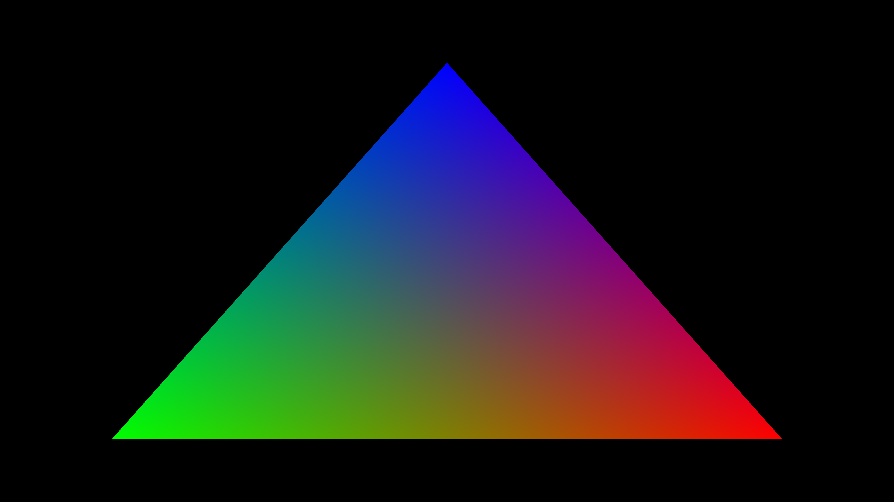

# Guest textures in a separate Windows GPU process

On 2026-10-13, two fresh QEMU/WHPX guests rendered both 3840×2160 shader frames
as UID/GID 65534 and transferred their texture into an owned Windows consumer
process. The consumer created its own D3D12 context, imported the NT resource,
performed GPU copies, verified retirement and exited normally. The guest client
had zero effective capabilities, `no_new_privs`, and no direct controller or
native-port access.

One separate window run passed both strict DXGI statistics checks and exact
backbuffer comparisons. Its immediate repeat failed at frame two. **Display
stability remains unverified. No Hyprland session has rendered through this
backend.** Capture, show and update [PR #2](https://github.com/7Wdev/try-omarchy-windows/pull/2)
immediately when the first verified Hyprland session works. The roadmap remains
4/8 verification stages and 0/4 desktop gates.



This PNG preserves the exact 3840×2160 native readback from run-10, frame two.
Its dense RGBA SHA-256 is
`0a5b6e1ed3c42b5a4ac4d668b4607a7938a2144e7daeb98177fcd79add032abf`.
It is a shader readback; the evidence records its origin and excludes a desktop
or window-screenshot claim.

## Hardware evidence

The [immutable evidence](evidence/WINDOWS-GPU-WORKER-2026-10-13.json) includes
complete final captures, failed controls, the same-process regression, scoped
audits, source closure pins and private artifact hashes. Raw private runtime
images, proprietary libraries and compiled executables stay local.

| Capture | Actual result |
| --- | --- |
| run-10, run-12 | Final-source separate-process GPU copies pass both full 8,294,400-pixel frame audits; maximum RGB error one byte. All 14 native commands and four signals retire; every process exits 0. |
| run-11 | Both 4K copy/backbuffer images match; DXGI reports frames one and two with advancing timing, from the consumer PID. The two-frame display audit passes. |
| run-13 | Same final binary and guest image; second DXGI statistics remain on frame one. Guest exits 5 and host exits 1. It remains a failed presentation workload. |
| run-9 | Existing same-process consumer passes the full 4K pixel/handoff audit. The new worker auditor rejects it as evidence of a separate process. |
| Earlier captures | Four successful copy-only regressions are retained by hash/audit. Three failed display controls and an incorrectly selected small-profile private image remain failures. |

Successful final guests create and explicitly revoke all 173 restricted CPU
views: 80 fence and 93 allocation leases. Kernel tests pass 581 memory checks,
561 object checks and 15 resource-FD checks. The module unloads with zero leases
and zero active CPU bytes. Native and QEMU counters balance, with no forced VM
or worker stop. The 128-slot layout and 96 MiB physical CPU mapping limit stay
unchanged. These results concern the bounded shader workload, not general
aperture fragmentation or whole-process GPU-memory accounting.

## Process and handle ownership

The trusted native coordinator starts its own executable in a suspended child,
assigns an owned job and resumes it. Only private control pipes, diagnostic
stderr and NUL standard handles are inherited. It duplicates the approved NT
texture reference into the pinned child process. The guest supplies no Windows
PID, executable path or NT HANDLE value. The child closes its duplicated NT
reference after opening the D3D12 resource; its GPU resource retains the storage.

This uses documented Windows [shared heaps/resources](https://learn.microsoft.com/en-us/windows/win32/direct3d12/shared-heaps)
and [handle duplication](https://learn.microsoft.com/en-us/windows/win32/sync/object-duplication).
The source resource is owned and type-checked by the existing KMT session. The
host-private worker protocol is separate from the guest driver protocol.

The persistent consumer reuses its imported resource, copy objects and context
across both frames. Replies bind operation, sequence and worker PID. GPU copy
retirement precedes the small reply and source reuse. Shutdown releases the
child context and confirms process exit before reporting successful consumer
retirement. A failed worker is reaped and remains a failed workload; a rejection
before initialization can exit on pipe EOF without a forced kill.

The data path shares GPU storage and performs GPU-to-GPU copies. Full CPU
readback and an independent integer oracle are acceptance diagnostics. This
serialized handoff has no performance acceptance result. GPU-side cross-process
waits and an overlapped buffer ring remain to be implemented.

## Display findings

The strict diagnostic compares actual backbuffer bytes, successful `Present`,
retired GPU work, the present count and advancing DXGI frame statistics. None
of those signals is silently replaced by another. Microsoft documents that
[frame statistics can be unreliable in some monitor/fullscreen configurations](https://learn.microsoft.com/en-us/windows/win32/api/dxgi/nf-dxgi-idxgiswapchain-getframestatistics)
and can need a DWM flush on Hardware Flip Queue systems.

Keeping only the diagnostic window on top did not resolve the reproduced
frame-two failure; that experimental switch was removed. Repeated bounded DWM
flushes produced a pass and a failed repeat, so they do not establish a fix.
The failed captures retain matching shader/backbuffer pixels and the stale
statistics. The final failure also records unsuccessful consumer retirement
rather than issuing an unconditional success receipt.

The owned window is 780×438 while its render/backbuffer images are 4K. Native
4K monitor scanout, continuous correct display, resize, input and recovery need
separate acceptance. The images here are shader evidence.

## Validation and reproduction

Standard and 4K MSVC `/W4 /WX` builds compile the worker. Portable protocol tests
reject 31 malformed state/reply cases. A Windows test launches real owned
processes but rejects source zero before any GPU call, then checks EOF cleanup
and continuing handle growth after one warmup. The first creation cycle retains
16 extra process handles in this environment; its attribution is unproven.
The second identical cycle leaves the count unchanged. This is a steady-state
check, not proof that every process-global allocation is understood.

The new capture corruption tests reject wrong PIDs, guest-selected handles,
missing/repeated lifecycle receipts, wrong frame hashes, bad retirement,
unprivileged-client violations and false scope claims. PNG tests verify exact
dimensions, CRCs and every decoded native readback byte via its SHA-256.

Build the native host with `build.ps1 -HighResolutionDiagnostic`. Build a matched
private guest with `build_runtime_diagnostic.sh ... 4k`, setting
`WDDM_BRIDGE_TEST_BROKER_ROUTE=1`, and pack the kernel module, contract helper and
graphics broker with `make_runtime_initramfs.py --runtime-workload native`.
Use `test_owned_runtime_qemu.py` with its existing native metadata, shared
resource/consumption and submission/memory gates, plus
`--driver-consume-shared-process`. The display diagnostic additionally requires
`--driver-present-shared`.

Re-audit the original private bytes with:

```sh
python3 experimental/windows-native-gpu/verify_native_worker_capture.py \
  --report RUN/driver.json --capture-directory RUN --oracle BUILD/rgba-oracle.exe --output RUN/audit.json
```

Add `--present` only for the display workload. The original 4K pixel auditor's
strict checks remain unchanged. The older small-profile runtime wrapper still
returns 1 for this separate workload; that result is preserved.

## Remaining compositor work

This provides one ordinary guest GPU producer and a separate Windows texture
consumer. Independent guest GPU clients still need native process contexts,
coordinated resource/fence ownership and memory apertures that can address each
owned worker safely. Current QEMU memory apertures remain tied to the original
Windows process.

The pinned guest uses Hyprland 0.56.2 and Aquamarine 0.15.1 with upstream guest
patches. Aquamarine's [allocator setup](https://github.com/hyprwm/aquamarine/blob/v0.15.1/src/backend/Backend.cpp)
requires a DRM node for GBM. Hyprland's [GL renderer](https://github.com/hyprwm/Hyprland/blob/v0.56.2/src/render/GLRenderer.cpp)
imports dma-buf attributes and uses sync-file fences. The current native FDs do
not satisfy those interfaces. A headless output's immediate present notification
does not prove a displayed Windows frame.

DRM/GBM, compositor-compatible native buffer import/export and synchronization,
continuous Windows presentation and the actual Hyprland session remain open.
General OpenGL/Vulkan, CUDA, video, NVIDIA-specific features, concurrent Windows
and guest workloads, long-run stability and ≥93% matched performance remain
unverified.
