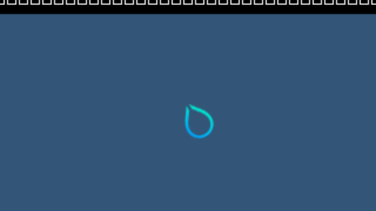

# Actual Hyprland framebuffer capture

Updated 2026-10-15. **The Windows GPU now captures actual Hyprland output buffers.
Two fresh guests each pass two captures and independently checked background
regions. This is not Windows app presentation or a complete Omarchy desktop.**
Full scene correctness, input, applications, sustained rendering, compositor 4K
operation and performance remain unverified. Progress stays 4/8 stages and 0/4
desktop acceptance gates.

This is the actual second 640×360 compositor output captured by the Windows GPU,
decoded directly from native BGRX bytes. It is not generated or resized. The
small diagnostic guest lacks usable fonts, so the startup text shows placeholder
glyphs. The cursor and text have not received an independent pixel oracle.


The changed-background control runs the same source and GPU stack with a
different pinned configuration:



## What the new path verifies

Aquamarine's actual output-commit observer supplies the current owned DMA-BUF.
The optional capture probe creates and exports a real EGL native renderer fence.
The unprivileged shim and broker resolve the buffer and fence to authenticated,
typed session tickets. No Windows HANDLE, LUID or file path comes from the guest.
The new request requires explicit compositor profile 4 and both sharing routes.
The resource and fence must belong to owned adapters that the native driver
verifies are the same physical GPU. Malformed descriptors, wrong object kinds,
foreign GPUs and more than two capture attempts are rejected.

The Windows consumer opens the shared resource and fence on its selected NVIDIA
device, verifies the actual resource description, enqueues a GPU wait for the
producer fence and copies the texture into a host readback resource. It returns
the source to COMMON and verifies copy retirement before mapping or releasing
its resources. No guest CPU map or CPU upload is used. Host readback is diagnostic
verification; the product presentation path must avoid this CPU readback.

All four captures contain 921,600 native bytes. Native capture records, the guest
reply and the saved file agree on their complete FNV digest; SHA-256 pins each
file independently. The auditor checks **133,120 background pixels per frame**
against the configuration's known RGB, including a changed-color control. It
does not infer its reference from the observed image or claim that the remaining
cursor/text pixels are correct. BGRX's unused X byte remains in the raw capture
for byte-integrity verification; previews display RGB without treating X as alpha.

## Actual runs and retained failure

The [development evidence](evidence/HYPRLAND-COMPOSITOR-CAPTURE-DEVELOPMENT-2026-10-15.json)
retains receipt excerpts, native/VM records, complete compressed pixel captures,
source/input digests and the previous failed guest-readback experiment. These
working-tree captures are based on 0df414d, not clean-revision desktop acceptance.
The native build snapshot also contains uncompiled guest C files; the actual
guest source and hook binary are separately pinned in each run's input records.
NVIDIA binaries and private guest images are not redistributed.

| Run | Evidence and limitation |
| --- | --- |
| 18 | A private GBM CPU-map attempt reaches real GL completion, then hits the 256-live-allocation bound and aborts. No pixels accepted. The failure and cleanup after VM exit are preserved. |
| 19 | A private one-capture prototype obtains actual output bytes through the Windows GPU and exits cleanly. It is retained separately from the final two-run audit. |
| 20 | Published capture mode, background `114477`: two 640×360 output captures, 266,240 background-reference pixels verified, clean guest/native/VM exit. |
| 21 | Same final code, background `335577`: two further captures independently match the changed reference and exit cleanly. |

Each final run commits seven output buffers, retires 29 guest native commands
plus two host capture copies, and releases all nine completed sync-files and 74
native DMA-BUF references. All 142 fence mappings, 178 allocation mappings, 204
allocation slots and 320 broker views release explicitly before VM exit. No
forced VM stop or deferred reclaim occurs. The guest allocation peak remains
within the existing 256-object limit; it was not raised to obtain these captures.
The [logging ownership fix](LIVE-HYPRLAND-LOGGING-LIFETIME.md) remains in place.

## Source and validation

Build `hyprland_startup_probe.c` with
`-DWDDM_BRIDGE_COMPOSITOR_HOST_CAPTURE=1` for the optional capture mode. It captures
output commits 2 and 4 and waits for at least four commits before requesting
graceful exit. Without that definition it retains the earlier metadata-only
startup behavior. It is not installed by the normal Windows launcher.

The native capture descriptor bounds dimensions at 4096×4096 and permits only
the four established RGB/RGBX layouts, with an exact logical stride. This source
bound is **not a verified 4K compositor result**; these actual runs are 640×360.
The request remains a two-attempt diagnostic within a finite startup profile.

Strict default and 4K-lab MSVC builds pass, as do all 230 local milestone tests.
The final native wire controls also pass under GCC. They cover malformed metadata, typed
ticket ownership, foreign GPU rejection, exported-fence lifetime after original
object destruction, malformed native replies and the two-attempt bound. File
tests verify an odd-width compositor readback, padding removal, exact bytes/hash
and refusal to overwrite evidence. The source-published C probe builds with C11
warnings as errors. Nine auditor regressions use the real retained captures and
reject stale/modified/truncated data, wrong reference colors, unretired fences,
missing release records, reordered frames and false presentation claims.

```sh
python3 experimental/windows-native-gpu/verify_hyprland_compositor_capture.py \
  --report CAPTURE/driver.json --expected-background-rgb 114477 \
  --output CAPTURE/compositor-capture-audit.json
```

The older general OpenGL-workload wrapper still returns 1 for this different
workload; that result is retained. The separate auditor accepts only the precise
readback/background/lifecycle scope above. It always leaves full scene correctness,
Windows presentation, desktop and near-native performance unverified.

Next is GPU presentation of the committed resource into the Windows app, then
font/theme data, a real application scene, input, sustained ownership and recovery.
The first verified frame displayed in the Windows app will be captured and added
to PR #2 immediately.
