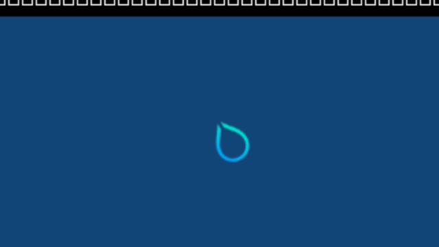

# Paced compositor handoff and deferred display evidence

Updated 2026-10-15. **Two fresh guests pass both actual Hyprland frame handoffs
and exact deferred display observations.** The compositor no longer waits for
immediate display statistics or holds every frame for three seconds. Normal
launcher integration, sustained rendering, full scene correctness, compositor
4K operation and near-native performance remain unverified. Counts stay 4/8
verification stages and 0/4 desktop acceptance gates.

The blue frame below is the earlier native-window backbuffer preview. Both raw
frames in the new blue-background run reproduce the earlier readbacks byte for
byte. The changed-background run independently reproduces its corresponding
reference. This is native GPU output, not an OS window screenshot. Missing-font
placeholders remain; cursor/text pixels lack a full independent scene oracle.



## The traced failure

Waitable swapchains and flip-discard did not by themselves eliminate the strict
second-frame statistics failure. The [retained evidence](evidence/HYPRLAND-FRAME-PACING-DEVELOPMENT-2026-10-15.json)
preserves every control, including successful and failed repeats.
These are working-tree experiments based on b9a30f1, with exact source/build
pins; they are not clean-revision desktop acceptance. Private vendor binaries
and guest images stay local.

In run 29, Intel PresentMon matches the actual renderer PID 11808, swapchain and
second Present-call QPC interval. It reports that frame as displayed in Composed:
Flip mode about 19.5952 ms later. The same native record reports stale DXGI count
1 after submitting frame 2. This proves stale telemetry in this traced case;
it does not retrospectively accept every previous failure.

The first PresentMon CSV row is absent, so the trace corroborates only frame two.
Its all-ETW-frames result remains false. An earlier trace ended before renderer
launch and supplies no display evidence; it is retained separately. The signed
Intel program was restricted to a unique renderer executable name, with input
tracking disabled and a 90-second lifetime. The raw CSV hash is pinned; its UTF-8
BOM is decoded explicitly rather than treated as part of a column name.

## What changed

The compositor window uses a bounded waitable swapchain, with one frame of
maximum latency. It waits before drawing each frame, including the first, while
servicing Windows messages and close requests. The wait has a five-second bound,
and its owned handle closes during teardown. Full-frame updates use flip-discard;
the legacy shader diagnostic retains its earlier swapchain mode.

The native capture/handoff succeeds only after its producer fence, GPU copies,
pixel capture, successful Present, matching present count and post-Present queue
retirement complete. Display statistics are an observation of later display
progress. They no longer cause a successful compositor submission to return an
error merely because that observation is not ready. The legacy strict immediate
display auditor and its failed results remain unchanged.

The compositor path performs one nonblocking statistics query per Present. It
does no per-frame DWM flush loop or fixed hold. This bounded diagnostic retains
the final output for one second at shutdown; that is explicitly recorded and is
not a throughput result. CPU readback/file capture and bounded GPU/frame-slot
waits remain in this diagnostic, so it is not the production display loop.

## Actual outcomes

| Runs | Evidence |
| --- | --- |
| 25, 26 | Waitable sequential swapchain: first strict display check passes; second remains stale in both runs. Ready signals and handle closure pass. |
| 27, 28 | Waitable flip-discard: strict second-frame check fails once and passes once. This does not establish a fix. |
| 29 | Targeted ETW corroborates displayed frame two despite the retained strict DXGI failure. No first-frame ETW row or all-frame ETW claim. |
| 30, 31 | Final submission path, two distinct pinned backgrounds: both GPU handoffs pass. The next frame-slot observation reports display count 1; the final observation reports count 2, with advancing QPC times after the corresponding Present calls. Both raw backbuffers match their earlier references. |
| 32 | Final native binary, presentation disabled: both original compositor capture audits pass. |

Each final run independently checks 133,120 known-background pixels per frame,
plus complete native/file/guest digest agreement. The new auditor binds deferred
statistics to the same PID and swapchain, actual copied frame, exact display
count and advancing timing. Present acceptance or a retired fence alone is
insufficient. A stale final display observation leaves submission accepted
but display unverified.

The two captured Presents are about 162.54 and 161.44 ms apart in the separate
startup experiments. Those irregular two-frame intervals are not FPS measurements
or native-performance comparisons. The existing 256-command / 50,000-request
profile and two-capture bound remain; they cannot sustain a desktop.

Final runs retain seven compositor commits and 29 guest GPU commands. All nine
sync-files, 74 native buffers, 142 fence mappings, 178 allocation mappings, 204
allocation slots and 320 broker views release before VM exit. All processes exit
normally, with no forced stop. The allocation peak stays 252/256. Native window
resources and the final diagnostic hold complete during host teardown.

## Validation and remaining work

Strict default and 4K-lab MSVC builds and all 255 local milestone tests pass.
Fourteen new auditor regressions use
actual retained captures and reject stale counts/timing, foreign identities,
unretired work, mismatched pixels, hidden windows and missing handle/observation
release. The old immediate auditor still rejects the new delayed observations;
its acceptance criteria have not been silently relaxed.

```sh
python3 experimental/windows-native-gpu/verify_hyprland_compositor_submission.py \
  --report RUN/driver.json --expected-background-rgb 114477 \
  --display --output RUN/deferred-display-audit.json
```

Next are a persistent display loop without per-frame CPU readback, normal
launcher/window integration, sustained resource/queue capacity, independent
guest GPU clients and real Omarchy assets/apps. Input, resize/fullscreen,
recovery, compositor 4K operation, CUDA, Vulkan, video and matched performance
remain required product work.

The implementation follows Microsoft's [waitable swapchain requirements](https://learn.microsoft.com/en-us/windows/win32/api/dxgi1_3/nf-dxgi1_3-idxgiswapchain2-getframelatencywaitableobject).
Microsoft also documents [frame-statistics limitations](https://learn.microsoft.com/en-us/windows/win32/api/dxgi/nf-dxgi-idxgiswapchain-getframestatistics).
The actual trace and frame-specific observations above supply the evidence for
this checkpoint's precise scope.
