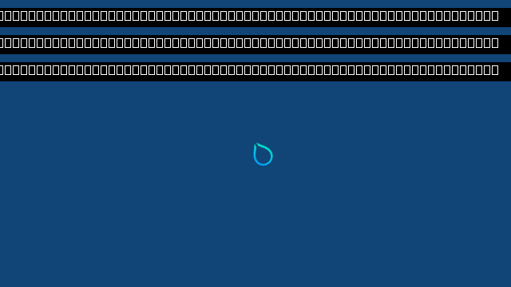

# Repeated Hyprland GPU presentation

Updated 2026-10-15. **Two fresh guests submit twelve actual 640×360 Hyprland
frames each through a bounded GPU staging ring.** Ten ordinary frames per run
have no CPU readback or upload. The first and twelfth frames are copied from
the native window backbuffer for auditing. This advances the experimental
presentation path; it does not complete a desktop acceptance gate.



This is the actual frame-12 GPU readback, decoded from BGRX to opaque RGB without
resizing or recoloring. It is not an OS screenshot or a complete Omarchy scene.
The later startup warning banners show missing-font placeholders. The first
blue frame exactly matches the earlier native-window capture; the later frame
differs as Hyprland redraws its cursor and warning overlays.

## Implementation

The Windows presenter owns its UI thread, D3D12 device, two queues, two retirement
fences and three staging textures. It caches at most three imported compositor
textures. Ingress waits for the exported producer fence, copies into a free GPU
slot and returns the source to COMMON. Its acknowledgement follows GPU copy
retirement, so the guest can safely reuse that source. No Windows presentation
or display-statistics wait runs on the ingress thread.

The UI thread copies staging textures to the waitable flip-discard swapchain,
services Windows messages and presents independently. Slot reuse waits on the
previous output copy's GPU fence. At most three frames occupy staging slots;
full capacity returns retryable backpressure without spending an audit attempt.
Only two explicitly requested frames may allocate/map an audit readback buffer.
Shutdown drains submitted work, joins the UI thread and closes both owned events,
the latency handle, window, GPU resources and imported source references.

The extra GPU staging copy and synchronous ingress-copy acknowledgement remain.
This is not a zero-copy path or a performance result. Dimensions are fixed for
the lifetime of this experimental presenter; resize and device recovery remain
unfinished. The overall profile-4 command/request budgets remain finite.

Protocol validation checks negotiated capabilities, owned resource and fence
tickets, trusted physical-adapter identity, metadata, frame sequence and native
replies. The older two-capture path cannot be mixed with queued presentation.
Concurrent Windows receipts use a C++17 line buffer so UI/ingress writes cannot
interleave inside a JSON record. A 4,000-line concurrent regression checks that.

## Retained outcomes

The [immutable evidence](evidence/HYPRLAND-QUEUED-PRESENTATION-DEVELOPMENT-2026-10-15.json)
pins each build, guest manifest, source and raw capture. These are development
working-tree runs based on b0003d2, not clean-revision product acceptance.
Private vendor binaries and guest images stay local.

| Run | Outcome |
| --- | --- |
| 33 | Sandboxed QEMU launch cannot establish QMP. No compositor result accepted. |
| 34 | Three GPU submissions and native cleanup pass, but the controller fails its twelve-frame target and exits 125. Retained as rejected. |
| 35 | All twelve submissions, both scoped pixel audits and explicit cleanup pass. Final display statistics stay on count 4; final-frame display remains unverified. |
| 36 | All twelve submissions, both scoped pixel audits and explicit cleanup pass. Final display statistics reach count 12 with matching PID/swapchain and timing. This verifies the final frame, not independent scanout of every frame. |

The original controller forked `hyprctl` inside Hyprland, whose child reaper could
collect the helper before its `waitpid`. The revised mode uses the same socket
protocol as the [pinned upstream client](https://github.com/hyprwm/Hyprland/blob/efb50993780079460b0cbed1363e2166a2de1d9f/hyprctl/src/main.cpp).
It requests `decoration:rounding 0`, which explicitly damages monitors in the
[pinned command handler](https://github.com/hyprwm/Hyprland/blob/efb50993780079460b0cbed1363e2166a2de1d9f/src/debug/HyprCtl.cpp).
Repeating `misc:background_color` alone does not request that repaint.

The original two-capture background region includes late startup warning banners
in frame 12 and correctly rejects it. That failure and raw pixels are retained.
The repeated-frame auditor explicitly checks the conservative known-background
regions y=128..159 and y=280..359: **71,680 reference pixels per audited frame**.
The expected RGB comes from the pinned configuration. Native/file hashes cover
every captured byte; text, cursor and full-scene pixel correctness remain
unverified. One summary shares a serial line with a shim diagnostic; its prefix
is retained, with one exact successful summary and twelve complete frame replies
required by the auditor.

Final runs retain 16/17 compositor commits and 56/59 retired guest GPU commands.
All 28/29 sync-files, 74 native buffers, 142 fence mappings, 178 allocation
mappings, 204 allocation slots and 320 broker views release before VM exit.
The native UI thread joins and its objects close in both runs. Peak guest
allocations reach 253/256; there is little capacity headroom for a real session.
Peak queued frames is one in these runs, so actual saturation/backpressure has
protocol coverage but has not been exercised by this hardware workload.

## Verification and distance to the desktop

Default and 4K-lab MSVC builds, strict GCC/C11 checks for all startup modes,
protocol ownership/reply regressions and concurrent log checks pass. The retained
evidence regression suite rejects unretired copies, readback on ordinary frames,
wrong sequences/identities, altered pixels, missing frame waits and incomplete
thread/handle cleanup. Display observations cannot upgrade submission into an
all-frame display claim.

```sh
python3 experimental/windows-native-gpu/verify_hyprland_queued_presentation.py \
  --report RUN/driver.json --expected-background-rgb 114477 \
  --output RUN/queued-audit.json
```

We have a real Hyprland renderer and experimental Windows output. A complete
Omarchy frame still needs its fonts/theme/configuration and real app surfaces,
independent guest GPU-client ownership, and integration into the normal Windows
launcher. Continuous resource budgets, input, resize/fullscreen, recovery,
compositor 4K and matched native performance are further acceptance work.
CUDA, Vulkan, video and NVIDIA-specific features have separate uncompleted gates.
The counts stay **4/8 verification stages and 0/4 desktop gates**. They measure
checklist acceptance, not remaining engineering time; there is no reliable ETA yet.
