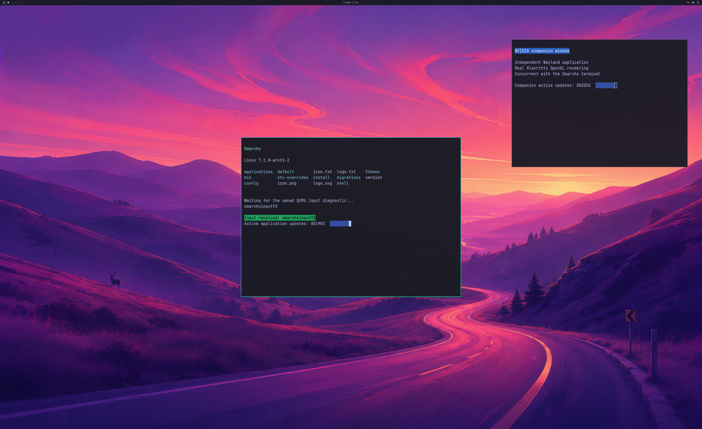

# Controlled alias refusal during real GPU rendering

Updated **2026-10-23**. Two fresh guests recover from one explicitly injected
resource-alias refusal, retry the **same GPU resource**, and complete **1,800
NVIDIA desktop handoffs** with two application windows. Complete first/final
source and SDL pixels, input response, resizing and live native cleanup pass.
**The injection occurs in the guest before the native alias call. Recovery
after an actual Windows-native quota refusal remains unverified.**

This is the losslessly encoded **2560×1566 SDL pre-swap backbuffer**, derived
from a complete **3840×2160 NVIDIA GPU source**. It shows the shipped Omarchy
wallpaper, Quickshell bar and two readable application windows. Physical 4K
scanout and uninterrupted display of every intermediate frame are unverified.

## What was exercised

The [previous correction](LIVE-ALIAS-CAPACITY-RECOVERY.md) preserves an
authenticated broker connection after `ENOMEM` / `ENOSPC`. A separate compile
flag now arms one test-only resource refusal after 100 successful native GPU
frame acknowledgements. It is restricted to the authenticated compositor;
sync aliases remain unchanged. The next qualifying resource import receives
`ENOMEM` **before** calling the Windows-native alias backend.

The trace records that origin, the refused donor and source ticket, the
accepted-frame boundary and the still-live descriptor ledger. The resource
is not published, released or replaced by the injection. The compositor
reports one real `EGL_BAD_ALLOC`, then successfully aliases that exact resource
and continues real GPU work. No completion fence is fabricated.

| Attempt | Result retained in the archive |
| --- | --- |
| Guest build 131 | Source-map guard fails before compilation or GPU startup. |
| Run 151 / guest132 | 1,800 handoffs, complete source/SDL copy pixels and clean native teardown. **Not accepted:** an inherited snapshot label incorrectly described the pre-native injection as native. |
| Run 152 / corrected guest133 | **Pass:** refusal after handoff 156; same-resource retry; 1,644 subsequent GPU handoffs; 1,800 total over 36.85 seconds. |
| Run 153 / guest133 | 1,800 handoffs and clean teardown, but **rejected by the unchanged wallpaper oracle**. Visual inspection identifies an actual Omarchy calendar popup over the fixed probes. Its physical input trigger is unknown. |
| Run 154 / unchanged guest133 | **Pass:** refusal after handoff 153; same-resource retry; 1,647 subsequent GPU handoffs; 1,800 total over 34.13 seconds. |

The run-153 calendar is an unexpected UI overlay, not evidence of corrupted
GPU pixels. All 601 predetermined wallpaper probes remain in use: 20 exceed
the existing error threshold, so the run stays rejected. No post-hoc calendar
mask, changed input action or relaxed pixel threshold is introduced.

Both accepted runs pass complete first/final 3840×2160 GPU source and SDL
window pixel comparisons, with maximum channel error **1** against the
unchanged tolerance **2**. They also pass four focus checkpoints, independently
changing application counters, the existing QMP input/resize workload, seven
live child retirements and terminal compositor retirement. Native work drains
before natural VM exit, with no forced stop or retained mappings.

The renderer is the **NVIDIA GeForce RTX 5090 Laptop GPU through D3D12**, using
the matching private NVIDIA 621.01 runtime. Instrumented CPU handoff intervals
are median **17.26 / 17.01 ms**, p95 **42.96 / 40.43 ms**. These are not displayed
FPS, physical input latency, GPU execution timing or matched-native results.

## Scope and reproducibility

The ordinary CPU384 broker is **byte-identical** to the previously tested
guest130 broker (`c6bced9d…ca54b8`) and contains no injection marker. Only the
explicit diagnostic build includes the fault. Strict state/build controls
reject missing opt-in, zero and out-of-range thresholds. Native86, kernel,
renderer actions, source disk and all resource guards remain fixed: CPU384,
1 GiB GPU usage and 16 recipient references per actor. Official Windows/QEMU
keyboard/cursor code and the launcher reserved-key route are unchanged.

[Lossless traces, complete reconstructable captures, exact compile sources and all attempts](evidence/OMARCHY-INJECTED-ALIAS-GPU-RECOVERY-2026-10-23.json)
are checked by a [separate injected-fault auditor](../experimental/windows-native-gpu/verify_injected_alias_gpu_recovery.py).
The archive is **28,001,710 bytes / 90 new blobs**, SHA-256
`d54bc56bdce0f0be8f11fa2550b255758c7eacb404adcd9551062cfdf1b85bdf`.
Its hash-pinned base archives retain older evidence without duplicating it.
No proprietary driver binary, guest disk or compiled module is published.

The frozen ordinary two-window auditor is unchanged and still rejects the
injected guest. The separate auditor permits exactly the validated one-shot
fault while preserving the complete pixel, fence, input, lifetime, ownership,
budget and cleanup checks. Its corruption controls reject software texture
upload, cleanup deferred until VM exit, a missing exact-resource retry,
mislabelled native origin and additional driver/EGL errors. The two
nonaccepted observations are independently replayed as nonaccepted.
[Validation output](evidence/INJECTED-ALIAS-GPU-RECOVERY-VALIDATION-2026-10-23.txt)
retains these checks and the strict compile/state controls.

## Remaining work

The natural run-144 **16-reference admission failure** remains unresolved.
This guest-side injection exercises compositor/resource recovery through the
corrected IPC path, but does not exercise native quota rejection or establish
that the original failure is fixed. No resource limit is raised by this work.

Backend verification stays **4/8**, desktop product acceptance **0/4** and
diagnostic scene coverage **3/3**. Normal account/device/launcher startup,
continuous multi-window use, physical input/display acceptance, broader APIs
and **≥93% matched-native performance** remain required. All updates stay in
**[PR #2](https://github.com/7Wdev/try-omarchy-windows/pull/2)**.
