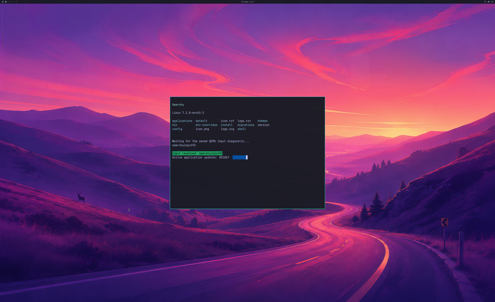

# Managed residency and GPU address accounting

Two fresh Omarchy guests using an opt-in residency backend complete **1,800 GPU
handoffs each**, with full first/final 4K source and SDL pixel checks, rendered
input response, five application lifecycles, three resize phases and live
cleanup. The host retains real residency references while allocations remain
CPU-mapped or GPU work is pending. Guest eviction/reuse transfers ownership;
native reclamation waits for unmapped pages and retired work.

This is the actual **2560×1566 SDL pre-swap backbuffer**, decoded and oriented as
RGBA. Its complete **3840×2160 GPU source** matches the guest buffer exactly.
The shipped wallpaper, bar, readable application, green PTY input response and
active counter are present. Maximum channel error against an independent full
GL_LINEAR reference is one, under the unchanged tolerance of two. Physical 4K
scanout remains unverified.

| Bounded observation | Run 131 | Run 132 |
| --- | --- | --- |
| Stream duration | 32.873 s | 32.193 s |
| Median steady CPU handoff interval | 16.782 ms | 16.748 ms |
| p95 steady CPU interval | 29.335 ms | 20.594 ms |
| Deferred references | 47 | 45 |
| References reused without another native admission | 3 | 2 |
| References reclaimed after unmapping/retirement | 44 | 43 |
| Native eviction batches | 11 | 10 |
| Retained references after cleanup | 0 | 0 |
| Peak reported GPU usage | 967,409,664 B | 961,576,960 B |

The auditor replays every retained-reference transfer and compares it with the
native cleanup counters. Both runs verify 1,798 ordinary GPU-only handoffs, two
diagnostic captures, independent producer/consumer fences, output detach before
the final guest reply, and natural VM exit with no deferred native/backing
mappings. The signed installed NVIDIA driver and private vendor libraries match
621.01 before and after. The source disk is read-only, with writes in a RAM
overlay and a disposable UWSM/PAM account.

These fixed-window CPU measurements include scheduling and instrumentation.
They do not establish GPU execution time, displayed FPS, physical input latency
or ≥93% matched-native performance. Both p95 values exceed a 60 Hz frame period.
Only one application is visible at a time; simultaneous windows remain pending.

## Why residency ownership changed

The earlier budget prototype returned busy when the guest evicted a CPU-mapped
allocation's last reference. The new backend keeps that real native reference
under host ownership. A later guest MakeResident can reclaim the reference
without another native residency call. Actual Evict requires all tracked GPU
work to retire and the allocation to have no CPU lock or VM mapping. A partial
native list failure leaves ownership uncertain and stops the owned VM before
teardown; it is not treated as a successful recovery.

The default backend retains its existing last-reference rejection. The new
backend requires `--driver-deferred-residency` in the explicit high-resolution,
read-only-root SDL coordinator. Repeated logical transfers use a bounded live
reference count rather than exhausting the legacy 64-attempt lifetime limit.
Strict C++ controls exercise 100,000 ownership transfers and 1,000 wire-level
eviction/reuse cycles, overflow, uncertain ownership and unchanged legacy guards.

Windows documents that residency references govern eviction and that accessing
an allocation after eviction is queued is illegal. The CPU mapping protection
is therefore retained. [D3DKMTEvict](https://learn.microsoft.com/en-us/windows-hardware/drivers/ddi/d3dkmthk/nf-d3dkmthk-d3dkmtevict).

## Separate addresses from physical residency

Two initial hardware attempts with the new residency backend still fail:

- **128 / Native80:** reaches 685 handoffs, then a guest GPU mapping failure and
  compositor assertion. Aggregate counters show real reuse/reclamation and
  clean shutdown; the instrumentation cannot replay every ownership transfer.
- **129 / Native81:** reaches 637 handoffs. The host explicitly rejects 8,160
  requested pages with 258,869 already mapped against a 262,144-page ceiling.
  Its complete ledger accounts for 118 deferred references: eight reused and
  110 reclaimed in 39 native batches, with none remaining. The guest mapping
  error and assertion remain rejected; the assertion's complete cause is not
  established.

The original mapped-address quota counts virtual GPU mappings separately from
the reported resident-memory guard. WDDM keeps GPU virtual addresses stable
while their underlying physical memory can change. [GPU virtual memory in WDDM](https://learn.microsoft.com/en-us/windows-hardware/drivers/display/gpu-virtual-memory-in-wddm-2-0).

The new **coordinator object agreement v6** explicitly accounts mappings inside
owned GPU reservations against their existing address capacity: 16 GiB per
actor and 64 GiB across the group. Standalone mappings retain a separate 1 GiB
quota. Both wire and native layers independently check reservation/device
ownership and retain overlap checks. The **1 GiB reported resident usage** and
**192 MiB CPU mapping** guards are unchanged. Older agreements retain their
original address-accounting rules, and a backend without the new residency
support rejects v6.

The private v6 payload changes only `guest-graphics-broker` and
`linux-ioctl-bridge.so` from the earlier current-driver payload. The guest
controller is compiled with `WDDM_BRIDGE_MANAGED_GPUVA=1`. Shader/rendering and
official QEMU input code, the GPU diagnostic workload, vendor libraries, source
disk and instrumented QEMU artifact are unchanged.

**Extended-address stress acceptance remains open.** Neither successful v6
desktop run crosses the old aggregate virtual mapping ceiling: peaks are
847,695,872 and 848,744,448 bytes. Ownership and quota arithmetic controls pass,
but the strict extended-boundary auditor rejects these runs as insufficient
coverage. Their bounded rendering audits explicitly select the narrower frame
scope and retain `extendedVirtualMappingBoundaryAccepted=false`. They do not
prove that sustained pressure recovery or the earlier assertion is fixed.

## Retained controls and next work

Run **130** uses the unchanged Native77 binary and reaches 1,800 handoffs, but
its controller fails a post-run source guard after the checkout changes during
the test. Its original records remain retained without rendering certification.
The subsequent v6 controllers verify frozen guest and host compile inputs, so
the live checkout can evolve without invalidating those checks.

**487 distinct local milestone checks are validated:** 479 regression checks
and eight new evidence replays/rejections. The first regression invocation has
four access-denied errors in the sandbox's redirected temporary directory;
rerunning the affected modules with a workspace-owned temporary directory
passes all six module tests, including those four. Test logic is unchanged and
the original failed invocation is retained. Strict MSVC default/4K builds,
portable C++ ownership/accounting/negotiation controls and CLI guards also pass.

[Lossless evidence](evidence/OMARCHY-MANAGED-RESIDENCY-2026-10-22.json), SHA-256
`cd0e4d31d46a2df23624acb15f2e5cfe7ab2344da19b7782e74679075d34b0c4`,
retains all five hardware attempts, raw traces, complete captures, exact native
and guest source archives, build/control logs and controllers. Proprietary
libraries, disks and initramfs are excluded. Older evidence and auditors retain
their original pins.

Backend stages remain **4/8**, desktop product gates **0/4**, scene elements
**3/3**. Required work includes controlled extended-address and memory-pressure
stress, normal device/account/launcher integration, official physical input,
continuous multi-window display, recovery, broader OpenGL/Vulkan/CUDA/video,
DLSS and hardware ray tracing workloads, and ≥93% matched-native performance.
