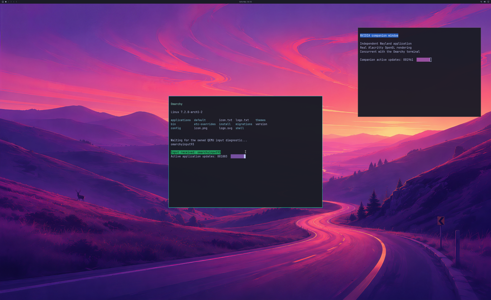

# Per-validation metadata and complete GPU receipts

Run **162** passes the bounded two-application desktop regression on the real
NVIDIA backend: **1,800 handoffs over 32.16 seconds**, complete first/final
3840×2160 source pixels, complete SDL window pixels, four focus checkpoints,
independent application counters, input response, resizing and live native
cleanup before natural VM exit. This is one fresh compatibility run, with the
unchanged Native86 binary, kernel, workload and resource guards.



Actual **2560×1566 SDL pre-swap backbuffer**, from the complete **3840×2160 GPU
source**. Both applications use OpenGL on D3D12/NVIDIA. All source bytes match
the native GPU captures; maximum full-window channel error is **1**, below the
unchanged tolerance of **2**. The other 1,798 ordinary handoffs use GPU buffers
without CPU texture upload/readback. Physical scanout and continuous display
of every intermediate frame remain unverified.

## What changed

`Aperture::info()` fetched the same immutable capacity and coordinator agreement
several times during one validation. It now fetches each at most once **within
that call**. Every invocation still fetches fresh mutable layout/counter data;
there is no persistent cache, new ABI, quota change or ownership shortcut.

Real authenticated Unix IPC controls, with the client running as UID 65534,
exercise six valid validations, including four concurrent callers. Before the
change they issue **30 capacity + 24 agreement requests**; afterward they issue
**6 + 6**. Both retain seven fresh layout requests, including the connection
handshake. Default and CPU384 builds pass malformed-layout/agreement and closed
channel controls. Kernel/native replies are mocked in these controls.
**77.8% fewer immutable-metadata requests is not a measured rendering speedup.**

The first GPU compatibility attempt, run **161**, completes all 1,800 GPU
handoffs and full copy-pixel checks, but its strict desktop audit rejects it.
Receipt 1448 joins an unfinished journal prefix, leaving only 1,799 anchored
handoff receipts. Its original trace remains intact and nonaccepted.

Future queue-result, end-ack and timing receipts now start with a newline and
use a single bounded FIFO write. A real concurrent-writer pipe test reproduces
the old prefix collision and validates 2,000 ordered receipts, malformed-line
rejection and write-error propagation. The new fixture generator changes only
diagnostic receipt writing. It preserves the rendering/application workload and
official input code; the historical generator and strict auditors are unchanged.
Run 162 passes those same audit criteria, with only exact candidate pins updated.

## Memory-pressure failures remain open

Earlier calendar-action diagnostics **159/160** stop after **851/953 handoffs**
when reported native GPU usage reaches **1,085,448,192 / 1,090,838,528 bytes**,
above the unchanged **1,073,741,824-byte** guard after deferred residency.
Native objects are released after VM exit, so these runs fail live-cleanup and
stability acceptance. Their complete original traces, reports and frozen guest
sources are retained alongside the successful compatibility run.

Run 160 includes the metadata optimization. It still fails under pressure.
Run 162 stays below the guard and does not exercise this failure. **Memory-pressure
recovery, actual native alias-quota recovery and the earlier 16-reference cause
are unresolved.** No guard was raised and no live capability was released to
make a test pass.

## Evidence and reproduction

[Lossless traces, controls, frozen sources and reconstructable pixels](evidence/OMARCHY-METADATA-AND-TRACE-FRAMING-2026-10-24.json)
have SHA-256
`269fd5f50b74bdebbf0b2f0f54daa5025307080bfcca946212c3bf1e4d9c6cc5`.
The actual PNG has SHA-256
`9ddd81d2494c01af6eae113c6d34dbd1617884d250ecf4ae48b6ba76383a3e7d`.
Archives contain source, logs and pixels; proprietary NVIDIA libraries, disks,
initramfs and compiled binaries are excluded.

```sh
python3 -m unittest discover -s experimental/windows-native-gpu -p 'test_metadata_framing_milestone.py' -v
```

The new replay checks include complete GPU pixels/lifetimes, the retained real
trace rejection, missing future receipts, corrupt pixels, cleanup after VM exit,
metadata request counts and retained pressure failures. Strict Linux builds and
real IPC/pipe controls are also included in the native GPU workflow.

Progress remains **3/3 diagnostic scene elements, 4/8 backend stages and 0/4
desktop product gates**. The disposable UWSM/PAM account, RAM overlay and
compositor hook are diagnostic fixtures. Normal account/device/launcher
integration, physical input/scanout, continuous stability, broad APIs, DLSS,
hardware ray tracing and ≥93% matched-native performance remain unverified.
All updates stay in **PR #2 / windows-nvgpu-lab**.
