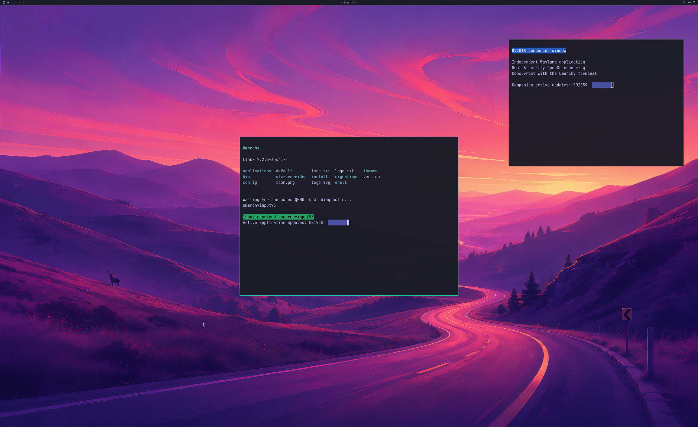

# Two NVIDIA applications in the 4K desktop fixture

Updated **2026-10-23**. Two fresh guests each complete **1,800 GPU handoffs**
with the shipped wallpaper, Omarchy bar and **two readable Alacritty windows**.
Both independently audited runs pass complete first/final source and SDL pixels,
four focus checkpoints, changing application counters and live native cleanup.
An earlier intermittent **16-reference admission failure remains unresolved**.
This is a bounded experiment; normal launcher and desktop product acceptance
remain incomplete. All changes stay in **PR #2**, on `windows-nvgpu-lab`.

Actual **2560×1566 QEMU SDL pre-swap backbuffer**, from a complete
**3840×2160 NVIDIA GPU source**. Each application's authenticated process logs
OpenGL 3.3 on D3D12 (NVIDIA GeForce RTX 5090 Laptop GPU). The source/window
comparison covers every pixel, with maximum channel error **1**, below the
unchanged tolerance of **2**. Physical 4K scanout is unverified.

## Explicit capacity agreement

OpenGL **profile 14 / coordinated objects v9** increases the shared aggregate
CPU mapping guard from **192 to 384 MiB**. The guest requires
`enable_multiapp_cpu=1`, the full desktop layout and expanded lease negotiation;
mixed flags, extents and byte limits are rejected. Profiles 1–13 and earlier
object agreements retain their original limits.

The **1 GiB reported GPU usage guard**, 1 GiB standalone mapping guard, owned
64 GiB virtual reservation limit, 64 hardware queues, 768 sync objects, 1,536
lease records and per-actor **16-reference** caps remain fixed. CPU mappings are
shared across actors, not multiplied per application. The CPU increase is a
capacity change, not a performance optimization or physical GPU partition.

The window actions, primary input workload and rendering code are unchanged
from the frozen two-application fixture. New generators only select profile 14.
The Windows/QEMU keyboard/cursor implementation and launcher reserved-key
route are unchanged. Focus checkpoints use Hyprland IPC; they do not establish
physical input acceptance. The existing isolated QMP input-response test passes.

## All attempts retained

| Run | Actual observation | Native cleanup |
| --- | --- | --- |
| 143 | Kernel passes 4,717 controls and negotiates CPU384; broker rejects the new request extent before GPU work. Extent validation is fixed and covered by malformed-request tests. | Verified |
| 144 | Two applications run for **1,113 handoffs**. The compositor reaches **16/16 resource references** while only 582/1,024 wire objects are live. Native alias admission fails, followed by EGL/Wayland/compositor failure. | **Not verified**; fatal owner and owned QEMU are reaped with objects retained in the native ledger |
| 145 | **1,800 handoffs / 33.52 s**, four focus checkpoints, two counters, full pixels, five primary application lifecycles plus companion retirement. | Verified before natural VM exit |
| 146 | Independent repeat: **1,800 handoffs / 33.03 s**, same complete checks. | Verified before natural VM exit |
| 147 | Frozen v6 one-application guest on the same new native binary: **1,800 handoffs / 32.92 s**, full pixels/input/resize/cleanup. Actual CPU limit remains **192 MiB**, with 768 leases / 32 queues / 384 syncs. | Verified before natural VM exit |

Runs 145/146 peak at **216,023,040 / 212,221,952 CPU bytes**, exceeding the old
201,326,592-byte guard. The exact residency ledger replays **58 / 9** deferred
references, including **6 / 3** reuses, with none left. All fence/allocation
mapping acknowledgements precede VM exit. Seven non-primary actors retire
while the compositor is live; the companion closes while the primary remains
mapped. These runs do not exercise the extended virtual mapping boundary.

Median instrumented CPU frame intervals are **16.96 / 17.17 ms**, p95
**24.71 / 22.18 ms**, with zero queue retries. The inherited timing windows
include the last focus checkpoint. These are CPU handoff intervals, not
displayed FPS, physical input latency, GPU execution time or a matched-native
performance comparison.

Run 144's precise FD-lifetime cause is unconfirmed. The broker now records a
bounded capability snapshot after native alias refusal; neither successful
repeat triggers it. No reference quota is raised and no live capability or GPU
fence is discarded. Process reaping is not proof of clean native retirement.

## Evidence and checks

[Lossless traces, complete reconstructable pixels and frozen compile sources](evidence/OMARCHY-MULTIAPP-CPU384-2026-10-23.json)
are replayed by the independent [CPU384 auditor](../experimental/windows-native-gpu/verify_multiapp_desktop.py).
Earlier auditors, failed evidence and pins remain unchanged. Native85 is retained
as a source-review exclusion: two profile gates were missing; it was never run
against the GPU. Native86 includes those gates. A first portable harness used
the 4K macro with small default wire fixtures; its assertion is retained, and
the corrected per-test build profiles pass. An initial archive omitted the raw
trace extension; replay rejected it, and the complete archive supersedes it.

Strict default/4K MSVC builds, six portable controls, all five broker build
modes, profile-14 extent/lease validation, the GCC16 guest kernel build and
**511 existing milestone/generator checks** pass. The routing unit controls
pass; the root-required Unix RPC portion was skipped locally. New archive
replays additionally cover both failures, both full two-application captures,
legacy limits and evidence corruption. [Validation output](evidence/MULTIAPP-CPU384-VALIDATION-2026-10-23.txt).

The source disk is read-only, with writes confined to a disposable RAM overlay.
Frozen source inputs, exact compiled hashes, QEMU/SDL artifacts and the signed
installed NVIDIA 621.01 runtime are checked. Proprietary libraries, initramfs,
disks and compiled executables/modules are excluded from the public archive.

## Remaining work

Resolve the intermittent reference failure and verify bounded recovery; extend
continuous rendering, memory pressure and concurrent host/guest use; integrate
normal guest device/account/launcher startup and verify official physical
input, displayed cadence and scanout. Broad OpenGL, Vulkan, CUDA, video, DLSS,
hardware ray tracing and **≥93% matched-native performance** remain unverified.
The seeded UWSM/PAM account and compositor hook are diagnostic fixtures.
Counts remain **scene 3/3, backend 4/8, desktop product 0/4**.
