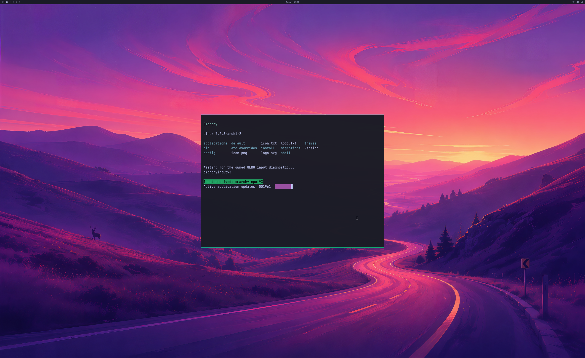

# Two-application admission investigation

Updated **2026-10-23**. The new simultaneous-application workload is **not
accepted**. The candidate initializes the second application's real NVIDIA
OpenGL renderer, then exhausts the existing CPU mapping budget and fails native
cleanup verification. Five rejected attempts and a separate successful legacy
desktop regression are retained. Development remains in **PR #2**; these changes
are not published to `master`.

## Actual compatibility frame

This is the actual **2560×1566 QEMU SDL pre-swap backbuffer** from a complete
**3840×2160** NVIDIA-rendered guest source. It shows the existing one-application
fixture, not the rejected two-application workload. Physical display ownership
and physical 4K scanout remain unverified.

## Observed failures

| Run | Agreement | Observed result | Native cleanup |
| --- | --- | --- | --- |
| 137 / 138 | v6: 768 leases, 32 queues, 384 syncs | Kernel view creation returns ENOSPC before frame one. The exact admission cause was not captured. | Verified |
| 139 | Same v6 | An atomic snapshot at the failing admission shows **768/768 leases**, 177,459,200 CPU bytes below the 192 MiB limit, and no CPU-byte or cookie exhaustion. | Verified |
| 140 | v7: 1,536 leases, original queue/sync limits | The wider lease contract passes 4,716 boot checks. The host reaches **32/32 hardware queues** and records one queue quota rejection. Rollback also encounters the existing CPU-view ownership guard. | Verified |
| 141 | v8: 1,536 leases, 64 queues, 768 syncs | The companion initializes OpenGL on **D3D12 (NVIDIA GeForce RTX 5090 Laptop GPU)**. Four CPU-byte admissions are rejected; peak mapping is **201,293,824 / 201,326,592 bytes**. No desktop frame completes. | **Failed** |

Run 141 exits the owned VM naturally, but leaves **3 pending hardware-queue
signals, 8 pending GPU waits**, native objects and CPU mappings in the host
ledger. QEMU releases mappings after VM exit. The host exits with status 1.
Process exit is not evidence that the bridge verified native retirement or OS
cleanup. This failure remains open; the earlier successful controlled
[SDL failure teardown](LIVE-SDL-FAILURE-TEARDOWN.md) covers a different case.

Boot contract tests intentionally exhaust both lease and CPU-byte limits. Those
faults are distinguished from the runtime failure; a boot fault alone cannot
establish the cause of application failure. The new bounded journal replay
captures admission snapshots taken under the kernel admission lock.

## Implemented contracts

Both new agreements are explicit opt-ins for the existing experimental 4K
coordinated profile. They retain the **1 GiB reported GPU usage guard, 192 MiB
CPU mapping guard, 512 fence slots and 1,024 sparse allocation slots**.

- **v7** negotiates 1,536 lease records for the existing fence/allocation slots.
  The guest module requires `enable_desktop_leases=1` and the full desktop
  layout. Legacy coordinated guests keep 768 records.
- **v8** adds object records for all four already-supported actors: 64 hardware
  queues and 768 sync objects, derived from the existing per-actor bounds.
  The active actor count and physical byte guards are unchanged.

Guest/host agreement checks reject mixed versions, limits and unsupported
backends. The kernel contract closes recipient file descriptors while keeping
controller leases alive, so the 1,536-record boundary can be tested within the
normal descriptor limit. Module option assembly now checks its buffer bounds.
No renderer or official Windows/QEMU input implementation is changed.

## Legacy desktop regression

**Native84 with the frozen v6 guest, run 142**, passes 1,800 handoffs over
**33.51 seconds**. Independent validation checks:

- Complete first/final 4K source pixels and every scaled SDL backbuffer pixel;
  maximum channel error **1**, unchanged tolerance **2**.
- Shipped wallpaper, Omarchy bar, readable application, five launch/close
  lifecycles, three application sizes, existing QMP input response and UWSM/PAM
  session metadata.
- 1,798 ordinary GPU-only handoffs, producer/consumer fences through 1,800,
  live SDL detach, all native objects and mappings retired before natural VM
  exit, and unchanged read-only source disk and installed driver snapshot.
- The actual agreement remains **v6 / 768 leases / 32 queues / 384 syncs**.
  The candidate's support for v8 does not increase the legacy workload's limits.

This run replays 52 deferred residency references through reclamation with none
left. It exercises **zero reference reuse** and does not cross the extended
virtual mapping boundary. Its separate compatibility auditor reports those
coverage limits; historical residency/pressure auditors and their acceptance
rules are unchanged. Median instrumented frame interval is **16.98 ms**, p95
**27.49 ms**. These CPU timings do not establish displayed FPS, physical input
latency, or ≥93% matched-native performance.

## Reconstructable evidence and remaining work

[Evidence archive](evidence/OMARCHY-MULTIWINDOW-ATTEMPTS-2026-10-23.json), SHA-256
`9e642fdaaf7aea75a5a8c6ed0c0b1a51c63d35022ce959d246b79e0589f2e0b6`,
contains complete raw traces, controller records, exact compiled source inputs,
build logs, failed attempts and reconstructable legacy pixels. Proprietary
libraries, disk images, initramfs and compiled binaries are excluded.

Strict MSVC default/4K builds, portable protocol/coordinator controls and the
guest module/contract builds pass. **501 broader regression tests and seven new
evidence replay checks pass locally**. Both Native84 variants reject all six
incomplete residency opt-ins before GPU/VM startup. Replay tests require the
recorded failures to remain rejected and prevent relabelling run 141 as clean.
[Original local test output](evidence/MULTIWINDOW-VALIDATION-2026-10-23.txt).

Next: design an explicitly negotiated CPU mapping capacity for the measured
multi-application workload and verify recovery from admission failure without
releasing resources still used by GPU work. Then require repeated simultaneous
window rendering, focus/resize/close checks and complete source/window pixels.
Normal account/device/launcher integration, long-run pressure, physical input
and scanout, broader APIs, DLSS/ray tracing and matched-native performance remain
open. Progress remains **backend 4/8, desktop product 0/4, diagnostic scene 3/3**.
