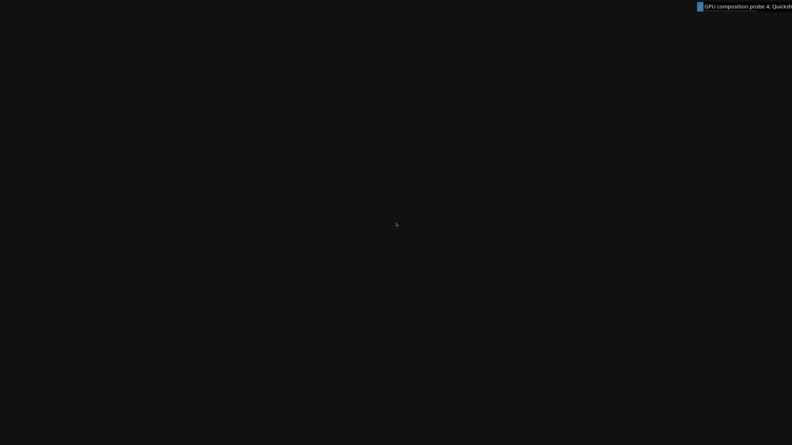

# Explicit presentation memory admission and clean 4K compositor shutdown

Two fresh read-only Omarchy guests each submit twelve **3840×2160 NVIDIA
Hyprland frames**, verify the complete first/last native backbuffers and shut
down normally. All GPU mappings release explicitly before VM exit. This fixes
the reported-usage failure exposed by the earlier version-9 capture, within a
distinct opt-in contract. **Quickshell is still absent; full Omarchy desktop,
normal launcher and reliable all-frame display acceptance remain unfinished.**

Actual frame 12 from the final run, decoded from native BGRX bytes without
resizing, cropping, recoloring or generation. The cursor and diagnostic
notification are visible; there is no Omarchy wallpaper/bar.

PNG SHA-256: `9a21cdc320cd71e9bfae138d6a8b523c5226926f337904f11f7907688098769d`.
Source dense BGRX SHA-256: `87ede4b513379c1061535169403cf06040cb7badea65f4fdaa9c43c0ba209e3c`.
Each raw capture contains exactly **33,177,600 bytes**. Native GPU copy-fence,
file and independently recomputed pixel digests agree.

Version 10 carries a fixed **48-byte** request: the existing explicit kernel
capacity fields (192 MiB CPU, 512 allocation slots, 256 fence slots, ABI 1),
the 1 GiB GPU-VA alias-mapping limit and a separate **1 GiB process-reported
GPU guard**. The broker checks its own kernel before forwarding; the shim,
wire session and native owner require the exact request. Missing, old-size,
unknown or altered contracts are rejected. Versions 1–9 retain their published
formats and budgets, including version 9's 512 MiB reported-usage guard.

The presentation path now checks process usage around device creation, all
three staging textures, the readback allocation and two swapchain buffers.
Native allocation information supplies heap-size estimates for admission;
imports and frames are checked before accepting work. Imported sources are
already allocated by the guest, so their full size is not charged twice.
The bounded audit buffer is created during initialization rather than racing
later guest allocations on the UI thread. Ordinary frames still have no CPU
upload/readback; only frames 1 and 12 are read back for verification.

This is an admission guard based on reported usage, **not a hard physical
allocation quota**. Windows' query reports process usage and its current
budget; virtual aliases, residency and opaque driver allocation sizes remain
different accounting domains. See Microsoft's [memory query](https://learn.microsoft.com/en-us/windows/win32/api/dxgi1_4/nf-dxgi1_4-idxgiadapter3-queryvideomemoryinfo)
and [resource allocation information](https://learn.microsoft.com/en-us/windows/win32/api/d3d12/nf-d3d12-id3d12device-getresourceallocationinfo%28uint_uint_constd3d12_resource_desc%29).

| Fresh guest | Frames / retired GPU commands | Peak reported GPU usage | Explicit fence / allocation / slot unmaps |
| --- | --- | --- | --- |
| Run 27 | 12 / 93 | 833,302,528 bytes | 142 / 181 / 269 |
| Run 30 | 12 / 96 | 832,974,848 bytes | 142 / 181 / 269 |
| Run 29, preserved version 5 | 300 / 960 | Within its original 256 MiB guard | 142 / 185 / 213 |

Both 4K runs release all **323 broker views**, complete systemd's supervised
service with status 0 and power off normally. The legacy regression retains
its 96 MiB CPU / 256 MiB GPU budgets, verifies both actual scene captures and
releases all 327 broker views. Its Foot application surface remains software
rendered, while Hyprland composes on NVIDIA. The complete source-image digest
is unchanged in every attempt; disk nodes and the owner's source handle stay
read-only, with writes confined to the bounded RAM overlay.

Two failures remain in the [immutable evidence](evidence/NORMAL-OMARCHY-4K-PRESENTATION-BUDGET-2026-10-16.json).
Run 26 stops at seven frames and reaches its 45-second supervision deadline,
deferring cleanup. Run 28 identifies a **5,312 ms IPC receive timeout** after
seven frames; it completes explicit GPU cleanup but remains a failed workload.
The opt-in full-resolution supervision window is now bounded at 90 seconds;
the IPC startup client uses 15 seconds with timing receipts. Older probes keep
45/5 seconds, and native GPU retirement timeouts are unchanged. The final run
has no control failure and shuts down at about 54.5 seconds of guest uptime.
An object-shaped layers JSON reply is also accepted correctly by the client.

All **351 milestone tests** pass. The dedicated auditors and mutation controls cover exact budgets/provenance,
missing/reordered/denied admission, overflow, heap estimates, hardware copies,
forced exits, pending native work, deferred mappings and broker releases.
Strict default/high-resolution Windows builds, native/broker transport
controls, 105 default CLI rejections, seven high-resolution startup guards
and real Unix credential/FD-lifetime controls pass. Portable GPU/kernel calls
remain explicit mocks; retained compositor captures run on actual NVIDIA/WHPX.

Display statistics still report **2 of 12** in both 4K runs; complete scanout
is unverified. Quickshell's independent GPU connection, shared-FD ownership,
safe abort cancellation from the earlier version-8 failure, normal UWSM/app
integration, input/resize/fullscreen, long runs and recovery remain open.
CUDA, Vulkan, video/NVIDIA features, concurrent host/guest work and **≥93% of
matched native performance** still need real-application acceptance. Counts
remain **4/8 verification stages and 0/4 desktop gates**.
