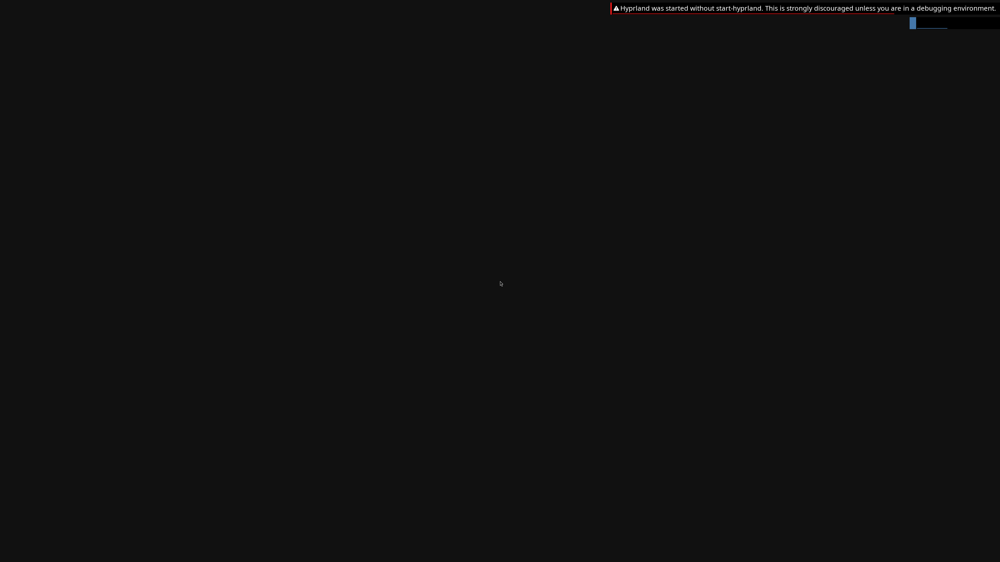

# First native 4K NVIDIA compositor readback

**Two actual 3840×2160 Hyprland backbuffers now pass GPU readback verification.**
This is a compositor diagnostic inside the real read-only Omarchy OS. The
shipped Quickshell bar and wallpaper are absent, reported GPU usage exceeds
its guard, normal shutdown fails and complete display/stability remains
unverified. It is not the requested full GPU-only Omarchy desktop.

The PNG is decoded directly from the native BGRX8888 backbuffer, with its unused
X channel ignored. No resizing, recoloring, cropping or generation is applied.
The warning banner, cursor and changing diagnostic notification are genuine
Hyprland output. The original file is 3840×2160; previews may be scaled by the
viewer. The terminal dense raw SHA-256 is
`d59a2b4f1064ca48d1b01c41c993b3c38cc81ac2e7a6124a9e335a07bc9fcab8`.

## Explicit GPU-VA contract

The separate version-9 request is 40 bytes: the exact kernel CPU/aperture
contract followed by an explicit 1 GiB GPU virtual-mapping limit. It requires
192 MiB CPU maps, 512 allocation slots, 256 fence slots and zero reserved data.
The exported entry point is `wddm_bridge_begin_opengl_desktop_large_map_render`.
The native session, Windows owner, guest shim and authenticated broker validate
the entire receipt. Bare version numbers, old-size payloads and any altered
field fail before negotiation. Versions 1–8 retain their previous budgets and
wire layouts. CPU, reported GPU usage, live object and pending-work limits are
independent; reported GPU usage remains at its previous 512 MiB guard.

The 1 GiB limit accounts for GPU-VA mappings, including imported aliases; it
is not a 1 GiB physical allocation guarantee. The larger mapping budget clears
the [retained version-8 quota failure](LIVE-NORMAL-OMARCHY-SPARSE-APERTURE.md).

## What the hardware run proves

The ordinary UID/GID 1000 compositor uses Wayland-enabled, D3D12-only Mesa and
the genuine NVIDIA Linux runtime backed by the native Windows NVIDIA adapter.
No Qt software override is supplied. The native worker's hardware adapter
selection, immutable executable/input hashes and exact kernel capacity receipt
are retained. Both complete source-image hashes match before and after the run.

Twelve compositor buffers pass the GPU staging/presentation path; the first
and twelfth native backbuffers are read back. Each contains **33,177,600 bytes**.
All producer and copy fences retire before acknowledgement, and native/file
FNV hashes match byte for byte. The other ten frames use no CPU readback and
no CPU upload. Both full-size captures are retained in compressed form in the
[evidence](evidence/NORMAL-OMARCHY-4K-GPU-READBACK-2026-10-16.json).

The dedicated auditor proves this readback scope while keeping full scene,
normal session, Quickshell GPU, desktop, complete display and near-native
performance flags false. Its controls reject stale/truncated data, wrong
geometry, unretired dependencies, CPU uploads, altered budgets and provenance.

## Failed gates remain visible

The presenter reports twelve accepted Presents, while the display observation
reports eight. This does not prove that every frame was displayed. Quickshell's
independent GPU connection fails and its layer metadata is empty. The image
therefore contains Hyprland output without the Omarchy shell.

Reported GPU usage reaches **831,991,808 bytes**, above the unchanged
536,870,912-byte guard; subsequent allocation attempts fail. The host-side
presentation resources contribute to this process-wide accounting and need a
matching, separately bounded policy. A successful readback cannot erase that
resource-control failure. Hyprland's exit request is accepted, but bounded
SIGTERM is eventually needed; 48 fence views and 40 allocation views are
released after VM exit. Native cleanup eventually passes, with all 51 GPU
commands, 34 hardware signals and 21 GPU waits retired. This differs from the
earlier version-8 abort control, which retains unretired waits and still needs
safe cancellation/cleanup work.

A fresh [version-5 regression](evidence/NORMAL-OMARCHY-LARGE-MAP-LEGACY-REGRESSION-2026-10-16.json)
using the new native build passes **300 frames / 948 retired GPU commands** and
the unchanged default 96 MiB CPU / 256 MiB GPU guards. Both native backbuffers
pass the strict scene auditor; all 142 fence views, 181 allocation views and
209 slot maps release before normal shutdown. Its Foot application remains
software-rendered and Hyprland composes on NVIDIA.

All **343 milestone tests** pass, including nine new readback/mutation/regression
controls. Strict default/high-resolution MSVC builds, 105 default CLI rejections,
seven high-resolution startup rejections, exact 40-byte native/broker contract
controls, legacy transport cases and real Unix credential/FD-lifetime checks
pass. Portable native/kernel calls remain explicit mocks; the retained readback
and regression captures use actual NVIDIA/QEMU hardware.

The [later explicit presentation budget](LIVE-NORMAL-OMARCHY-4K-PRESENTATION-BUDGET.md)
passes two fresh 4K compositor runs with normal shutdown and explicit mapping
cleanup. This earlier version-9 failure remains unchanged. The next work is
abort cancellation and independent GPU clients/shared-FD
lifetimes. Full Omarchy assets/apps on GPU, normal UWSM/launcher/input,
sustained display/stability, application APIs and ≥93% matched-native
performance remain open. Desktop acceptance stays **0/4**.
