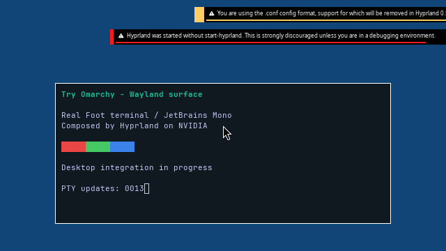
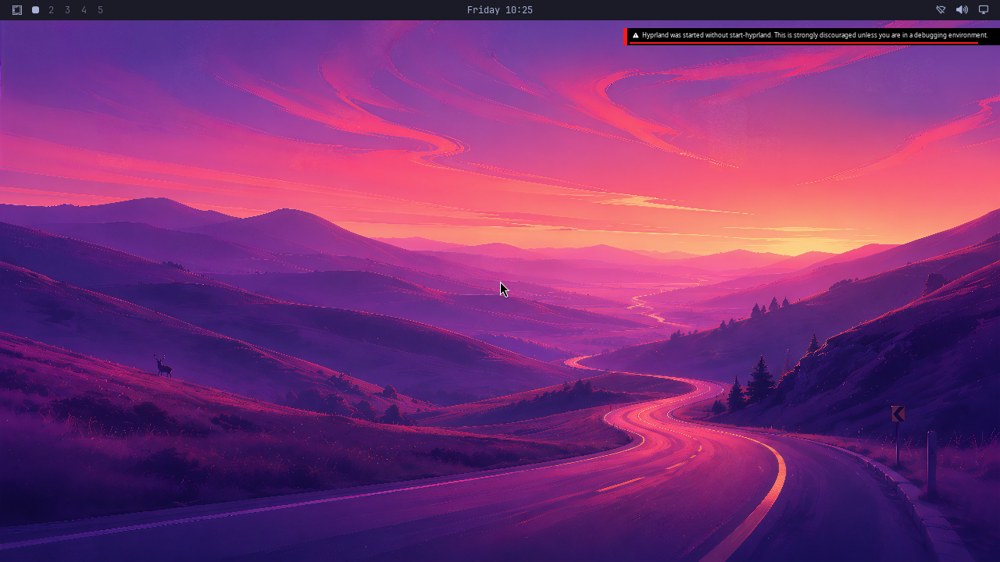

# NVIDIA composition inside the real Omarchy OS

Two fresh QEMU/WHPX guests boot the actual Omarchy 4.0.4 root image and complete
300 frames each through the Windows NVIDIA bridge. Each run retires 948 GPU
commands. The authenticated compositor runs as UID/GID 1000 with no capabilities,
no new privileges, and no access to the broker controller or native transport.
All GPU mappings are explicitly released before normal VM shutdown.

This uses a controlled compositor configuration and a software-rendered Foot
surface. It proves NVIDIA composition inside the real OS, rather than a complete
GPU-accelerated Omarchy desktop. The normal launcher, UWSM session, independent
GPU applications, long-run recovery and performance acceptance remain open.

## First shipped desktop appearance

The shipped user Lua configuration now loads its normal Omarchy modules and starts
Quickshell against a real user manager/session bus. Its real wallpaper and bar
appear at 1280×720 in the native GPU backbuffer:

**Quickshell used Qt software rendering for this appearance diagnostic.** Hyprland
composed it on NVIDIA. This image is not evidence of a GPU-only desktop, 4K desktop
support, stable operation, or presentation in the regular Try Omarchy launcher.
It is decoded directly from native BGRA bytes without resizing or recoloring.
The complete native/file digest agrees. Actual layer metadata identifies
`omarchy-background` and `omarchy-bar` from the same Quickshell process.

The appearance run stops after seven submitted frames when the guest broker
reaches its former unconditional 512-object bound. The Windows desktop profile
already permits 1,024 live objects. The broker now follows only a successfully
observed, exact host profile receipt; identity collisions and over-quota work
remain rejected. Tests cover all four expanded profiles, malformed/duplicate
negotiation, quota exhaustion and reuse after retirement. No host quota is raised.
A subsequent 36-frame diagnostic still times out and defers cleanup; it remains
a failed control. Neither run closes a desktop acceptance gate.

## GPU-only 4K target

The requested next image must be **3840×2160 with both Hyprland and Quickshell on
the GPU**. A software Qt shell or an enlarged earlier image will not satisfy it.
Quickshell's hardware run currently fails EGL Wayland-platform initialization;
the earlier passing private Mesa build has `platforms=[]`. A separate
Wayland-enabled Mesa build now succeeds with the original optimization flags,
without replacing the retained passing runtime. A GCC internal compiler error
is retained; the unchanged failed unit succeeds on retry at lower build
concurrency. Matching Wayland 1.26 tooling and libraries are checksum-verified
against Debian's published package metadata.

The [hardware-only follow-up control](evidence/NORMAL-OMARCHY-WAYLAND-HARDWARE-CONTROL-2026-10-16.json)
gets past platform selection: Quickshell selects D3D12, then fails to open its
independent bridge connection and cannot initialize its graphics context.
No software Qt override is supplied. Hyprland completes twelve 1280×720 frames,
retires 264 GPU commands and releases every mapping before shutdown; the
Quickshell background/bar layers are absent. This remains a **failed GPU desktop
control**, not a 4K result. Four additional tests preserve that distinction,
exact full capture bytes and build provenance. All **313 local milestone tests**
pass after this follow-up.

The broker also admits one authenticated rendering process per native worker.
A real second GPU application needs coordinated native object ownership,
cross-process capability-FD sharing, independent process exit handling and
aggregate resource accounting. Accepting another socket alone is insufficient.
The combined 4K allocation, CPU mapping, fence and synchronization demand must
be measured against the negotiated limits. No GPU-only 4K desktop result is
claimed from the smaller experiments.

## Retained experiments and source protection

[Complete evidence](evidence/NORMAL-OMARCHY-GPU-DEVELOPMENT-2026-10-16.json) retains
all thirteen attempts, including failures, compressed complete serial receipts,
native records, reports, input manifests and actual compressed raw backbuffers.
Successful runs 6, 9 and 10 pass the dedicated real-root scene auditor; all ten
failed controls remain rejected. Twelve additional milestone tests check these
results and independently mutate provenance, read-only policy, privilege,
service exit, cleanup, frame count and capture bytes.
All **309 local milestone tests** pass. Strict default/4K-lab MSVC builds,
the guest C11 builds, concurrent log-line regression and real Unix broker
credential/FD-lifetime tests pass. A fresh [CPU-only boot regression](evidence/NORMAL-OMARCHY-CPU-REGRESSION-2026-10-16.json)
also passes with the optional graphics bundle absent and the source disk unchanged.

The source image is 7,516,192,768 bytes, SHA-256
`3954123192111ce2d28cafb9dd108e1ca14c288bfc2429ed899b0f36aeccf942`.
Every run hashes the complete disk before and after. Both QEMU block nodes are
read-only; the owner holds a read handle denying write sharing. Guest writes
stay in a 512 MiB RAM overlay. Vendor binaries, private runtime and the root image
are not committed or approved for redistribution.

The first attempt omitted the installed NVIDIA DriverStore directory. Restoring
it enabled GPU initialization. Moving from `/tmp` to `/run/user/1000` exposed a
second hardcoded Hyprland control-socket lookup, now shared by readiness and IPC.
Diagnostic serial-getty isolation is confined to the RAM overlay. An earlier
SIGABRT and its nonzero exits are retained; a direct hangup cause is not proven.

Run 7 completed 300 frames with clean retirement but failed receipt validation
when another process's log interleaved with the scene-close message. The producer
now writes each critical message and newline together. Runs 9/10 pass without
loosening that check. A concurrent-process regression exercises 2,000 log lines
and checks that write failure invalidates acceptance.

Counts remain **4/8 verification stages and 0/4 desktop acceptance gates**.
The ≥93% matched-native target, Vulkan, CUDA, video and NVIDIA-specific features
still require their own real-application tests.
