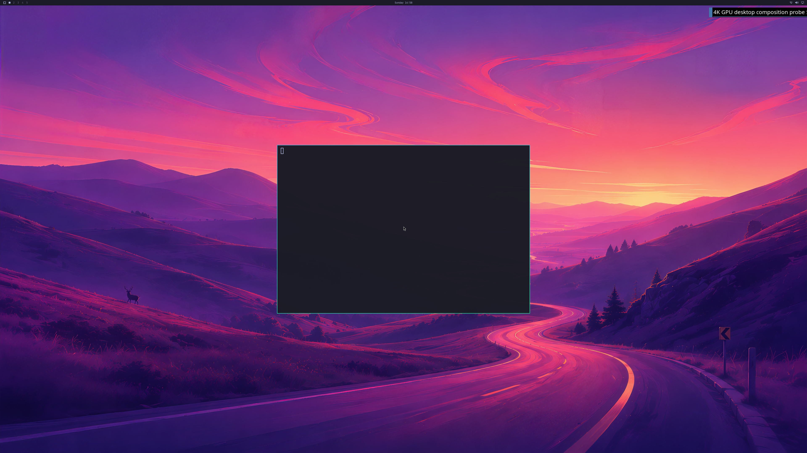

# 4K wallpaper and NVIDIA application surface

Updated 2026-10-19. The actual Omarchy wallpaper, shell bar and an Alacritty
window now appear together in a **3840×2160 GPU framebuffer**. Alacritty reports
`Running on D3D12 (NVIDIA GeForce RTX 5090 Laptop GPU)` and uses its OpenGL
renderer. Quickshell and Hyprland also use NVIDIA. **The terminal text and the
complete desktop lifecycle still fail; this is a partial diagnostic result.**
Counts remain **4/8 verification stages and 0/4 desktop acceptance gates**.

This is run 49, frame 12, converted directly from the native BGRX readback.
No pixels were edited. The terminal body is visibly empty. Its later
`GL_OUT_OF_MEMORY` / GPU-reset messages and forced VM shutdown are retained;
a mapped window alone does not pass the complete-frame acceptance check.
The separate Windows test window remains 1280×720, so this is not a claim
about a physical 4K display or the normal launcher.

## What is verified

The normal Omarchy 4.0.4 filesystem boots under QEMU/WHPX with its source disk
read-only. All guest changes use a bounded RAM overlay. Complete source-image
hashes match before and after every retained run. The fixture selects the
shipped Tokyo Night theme and `0-winding-road.jpg`; it installs an official
Arch Alacritty executable only into the disposable test payload.

Qt originally decoded the 6016×3384 wallpaper into an allocation larger than
the current single-allocation mapping limit. The fixture now sets the three
background/transition Images' `sourceSize` to 3840×2160, keeping their crop,
shader and animation paths. This follows [Qt's image-memory guidance](https://doc.qt.io/qt-6/qtquick-performance.html).
The original JPEG stays unchanged. Independent resizing of that image matches
689 captured wallpaper samples with mean absolute RGB error **0.696/255**.

The native renderer receives real resource-FD imports from the shell and the
application. Twelve GPU frame handoffs use no CPU upload/readback. Two
diagnostic readbacks check complete native-buffer FNV digests; the later one
produced the image above. Its PNG SHA-256 is
`b83166bd7292d42262e84cfc17543605c387152099d734d500be0e799ca64fd3`;
the native raw-buffer SHA-256 is
`11247eb863941d08bec0db99614e6db617e9a3ef726f57d457436a2db47af169`.

## Changes and retained failures

The separately negotiated desktop profile adds a 512-page fence aperture,
128 per-client GPUVA reservations and a v4 aggregate allocation-object quota
of 1024. All earlier profile contracts remain fixed. CPU mapped data stays
bounded at 192 MiB, GPU-VA mappings at 1 GiB and reported GPU use at 1 GiB.
The explicit desktop startup diagnostic has a 240-second deadline; this does
not accept startup speed, frame rate or near-native performance.

| Run | Outcome |
| --- | --- |
| 46 | Wallpaper layer prepared; terminal graphics initialization failed with the 256-page fence layout. |
| 47 | Actual 512-page fence receipt passed; the aggregate native allocation count reached 512. No frame accepted. |
| 48 | Protocol trace exposed the oversized wallpaper mapping and device removal. No frame accepted. |
| 49 | Wallpaper, bar and NVIDIA application surface captured; glyph rendering/reset and forced shutdown failed acceptance. |
| 50 | GPU work retired, but the 120-second coordinator diagnostic expired before application initialization completed. |
| 51 | Natural VM exit and native cleanup passed; terminal glyph uploads still failed. Two CPU-slot admission rejections occurred with 165,625,856 mapped bytes, below the 192 MiB byte limit. |

The next change addresses sparse **virtual CPU mapping slots**. Small buffers
can exhaust the 512-slot address layout while actual mapped bytes remain
within budget. [QEMU-only 1024-slot groundwork](../experimental/qemu/README.md)
preserves the old layouts and needs a distinct matching native/guest receipt
before hardware use. Increasing that virtual capacity does not remove the
mapped-byte guard.

The [retained evidence](evidence/OMARCHY-4K-DESKTOP-CONTENT-PARTIAL-2026-10-19.json)
contains all six failed reports, exact source/build receipts, the captured
run's guest/native records, wallpaper sample comparison and test logs. Local
controls include strict MSVC/GCC builds, 106 CLI rejection cases, seven
coordinator guards in each Windows build, root Unix credential/FD tests and
362 passing historical milestone tests. Mock controls remain labeled as such.

Required next: readable GPU application content, a fresh repeat with clean
graphics/lifetimes, sustained presentation, normal UWSM/launcher/input,
multiple applications, recovery and matched performance measurements. CUDA,
Vulkan, video acceleration and broader NVIDIA features remain separate open
requirements of the full project goal.
