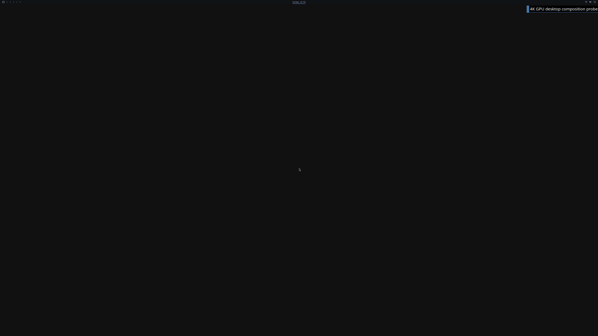

# First 4K Omarchy GPU shell bar

Later work captures [wallpaper and an NVIDIA application surface](LIVE-OMARCHY-4K-DESKTOP-CONTENT.md), with terminal glyph rendering and full lifecycle still failing. The historical shell-only result below retains its original scope.

Two fresh QEMU/WHPX guests render Quickshell's actual Omarchy bar through
Hyprland on the NVIDIA GPU. **Wallpaper and application windows are missing;
this is a partial shell milestone, not the requested full desktop frame.**
The counts remain **4/8 verification stages and 0/4 desktop acceptance gates**.

The image is frame 12 of run 45, converted directly from the GPU backbuffer's
BGRX bytes to PNG without edits. It is a full-resolution 3840×2160 buffer;
the separate diagnostic Windows window has a 1280×720 client area. This does
not establish a 4K physical display or normal launcher integration.

## Hardware evidence

Both ordinary UID 1000 clients have separate authenticated broker actors.
Quickshell reports `D3D12 (NVIDIA GeForce RTX 5090 Laptop GPU)`, OpenGL 4.6,
Mesa 26.0.8, and creates Qt's OpenGL RHI. Its actual resource FDs are resolved
into independently owned recipient NT references. Hyprland imports and
composes those resources, then GPU-copies its output into the Windows ring.
Ordinary frame handoffs use no CPU upload/readback. Two diagnostic audits
per run read back complete buffers and check their native FNV digests.

| Actual run | Retired GPU commands | Retired borrowed GPU waits | Resource aliases | Final shell pixels |
| --- | ---: | ---: | ---: | --- |
| 44 | 385 | 36 | 2 | Verified in workspace, clock and status regions |
| 45 | 417 | 33 | 2 | Verified in workspace, clock and status regions |

The first audited frame in each run contains an incompletely populated bar;
only the later audited frame passes the three-region glyph check. Alpha 1
and layer registration alone do not establish fully rendered content.
The published PNG SHA-256 is
`b49c9361bd5404042dab6d7022e320055a4cd48da10dc7d26a9e8a96088add30`;
its raw source SHA-256 is
`4998380eae426cb4506fd5db1439cfcbb1870d511b586492c64aae2086b4b8d7`.

The [retained evidence](evidence/COORDINATED-GPU-SHELL-FRAME-2026-10-18.json)
contains both complete raw captures per run, guest receipts, native records,
reports, build hashes and prior failed reports. The
[auditor](../experimental/windows-native-gpu/verify_coordinated_gpu_clients.py)
and mutation controls reject software renderers, wrong client PIDs, forged
aliases, missing kernel controls, invisible layers, modified captures,
unretired work, forced shutdown and multiplied budgets. The older clean
single-client desktop auditor retains its stricter lifecycle contract.

## What changed

The explicit [coordinator](GPU-CLIENT-COORDINATOR.md) admits independent clients
under one shared native memory budget. Same-device paging/progress fence waits
and synchronization-only contexts now reach real WDDM operations. The bridge
reads real fence words; it never invents GPU completion.

Hyprland's DMA-BUF import preflight needs DRM PRIME handles. A separately
enabled guest render-node path now provides bounded GEM handles for only the
aperture driver's own authenticated opaque resource buffers. It uses the
exporter's actual kernel identity, retains the DMA-BUF until handle/file
release and caps live imports at 256. Foreign buffers, CPU maps, arbitrary GEM
allocations, DMA attachment and scanout remain unavailable. Before GPU startup,
**980 actual guest-kernel controls** test ordinary-user import, duplicate
handle identity, quota failure, retention after FD close and file-exit release.
The separate aperture contract passes **1,619 checks**. Kernel modules are
compiled against matching guest headers and never loaded on Windows/WSL.

## Remaining work

Wallpaper and real GPU application windows are the next required content.
Xwayland and desktop portals are disabled only in this isolated fixture's RAM
overlay; their full cohort previously exhausts the 256-page fence aperture.
Animations are disabled and the compositor is a supervised diagnostic under
the normal OS, outside a normal UWSM session.

Both VMs exit normally and all native/kernel objects eventually release;
the complete read-only source-image digest stays unchanged. Cleanup still
retains **71 fence mappings** and **108/105 allocation mappings** until VM exit.
One broker also retains views until that boundary. This is insufficient for
reliable process restart or product recovery. General GPU abort cancellation,
live actor reuse and explicit pre-exit cleanup remain open.

Display telemetry does not verify every presented frame. Input, normal launcher
and UWSM integration, multiple real apps, long runs, recovery, physical 4K
display, CUDA, Vulkan, video/NVIDIA features and ≥93% matched-native performance
all remain unaccepted. Local mock controls and hosted CI are separate from
the actual physical-GPU runs described here.
