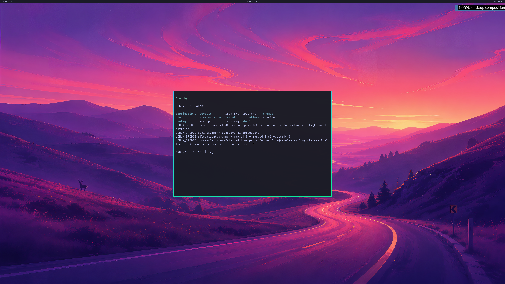

# 4K Omarchy wallpaper and readable NVIDIA application

Updated 2026-10-19. Two fresh QEMU/WHPX guests now capture the shipped Omarchy
wallpaper, Quickshell bar and readable Alacritty terminal together in a
**3840×2160 NVIDIA-composed framebuffer**. Hyprland, Quickshell and Alacritty
all use the RTX 5090 D3D12 renderer. This verifies a bounded desktop-content
capture; normal launcher/input integration and a stable product remain open.
Counts remain **4/8 verification stages and 0/4 desktop acceptance gates**.

This is run 53, frame 12, converted directly from the native BGRX readback.
No pixels were edited. It shows real Bash output from the disposable Omarchy
OS. Child utilities still print bridge diagnostics in these first captures.
The separate Windows diagnostic window is 1280×720; this is not a physical
4K scanout or normal Try Omarchy launcher acceptance. Display telemetry still
reports `displayVerified=false`.

## Actual verification

Both runs boot Omarchy 4.0.4 / Hyprland 0.56.2 with the source disk read-only
and writes confined to a bounded RAM overlay. Complete source-image hashes
match before and after. The shipped Tokyo Night wallpaper remains unchanged.

The controller verifies actual kernel capacity and ordinary-user isolation.
All 1,644 aperture checks and 980 native PRIME controls pass. PID-correlated
logs identify three independent NVIDIA clients; genuine resource FDs and
independent native references connect the application/shell to the compositor.
The terminal's real PTY-output marker appears before capture, and its window
unmaps on close.

Each run submits twelve GPU compositor handoffs. Ten ordinary frames use no
CPU upload/readback; the first and last use diagnostic readback. Full-buffer
FNV digests match the native copy receipts. The final image has 19,773 bright
glyph pixels in the terminal text region and is visually readable. Independent
resizing of the shipped JPEG matches 689 wallpaper samples at mean RGB error
**0.696/255**. The automated text check detects visible pixels; it is not OCR.

| Run | Native GPU commands retired | Borrowed GPU waits retired | Outcome |
| --- | ---: | ---: | --- |
| 53 | 850 | 42 | Both captures pass, readable application, normal VM exit and native cleanup. |
| 54 | 739 | 38 | Fresh-VM repeat passes the same checks. |

All native failed/live/pending/forced counters required by the audit finish
at zero. The owner reaps the VM before its four-phase retained-object cleanup;
142 fence mappings and 260/263 allocation mappings are deferred until VM exit.
This proves bounded ownership through shutdown, not complete live reclamation
or long-run stability. Peak reported GPU use is close to the 1 GiB diagnostic
guard, so broader application workloads still need capacity/performance work.

## Fixes and failures retained

Exact OpenGL profile 12 negotiates **1024 sparse CPU address slots** and 512
fence pages. Windows, native wire sessions, broker, guest shim and actual
kernel discovery must all agree. Additive ioctl 0x53 returns a fixed 32-byte
receipt for the 1 GiB, 64-bit virtual PCI BAR. Mapped data remains bounded at
**192 MiB**, GPU-VA mappings at 1 GiB and reported GPU use at 1 GiB. Profiles
1–11 and legacy kernel/coordinator payload sizes stay fixed.

Run 52 reaches completed NVIDIA Alacritty initialization without CPU-slot
rejection or GPU OOM/reset, but its content marker never appears. The actual
Bash scene script had Windows CRLF endings. Pinning it to LF fixes the marker;
a real Bash control verifies startup/output and reproduces CRLF rejection.
The [earlier slot-exhaustion and glyph/reset failures](LIVE-OMARCHY-4K-DESKTOP-CONTENT.md)
remain unchanged in their original evidence.

Run 55 removes the preload from Alacritty's non-graphics Bash child to avoid
diagnostics in the terminal. It reaches the real content marker, then a native
recipient-reference request is rejected. The broker disconnects that client
and Hyprland aborts before any capture. The VM still exits naturally and native
cleanup completes. **This failure remains open in the current payload.**
Reference admission/lifetimes and compositor recovery need a fix; the two
passing captures do not establish a stable desktop.

The [retained evidence](evidence/OMARCHY-4K-READABLE-GPU-DESKTOP-2026-10-19.json)
includes all four reports and exact source/build receipts, full guest/native
records, all four audited raw buffers from runs 53/54, independent wallpaper
samples and test logs. Proprietary runtime binaries and disk/initramfs images
remain private. Strict MSVC/GCC builds, actual root Unix credential/FD controls,
107 default CLI guards, ten coordinator guards per build, 365 historical
milestone tests and two Bash controls pass. Mock tests are labeled separately.

Next: diagnose the recipient-reference rejection, reclaim references safely
during live work, then verify sustained presentation, normal UWSM/launcher/input,
multiple applications, resize/fullscreen, recovery and matched-native benchmarks.
CUDA, Vulkan, video acceleration and broader NVIDIA features remain separate
unfinished requirements of the complete product goal.
