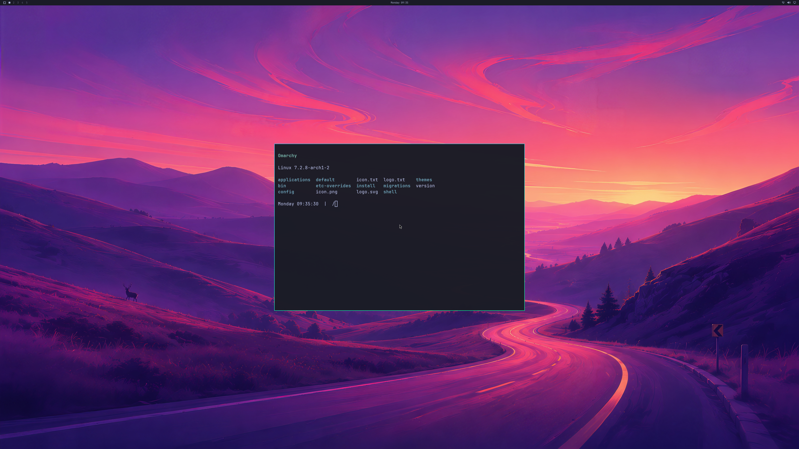

# 4K GPU desktop after shared-reference and capture-memory fixes

Updated 2026-10-19. Two fresh QEMU/WHPX guests pass the cleaner application
fixture: the shipped Omarchy wallpaper, Quickshell bar and readable Alacritty
window are composed by Hyprland at **3840×2160 on NVIDIA**. This fixes the
recipient-reference admission failure retained in the
[previous checkpoint](LIVE-OMARCHY-4K-READABLE-GPU-DESKTOP.md).
Counts remain **4/8 verification stages and 0/4 desktop acceptance gates**.

This is run 59, frame 12, converted directly from the actual Windows GPU
backbuffer's BGRX bytes to PNG. No pixels were edited. The application uses
NVIDIA D3D12; its non-graphics Bash child runs without the graphics preload,
so bridge diagnostics no longer obscure the terminal output. The actual
Windows diagnostic client area remains 1280×720. Physical 4K scanout,
all-frame display and normal Try Omarchy launcher acceptance are unverified.

## Measured results

Both guests use Omarchy 4.0.4, Hyprland 0.56.2, Mesa 26.0.8 and the RTX 5090
Laptop GPU. The source disk stays read-only, with writes confined to a RAM
overlay; its complete SHA-256 matches before and after each run. Actual guest
kernel controls pass 1,644 aperture and 980 PRIME checks.

PID-correlated NVIDIA renderer records, authenticated executable identities,
real resource FDs and independent recipient NT references bind Hyprland,
Quickshell and Alacritty to the GPU handoffs. The real PTY-output marker
precedes capture; the application window unmaps on close. Each run submits
twelve compositor frames. Ten ordinary frames have no CPU upload/readback;
the first and twelfth have diagnostic backbuffer readback.

| Fresh run | Retired native GPU commands | Borrowed GPU waits | Resource aliases | Visible terminal glyph pixels | Peak reported GPU bytes |
| --- | ---: | ---: | ---: | ---: | ---: |
| 59 | 826 | 39 | 9 | 9,729 | 1,038,680,064 |
| 60 | 811 | 41 | 9 | 9,695 | 1,043,038,208 |

Each complete 33,177,600-byte capture matches its native FNV receipt. The
final frames match 689 independently resized shipped-wallpaper samples at
mean RGB error 0.696/255. Pixel checks detect visible terminal glyphs, not
OCR; the actual image is also inspected. Both VMs exit naturally, the root
service returns zero, and every failed/live/pending/forced counter required
by the audit finishes at zero. The generic legacy experiment verifier still
rejects this root-desktop fixture; the separate scoped auditor validates it
without changing legacy acceptance requirements.

## Fixes and retained failures

Run 56 identifies the previous failure exactly: native recipient alias
admission rejects **16 live references at a global limit of 16**, while GPU
usage remains below its guard. Each actor already permits sixteen references,
so four coordinated actors need a distinct group allowance. Exact OpenGL
profile **13** requires fixed-size object agreement **v5**, permitting **64
native resource references and 64 sync references across the group**. Per-actor
limits remain sixteen. Both new runs reach seventeen simultaneous resource
references, exercising the fix. Older profiles retain their original limits.

Run 57 passes reference admission but fails a reported-GPU-usage guard at
1,077,280,768 bytes, above the unchanged 1,073,741,824-byte limit. Instead of
raising that guard, diagnostic readback now copies the actual current DXGI
backbuffer in **nine tiles of at most 256 rows**, reusing a **3,932,160-byte**
GPU readback buffer in place of a full 33,177,600-byte buffer. Every tile has
its own retired fence value before allocator reuse or CPU mapping. Audit
fences reach 9 and 18. All rows and pixels are retained; ordinary frames keep
the existing GPU path. The extra tile waits apply to the two diagnostic
captures, and are not a performance benchmark. D3D12 copy bounds/states and
fence-before-map requirements follow the
[CopyTextureRegion contract](https://learn.microsoft.com/en-us/windows/win32/api/d3d12/nf-d3d12-id3d12graphicscommandlist-copytextureregion)
and [readback guidance](https://learn.microsoft.com/en-us/windows/win32/direct3d12/readback-data-using-heaps).

Run 58 renders twelve frames and exits cleanly, but the strict audit rejects
an authenticated peer receipt joined to an unfinished trace line. That result
remains unaccepted. Broker receipts now use bounded single writes with an
explicit leading newline; the root service replays only owned application
renderer identities after graphics writers stop. PID metadata is preserved,
and the audit keeps its complete-line requirements. Concurrent-writer and
truncation controls cover the logging change.

The CPU mapped-data guard remains **192 MiB**; GPU-VA mappings and reported
GPU use remain bounded at **1 GiB** each. Profile 13 retains profile 12's
1024 sparse CPU slots and 512 fence pages. These fixes do not multiply memory
budgets per actor or change existing kernel payload sizes.

## Evidence and remaining work

The [retained evidence](evidence/OMARCHY-4K-REFERENCE-FIX-GPU-DESKTOP-2026-10-19.json)
contains both passing reports, source/build receipts, full guest/native records,
all four audited raw buffers and failed runs 56–58. Raw buffers use lossless XOR
deltas against the pinned run-53 buffer in the previous evidence file, followed
by zlib/base64 compression. Tests reconstruct the exact original bytes, check
SHA-256 and repeat the full native/pixel audit. This avoids duplicating the
unchanged wallpaper bytes in another large evidence file. Private runtime
binaries and disk/initramfs images remain private.

Strict default/high-resolution MSVC builds, strict GCC protocol/coordinator,
FD-lifetime and logging controls, actual root Unix credential/FD controls,
portable tile/stitching tests, and startup rejection controls pass. Mock GPU
controls remain labeled separately from these physical NVIDIA runs.
All 373 local milestone regression tests pass, including full-buffer
reconstruction and rejection controls for missing identities, incorrect tile
counts/fences, software rendering, byte-limit violations and modified pixels.

This is bounded capture and shutdown evidence. Each VM still retains 142
fence mappings, 206 allocation mappings and 267 CPU-slot mappings until exit.
Next work is safe live retirement/reuse and repeated application lifecycles,
then normal UWSM/launcher/input integration, sustained multi-window presentation,
resize/fullscreen and recovery. Long-run stability, ≥93% matched-native
performance, CUDA, Vulkan, video acceleration, concurrent host/guest applications
and broader NVIDIA features remain unfinished product requirements.
