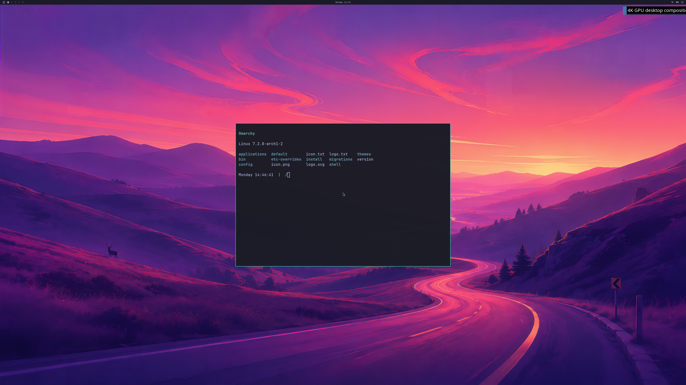

# Live NVIDIA application lifecycles with an audited 4K Omarchy desktop

Updated 2026-10-19. Two fresh QEMU/WHPX guests each launch and close **five real
NVIDIA Alacritty applications while the same Hyprland compositor stays alive**.
The shipped wallpaper, Quickshell bar and fifth application are captured at
**3840×2160**, with exact first/last GPU backbuffer and independent pixel audits.
All five application actors and the shell actor retire live; every aperture
mapping is acknowledged as unmapped before VM exit. Normal shutdown passes.
Counts remain **4/8 backend stages and 0/4 desktop product gates**.

This is run 67, frame 12, converted directly from the actual GPU backbuffer.
No pixels were edited. The separate Windows diagnostic client remains
1280×720. Physical 4K scanout, all-frame display, normal UWSM/launcher/input,
interactive multi-window use and matched-native performance remain unverified.

## Physical results

Both guests use the same read-only Omarchy 4.0.4 image, Hyprland 0.56.2,
Mesa 26.0.8 and RTX 5090 Laptop GPU. Their complete source-image hashes match
before and after. Each passes 1,644 actual aperture and 980 PRIME checks.
Authenticated executable/PID identities, NVIDIA renderer records, real kernel
FDs and independent recipient NT references bind **all five applications and
Quickshell** to the compositor's native GPU handoffs. A renderer name or a
visible window alone is insufficient for this audit.

| Fresh run | GPU commands retired | Borrowed GPU waits | Native resource aliases | Live actors retired | Wire objects reclaimed |
| --- | ---: | ---: | ---: | ---: | ---: |
| 67 | 1,299 | 67 | 21 | 6 | 2,404 |
| 68 | 1,215 | 64 | 21 | 6 | 2,260 |

Each run performs twelve GPU handoffs. Ten ordinary frames avoid CPU
upload/readback; the first and twelfth retain complete 33,177,600-byte audits
using the existing nine-tile readback buffer. The final wallpaper matches
689 independent source-image samples. Application glyph counts are 9,645
and 9,660, with the actual image also inspected for readability.

The authenticated application actors reach ID 7 while peak concurrent actors
stay at three: retired slots are reused without reusing actor identities or
restarting Hyprland. Each application shows real PTY output, closes, and has a
root-owned completion witness observed while compositor IPC remains alive
before the next application starts. All twelve final handoffs precede the
fifth application's retirement. Quickshell then retires during normal shutdown.

All **568 fence mappings per run**, **1,059/1,056 allocation mappings** and
**1,214/1,211 CPU-slot mappings** receive live unmap acknowledgements.
No backing mappings, hardware queues, sync objects, reservations or CPU locks
depend on VM-exit reclamation. Natural VM exit, root service exit zero and
native cleanup pass. The unchanged generic legacy verifier still rejects this
root-desktop fixture; the dedicated lifecycle auditor validates its full scope.

## Implementation and diagnosed failures

The privileged coordinator explicitly negotiates live retirement before actor
registration. Ordinary clients gain no retirement opcode. After pidfd-confirmed
process exit, CPU-view revocation and real shared-FD drainage, each RPC destroys
at most sixteen owned objects in four dependency-ordered phases. Actual GPU
progress gates destruction. Failed/busy children stay owned and charged;
parents and actor slots cannot be released early. The primary compositor actor
cannot use the application-retirement operation.

The CPU mapped-data guard remains **192 MiB**, and GPU-VA/reported-use guards
remain **1 GiB**. Peak CPU mapped data is 169,492,480/169,099,264 bytes; peak
reported GPU usage is 1,043,988,480/1,042,628,608 bytes. No byte budget is
multiplied per actor.

The retained runs identify separate problems:

- **61:** live object reclamation succeeds, but the first application and shell
  lack the required native FD handoffs. It remains unaccepted.
- **62:** Hyprland aborts during a later application launch. Its report was lost
  with the RAM overlay. The supervisor now preserves a PID-specific, owned,
  regular report in bounded hex chunks without following a report symlink.
- **63:** a blanket pending-work guard rejects closing an exported NT reference
  while another client renders. Reference closure now preserves backing KMT
  objects and independently opened recipient references. Both passing runs
  exercise one NT-reference close while other GPU work is pending.
- **64:** mapping telemetry proves a different device's queue blocked an
  allocation-state update. Physical overlaps must belong to the paging device;
  their barrier now covers that device's queues. Protection changes retain a
  process-wide barrier, and every successful mapping still waits for its actual
  paging fence. This follows the [paging-fence contract](https://learn.microsoft.com/en-us/windows-hardware/drivers/ddi/d3dukmdt/ns-d3dukmdt-d3dddi_mapgpuvirtualaddress).
- **65–66:** all five GPU applications and twelve 4K handoffs succeed, but slow
  shell retirement reaches the eight-second budget and the compositor watchdog
  terminates shutdown. FIFO RPC scheduling prevents overtaking; timing then
  localizes most delay inside native destruction rather than lock acquisition.

The final fix removes an unconditional bytewise fingerprint of every mapped
allocation at lock/unlock from ordinary rendering. These mappings include
write-combined GPU memory, for which Microsoft [documents a severe CPU-read
penalty](https://learn.microsoft.com/en-us/windows/win32/api/d3d12/nf-d3d12-id3d12resource-map).
The scan and first/last-word reads remain confined to the explicit CPU-store
diagnostic. Both new runs report **zero allocation-fingerprint calls/bytes**;
the independent complete-frame audits remain enabled.

For the same first application, native retirement falls from 5.203 seconds in
run 66 to 0.374 seconds in run 67; broker-observed time falls from 5.365 to
0.485 seconds. The first four run-67 applications reclaim the same 423 objects
each. All new application retirements take 0.282–0.526 seconds, and shell
retirement completes in 0.325/0.348 seconds. Native/guest sources other than
`driver_bridge.cpp`, the guest image and QEMU are unchanged between these two
candidates. This is a diagnostic cleanup comparison, not a rendering-throughput
benchmark or evidence of ≥93% matched-native performance.

## Reproducible evidence and remaining work

The [retained evidence](evidence/OMARCHY-4K-LIVE-GPU-LIFECYCLES-2026-10-19.json)
contains both passes, failures 61–66, original audits, complete guest/native
records, build/source receipts and all captured raw frames. Lossless XOR deltas
use the pinned run-53 buffer in the earlier evidence file. Regression tests
reconstruct every passing byte and reject missing GPU donors/witnesses, unsafe
retirement batches, changed pixels, CPU scans, incorrect barrier scope and
deferred mappings. Private driver binaries, initramfs and disk images stay private.

Strict default/high-resolution MSVC builds, strict GCC protocol/FD controls,
FIFO concurrency/wrap tests and actual root Unix credential/FD tests pass.
The original 373 milestone regressions and five new lifecycle tests pass.
GPU evidence comes from these physical runs, separately from mock controls.

This advances bounded desktop resource reuse. Supported guest-device integration,
normal UWSM/launcher/input, continuous presentation, concurrent application
windows, resizing/fullscreen, long runs, failure recovery and ≥93% matched-native
benchmarks remain required. CUDA, Vulkan, video, concurrent Windows/guest GPU
applications and broader NVIDIA features remain separate unfinished requirements.
