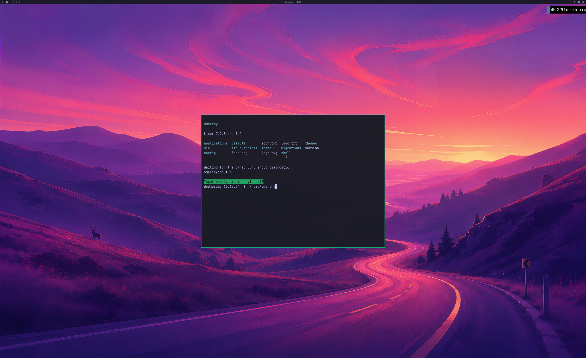

# Real NVIDIA Omarchy frames in QEMU SDL

On October 21, 2026, **run 102 delivered a real 3840×2160 Omarchy/Hyprland GPU
scene to QEMU's SDL frontend**, preserving the official SDL input implementation.
The shipped wallpaper, Quickshell bar and NVIDIA-rendered Alacritty window are
visible together. This is an experimental, bounded guest fixture with a seeded
account, UWSM/PAM session and RAM overlay over a read-only source disk.



This image is the actual **2560×1566 SDL pre-swap backbuffer**, converted from
RGBA readback with a vertical flip. The source texture is 3840×2160; physical
4K scanout remains unverified. No image generation or repainting was used.

## What passed

- All 300 guest frame handoffs reach the NVIDIA SDL relay in order. The 298
  ordinary frames use GPU copies and shared fences without CPU texture upload
  or diagnostic CPU readback. First and final frames use complete readback.
- Every byte of both complete 4K SDL source captures equals the actual guest
  GPU buffer after BGRA-to-RGBA channel conversion. Every channel of both full
  SDL backbuffers is within **one code value** of an independent GL_LINEAR
  pixel-center scaling reference. The reference comes from the compiled
  `ui/sdl2-gl.c` and `ui/egl-helpers.c`, with a predefined tolerance of two.
- The original application resizes through 1440×960, 1600×1000 and 1200×800.
  Independent wallpaper samples, bar glyphs and the real terminal's green PTY
  input confirmation appear in the final GPU pixels. Five NVIDIA application
  launch/close cycles, UWSM service/session checks and live actor cleanup pass.
- Separate producer and consumer fences reach 300. All SDL imported objects,
  conversion program, local scanout and import context retire **before the
  final guest acknowledgement**. QEMU exits naturally with code zero; backing
  mappings are released before VM exit. Peak reported GPU usage is 995,282,944
  bytes, below the unchanged 1 GiB diagnostic guard.
- The user also reports moving the guest cursor through the SDL window. This
  is a manual observation; the fixed QMP keyboard/PTY diagnostic is separate.
  Automated physical keyboard/mouse and launcher reserved-key acceptance are
  still open. The new output does not initialize the old custom HWND input path.

## Lag and retained failures

**Run 103 is a failed stability repeat.** The same compiled native bridge,
guest payload and QEMU artifact stop after frame 207, followed by
`SDL compositor retirement failed: SDL consumer device lost`. Complete clean
teardown is not established for this run. The first exception/device-removal
reason was not captured, so the root cause is still unknown. No matching recent
Windows display-driver System event was found. This is **one accepted 300-frame
run and one failed repeat**, not repeated stability.

The failed repeat includes an observer that timestamps host log receipt without
changing compiled bridge, guest or input code. Excluding the held first two
diagnostic frames, the median inter-frame receipt interval is **69.15425 ms**
(about 14.5 updates/s); the median observed ingress-to-SDL receipt interval is
**5.0674 ms**. These observations suggest most delay occurs before the SDL relay,
but include pipe/log scheduling and do not measure physical scanout, end-to-end
input latency or matched-native performance. Resize/barrier waits and diagnostic
logging are still present. The user reports lag in both cursor and window use.

**Run 101 also remains rejected.** An initial IRQ-disabled machine variant never
reached the graphics service and required owned VM termination. Restoring the
original `q35,accel=whpx` machine mode, with the identical guest payload, produced
run 102. No source disk writes were allowed in any attempt.

Next: capture the first failure and `GetDeviceRemovedReason`, correct failure
teardown ordering, measure guest render/bridge submission costs and frame pacing,
then repeat pixel, lifetime and interactive checks. Retain the current memory
guards and official input source while doing this work.

## Reconstructable evidence

[Raw evidence](evidence/OMARCHY-QEMU-SDL-DESKTOP-2026-10-21.json), SHA-256
`0369b574ce3f1c4c3bfd7f29333d7dcc0cf06735d6cf048f1a625db6a2abce28`,
retains all three attempts' source/build receipts and complete logs, the original
117 compiled source files for native versions 70/71, lossless complete frame
captures, the timed observer source and all 207 timing observations. GPU binaries,
private NVIDIA/WSL libraries, source disk and initramfs are excluded.

The encoding stores checksummed zlib blobs, optional lossless XOR bases,
BGRA-to-RGBA reconstruction and lossless XOR against the independent scaling
reference. The replay verifies the complete original hashes, not just samples.
Earlier [host-only relay controls](LIVE-QEMU-SDL-GPU-RELAY.md), including the
rejected swapped-channel result, retain their separate scope.

Run the seven replay and rejection tests with:

```text
python -m unittest discover -s experimental/windows-native-gpu -p test_real_sdl_desktop_milestone.py -v
```

Native versions 70/71 passed strict MSVC C++17 `/W4 /WX /O2` builds and native
control tests; the default compatibility build is version 70. The pre-boot Python
suite passed 441 tests. Normal launcher/device integration, sustained multi-window
use, recovery, Vulkan/CUDA/video coverage, simultaneous Windows/guest workloads
and ≥93% matched-native performance remain open. Backend stages stay **4/8** and
desktop acceptance gates stay **0/4** under their original definitions.
