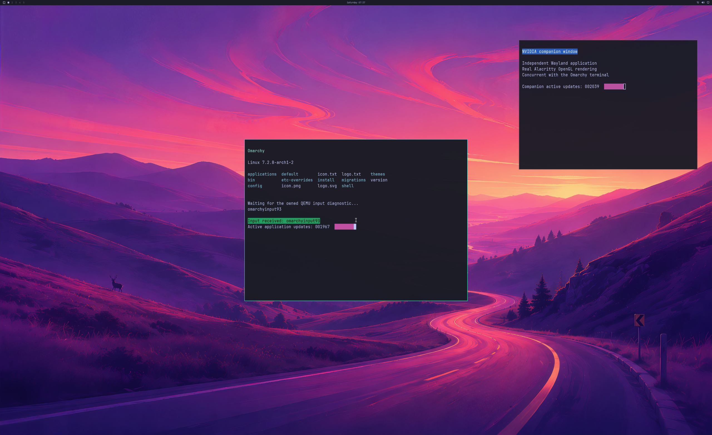

# Residency rollback investigation

October 24, 2026. **The attempted recovery implementation is rejected.** A
four-allocation refusal caused device loss after native eviction reported
success. The published runtime has not been replaced by that implementation.
All updates remain on `windows-nvgpu-lab` in [PR #2](https://github.com/7Wdev/try-omarchy-windows/pull/2).

Actual **2560×1566 SDL pre-swap backbuffer** from a complete **3840×2160 GPU
source**, with shipped wallpaper, Omarchy bar and two readable GPU application
windows. This is a bounded successful observation of one allocation. It does
not establish that the rejected implementation safely handles larger lists,
physical 4K scanout, a normal launcher session or continuous desktop use.

## Retained outcomes

All five runs used the same frozen guest 144, real NVIDIA 621.01 hardware,
unchanged QEMU SDL input sources and a read-only Omarchy source disk. Native 89
and 90 came from identical source inputs; 90 alone enabled the explicit host-policy
fault. The fault is **not actual Windows quota exhaustion**.

| Run | Observation | Result |
| --- | --- | --- |
| 165 | One allocation refused after 150 handoffs; native MakeResident 259, real paging retirement and Evict 0; then 1,650 further handoffs | All 1,800 handoffs, complete source/SDL pixels, input/resize/focus checks and live cleanup pass. Limited successful observation. |
| 166 | Ordinary 89 reaches 1,800 handoffs and live cleanup, but exercises no retained-reference reuse | Nonaccepted coverage gap. The original ownership oracle remains unchanged. |
| 167 | One-allocation rollback, 1,800 handoffs and live cleanup; a visible cursor overlaps wallpaper probe 1056,960 | Nonaccepted wallpaper result. No new cursor mask or tolerance exception. |
| 168 | Ordinary 89; 1,800 handoffs, 265 reference reuses | Full original bounded regression passes, including complete pixels, input/resize and live cleanup. |
| **169** | **Four allocations refused after 116 handoffs; MakeResident 259, real paging retirement, Evict 0/refund 4; then device loss** | **Rejected. Native cleanup false, host failure, forced VM exit 90 and mappings retained until VM exit. No final frame or complete guest trace is invented.** |

A successful native eviction and internally balanced reference counts do not
prove that subsequent GPU commands can run safely. Run169 is a counterexample
to treating run 165 as general recovery evidence.

## What is being investigated

The rejected implementation performed MakeResident on the requested native
paging queue. Its real read-only CPU fence word is already mapped into the
guest. Therefore returning an error later cannot undo any fence advancement
the guest may have observed. Source inspection confirms that exposure; **the
exact cause of run 169's device loss remains unproved**.

A private paging-queue prototype is being tested locally. It completes actual
native paging before synchronous success, checks that the requested public
fence word stayed unchanged, and owns one private queue per live device.
No native fence is written, rewound or replaced with a fabricated completion.
The prototype is **not published as a runtime fix**. Its late four-allocation
fault boundary was not reached in runs 170/171. An earlier startup boundary in
run 173 also did not fire and lacked reuse coverage. Passing ordinary rendering
in run 172 does not close these fault-coverage gaps.

Microsoft documents that a device can have multiple paging queues and that each
queue owns a monitored fence. Residency references belong to the device; they
are reference counted across MakeResident/Evict calls.
[Paging queue contract](https://learn.microsoft.com/en-us/windows-hardware/drivers/ddi/d3dkmthk/ns-d3dkmthk-_d3dkmt_createpagingqueue) ·
[Residency reference model](https://learn.microsoft.com/en-us/windows-hardware/drivers/display/residency-overview).

Next: exercise a real multi-allocation refusal under the private-queue
implementation without dropping the CPU-mapping guard or narrowing the native
list, then require the complete pixel/input/resize/lifetime regression and
cleanup before a natural VM exit. Actual memory-pressure recovery remains open.

## Reproducible historical evidence

[Lossless archive](evidence/OMARCHY-RESIDENCY-ROLLBACK-OBSERVATIONS-2026-10-24.json),
SHA256 `88ff20413a4d9ef086dfb4d8388eb440ab05ad8788392a94e5499808b9038bef`,
retains complete available original logs and frames, all five outcomes, both
exact frozen native source sets, strict build logs, fault-selection and invalid
build-profile controls, predeclared acceptance criteria and the failed 87
packaging attempt. It links the earlier metadata/framing evidence by hash.
Compiled binaries, proprietary libraries, VM disks and initrds are excluded.

The [16 replay checks](../experimental/windows-native-gpu/test_post_native_residency_milestone.py)
preserve run 169 as a failure and reject altered cleanup, a narrowed one-allocation
counterexample, hidden GPU handoffs, corrupt final pixels, false quota origin,
uncertain rollback, deferred cleanup and diagnostic builds labelled ordinary.
The original desktop/ownership auditors remain immutable. Only the explicitly
expected single diagnostic OOM and its native reference transaction are added
when auditing run 165.

The source disk remained unchanged:
`3954123192111ce2d28cafb9dd108e1ca14c288bfc2429ed899b0f36aeccf942`.
The displayed PNG SHA256 is
`0e7bb2d09b4c879f8e13c6eb4d2e6e1dfc18d541e49f0b36d7a3672bda31c3f2`.

## Product scope

Counts stay **backend 4/8, desktop product 0/4, diagnostic scene 3/3**. This RAM-overlay
UWSM/PAM fixture and custom compositor hook do not establish normal launcher,
account or supported-device acceptance. The official keyboard/cursor and
reserved-key routing remain the product requirement. Stable long-running use,
physical input latency, matched-native 93% performance, broader OpenGL/Vulkan,
CUDA, video acceleration, DLSS and hardware ray tracing remain unverified.
