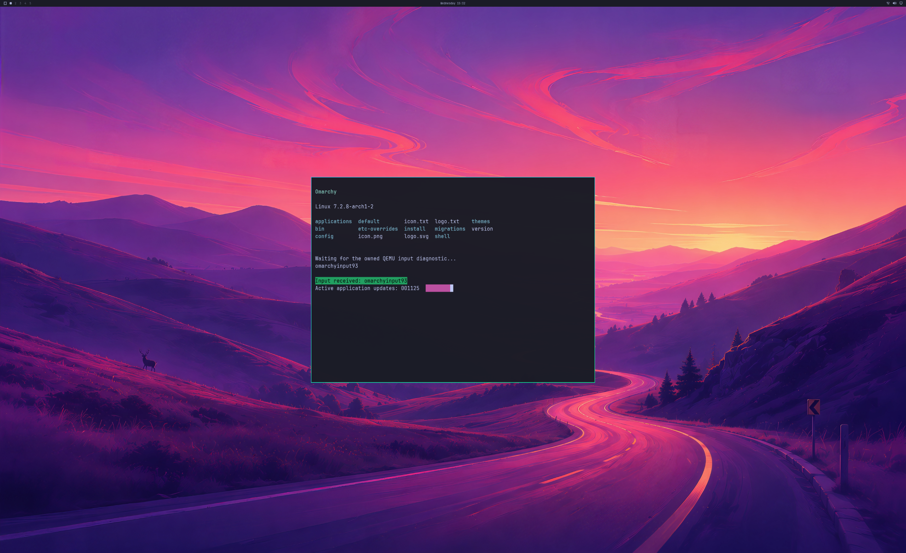

# SDL output retirement after a controller failure

An interrupted GPU coordinator previously stopped QEMU before retiring the SDL
output. The output thread then tried to use the stopped process's GPU imports
and QMP connection. A controlled interruption reproduced `QMP disconnected`,
followed by `SDL consumer device lost` and a fatal bridge exit without the normal
native cleanup report.

The bridge now drains its SDL output **before stopping QEMU on both success and
controller failure**. Actor sessions and their guest backing pages stay alive
until the owned VM has been reaped. Fatal SDL/compositor exits also reap the owned
QEMU process before terminating the bridge. Concurrent stop requests serialize
on the owned process; the fatal callback retains native objects and connections.
The official keyboard/cursor code, SDL frontend and reserved-key route are unchanged.

## Hardware controls

All four attempts use the same read-only Omarchy source disk, byte-identical
active guest payload and instrumented QEMU/SDL artifact. The failures are explicit
diagnostic injections at **frame 64**; neither test removes the GPU device.

| Run | Bridge / control | Observed result |
| --- | --- | --- |
| 112 | Native75, original ordering; coordinator interrupted before replying to frame 64 | Secondary QMP/consumer errors, host exit 3, no normal native cleanup report. Owned VM reaped before fatal exit. |
| 113 | Native76, corrected ordering; identical interruption | All 64 frames retire, SDL detaches before VM stop, native objects are released, and the original injected failure is reported with exit 1. |
| 114 | Native76; same interruption plus an injected SDL detach error | First failure and detach diagnostics retained; owned VM reaped with driver objects retained before host exit 3. Normal native cleanup is not claimed. |
| 115 | Native76; no injected failure | 300 handoffs, full first/final pixel audits, live SDL detach and natural shutdown pass. |

Run 113 intentionally terminates the interrupted guest with QEMU exit 90. Guest
backing mappings and KMT objects still in use are retained until that exit and
then released. All live native counts reach zero. This differs from run 115,
where all backing mappings retire before the VM's natural exit.

Run 115's complete 3840×2160 SDL sources equal the guest GPU buffers exactly.
Both full 2560×1566 SDL backbuffers differ by at most **one code value** from the
independent GL_LINEAR scaling reference, under the unchanged tolerance of two.
The ordinary path has no CPU texture upload or diagnostic readback. The first
and final diagnostic frames retain complete captures.



This is the real SDL pre-swap backbuffer after the active application and resize
workload, converted with RGBA decoding and vertical orientation conversion.
Its GPU source is 4K; physical 4K scanout remains unverified.

## What this establishes

The controlled comparison establishes a failure-teardown ordering bug and its
correction. A healthy GPU stream interrupted by the controller can now retire
the output and report normal native cleanup instead of causing a secondary SDL
failure. The separate fatal control establishes owned-VM exit before host abort.
It does **not** establish restart/recovery after a real GPU device removal.

The original run 103's frame-207 error remains unresolved. Run 112 demonstrates
that the same consumer-loss message can follow another failure during teardown;
it does not establish that run 103 had the same initiating cause. The intermittent
zero SDL capture and desktop lag also remain open. No near-native performance
claim is made from these controls.

Both failure flags require the explicit high-resolution owned SDL coordinator
and read-only root. They are rejected before runtime startup in other modes and
are never selected by the launcher. The retirement control wraps only the
diagnostic graphics detach command; it does not reset or remove the GPU device.

## Reconstructable evidence and validation

[Lossless evidence](evidence/SDL-FAILURE-TEARDOWN-2026-10-21.json), SHA-256
`58c50e266c052450280718252a6f2952d1b6abfeae63d8da3a48312e16d74633`,
retains all four attempts' original logs/reports, complete captured buffers,
exact Native75/76 compiled source archives and build scripts, and controller and
runner source. Shared blobs reference the separately checksummed active-SDL and
earlier real-SDL evidence. Private NVIDIA/WSL binaries, disk and initramfs are excluded.

The 457 existing milestone tests pass. Six additional replay/rejection tests
check the actual before/after ordering, fatal owner reap, normal full-pixel
regression, complete archives and mutations of lifetime/provenance evidence:

```text
python -m unittest discover -s experimental/windows-native-gpu -p test_sdl_failure_teardown_milestone.py -v
```

Native76 passes strict MSVC C++17 `/W4 /WX /O2` builds in both 4K/default profiles,
107 default CLI cases, 10 SDL failure-probe guards in each profile, 4K/coordinator
guards and portable Linux SDL controls. Backend stages remain **4/8** and desktop
product gates remain **0/4**. Normal launcher integration, sustained interactive
use, broader APIs, genuine fault recovery and ≥93% matched-native performance
still require implementation and acceptance work.
