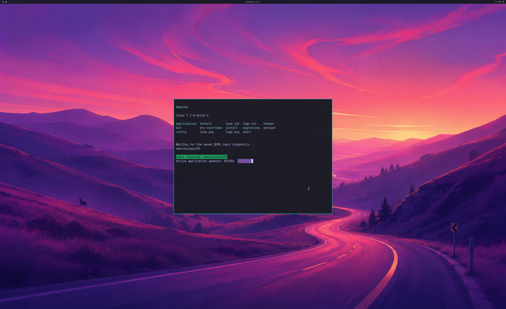

# Sustained NVIDIA desktop rendering and driver matching

Two fresh Omarchy guests complete **1,800 GPU handoffs over 33.5 and 33.8 seconds**
with NVIDIA 621.01. Each passes complete first/final 4K source and SDL pixel
audits, the rendered input-response diagnostic, five application lifecycles,
three resize phases, live output retirement and natural shutdown. The source
disk remains read-only; ordinary frames use GPU copies without CPU texture upload
or diagnostic readback. This is a longer bounded run, with full product acceptance
still open.



Run 125, frame 1,800: the shipped wallpaper, Omarchy bar, readable NVIDIA terminal,
green PTY input confirmation and active application counter. This is the actual
2560×1566 SDL pre-swap backbuffer, decoded as RGBA and vertically oriented. Its
3840×2160 source equals the guest GPU buffer exactly. Every scaled window channel
is within one code value of the independent full GL_LINEAR reference under the
unchanged tolerance of two. Physical 4K scanout remains unverified.

## Measured runs and retained attempts

| Run | Host / private vendor runtime | Result |
| --- | --- | --- |
| 122 | Working Native77 / earlier 617.14 runtime | Stops at 527 handoffs when reported aggregate GPU usage exceeds the 1 GiB guard. Accepted frames drain; owned VM is reaped; trace is incomplete. Rejected. |
| 123 | Budget prototype Native78 / earlier runtime, after host driver change | Compositor backend initialization fails before any memory-budget query or GPU submission. Complete trace and clean teardown do not establish rendering. Rejected. |
| 124 | Controller preflight | Nested Windows PowerShell cannot resolve Get-FileHash; no VM/GPU work starts. The revised private guard uses .NET hashing and retains stdout/stderr. |
| 125 | Working Native77 / matching 621.01 runtime | 1,800 handoffs in 33.527 s; full pixel/input/lifecycle/cleanup audit passes. |
| 126 | Budget prototype Native78 / same matching runtime | Stops at two handoffs after a busy eviction rejection involving a CPU-mapped allocation and a compositor render-end assertion. Rejected; root cause is not yet proven. |
| 127 | Working Native77 / same matching runtime | 1,800 handoffs in 33.842 s; full audit passes again. |

The same source disk, QEMU/SDL artifact, input implementation and 1 GiB reported
GPU usage guard apply. Both successful runs use the **same private guest payload**
and frozen Native77 host. Both verify 1,798 ordinary GPU-only handoffs, exact frame
order, independent producer/consumer fences, live SDL detach before the final
guest reply, and zero backing/native mappings deferred to VM exit. The ordinary
account is disposable, with real UWSM/PAM/logind over a RAM overlay.

| CPU wall-clock observation | Run 125 | Run 127 |
| --- | --- | --- |
| Median steady handoff interval | 17.277 ms | 17.115 ms |
| p95 steady interval | 24.682 ms | 24.292 ms |
| Peak reported GPU usage | 963,256,320 B | 937,213,952 B |

The fixed steady windows are `[20,45]`, `[80,140]`, `[200,280]`, `[400,580]`,
`[1000,1180]`, `[1500,1780]`; the auditor requires a 25-second minimum stream.
These are CPU handoff observations including scheduling and instrumentation.
They do not establish GPU execution time, physical display cadence, input latency
or matched-native performance. Neither run proves continuous 60 FPS.

## Match the currently installed Windows driver

During this investigation the installed NVIDIA driver changed from 617.14 to
621.01, with a new adapter identity and DriverStore package. The earlier guest
payload carried the older vendor libraries. Rebuilding a private payload with
the current driver package restores graphics initialization; both subsequent
Native77 repeats pass the complete longer workload.

`snapshot-nvidia-wsl-runtime.ps1` resolves the single signed installed NVIDIA
display driver's active WSL library through its driver-class registry entry.
It copies **libnvwgf2umx.so** and **libnvidia-gpucomp.so** from that DriverStore
package into an exclusive private output folder, checking source/copy hashes
and installed driver identity before accepting the snapshot. The receipt omits
the machine's device ID. Both successful runs independently check the installed
package and both library hashes before and after the VM run.

```powershell
./experimental/windows-native-gpu/snapshot-nvidia-wsl-runtime.ps1 -OutputDirectory ../private-nvidia-runtime
```

The snapshot is local build input. Published evidence contains its receipt and
collector source, with the proprietary libraries excluded. The earlier guest
and failed attempts remain retained. Source-disk contents, renderer source and
official input code are unchanged. Normal launcher/runtime refresh integration
still needs implementation; this collector alone does not provide it.

## Memory pressure remains open

The original host reports a 1 GiB budget for each segment while enforcing 1 GiB
across their combined usage. The Mesa residency code adds the segment budgets.
The tested Native78 prototype partitions one aggregate budget using stable
adapter capacity weights and reserves 64 MiB for presentation. Its standalone
arithmetic controls pass, but its hardware run does **not** pass desktop acceptance.

Run 126 requests eviction of three allocations, including one with an active
CPU lease. The existing last-reference protection rejects the request as busy
before a native eviction is attempted. A compositor render-end assertion follows.
This establishes the rejected path and its ordering; it does not prove the final
cause of the assertion. The current working host source is restored to Native77.
The entire rejected Native78 source archive, build/control logs and patch remain
reconstructable in the evidence.

The next residency change must retain real allocation ownership while pages are
mapped into the VM and defer reclamation until GPU use has retired. Windows
documents that an allocation may be evicted once an eviction is queued, after
which accessing it is illegal. [D3DKMTEvict documentation](https://learn.microsoft.com/en-us/windows-hardware/drivers/ddi/d3dkmthk/nf-d3dkmthk-d3dkmtevict).
The busy guard is retained. Memory-pressure recovery and the earlier device-loss
and zero-buffer failures remain unresolved.

## Validation scope and next acceptance

The full scoped desktop auditor accepts runs 125/127 and rejects 122/123/126.
The original generic runtime checker is retained; it is not a desktop acceptance
gate and returns a nonzero result for this fixture. Clean host/VM exit alone is
never treated as a rendered-desktop pass.

[Lossless evidence](evidence/OMARCHY-SUSTAINED-NVIDIA-2026-10-22.json), SHA-256
`9d50ef255fb6bdadf53211bb0411b1ee570555e59822bb2b53e33f1422b0f9ea`,
contains all five hardware attempts and preflight rejection, raw UART/virtio
traces, full captures, exact working/prototype host sources, original/generated
guest source and private controllers. Shared blobs reference earlier checksummed
evidence. Proprietary binaries, disk and initramfs are excluded.

Backend stages remain **4/8**, desktop product gates **0/4**, scene elements **3/3**.
Normal account/launcher integration, physical input and displayed cadence,
simultaneous application windows, resource churn, recovery and ≥93% matched-native
performance remain required. General OpenGL, Vulkan, CUDA and video coverage,
**NVIDIA DLSS** and **hardware ray tracing** each need real guest application or
SDK workloads with correct output and verified hardware execution.
