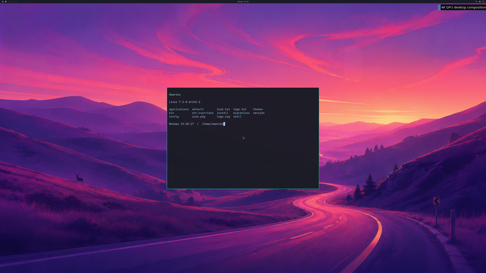

# UWSM-managed NVIDIA Omarchy capture

One fresh QEMU/WHPX guest passes a complete GPU capture through UWSM in a real PAM/logind user
session. Systemd independently reports the admitted compositor
service and `graphical-session.target` active while the same Hyprland process
renders five GPU application lifecycles and twelve 3840×2160 handoffs.
The shipped wallpaper, Quickshell bar and readable Alacritty application all
use NVIDIA. All six retired client actors and every backing mapping are
reclaimed before VM exit. Its fresh repeat fails the existing 1 GiB reported
GPU usage guard after two handoffs; repeatable UWSM rendering is not accepted.
This advances session integration; normal launcher,
input and sustained desktop acceptance remain unfinished.



Run 77, frame 12, converted directly from the GPU backbuffer. The complete
first and last 33,177,600-byte buffers are reconstructed and checked against
native digests in the passing run. The wallpaper matches 689 independent samples.
The image has no pixel edits. The separate Windows diagnostic client remains
1280×720; physical 4K scanout and all-frame display are unverified.

## What changed

UWSM starts the compositor through the user systemd manager, so the original
direct-child PID is not its process identity. The root supervisor now finds
one exact executable inode, service cgroup and ordinary UID/GID match, pins
that process with a real pidfd, and transfers the descriptor over a private
root-created Unix seqpacket channel. The broker validates the kernel pidfd
identity and its lifetime before admitting the matching authenticated peer.
Missing, wrong, exited or ambiguous identities fail closed. Ordinary GPU
clients never inherit the supervisor's identity channel.

The owned test service uses the guest's packaged PAM login stack and logind.
It does not fabricate session IDs. A small compositor exec helper loads a
bounded root-owned environment immediately before Hyprland, leaving UWSM's
Python helpers on normal OS libraries. The compositor has UID 1000, no
effective capabilities and `NoNewPrivileges`; direct controller/native-port
access stays denied. An independent supervisor query waits for the graphical
target, then records the active service, exact MainPID/cgroup and target state.

Critical lifecycle receipts use the same synchronous dedicated guest console
as the earlier direct fixture. Asynchronous journald forwarding could show a
later client before an earlier compositor receipt even though the control
thread waits for the root-owned retirement witness. That failed ordering
remains rejected; the published GPU/pixel/retirement auditor is unchanged.

The Windows GPU implementation, kernel modules, 192 MiB CPU mapped-data guard,
1 GiB GPU-VA/reported-use guard and existing object/reference limits are
unchanged. A direct-start regression also passes five GPU application cycles,
twelve handoffs and zero deferred mappings with the new pidfd handoff.

## Verification and retained failures

[Reconstructable evidence, source/build receipts and original failed runs](evidence/OMARCHY-4K-UWSM-GPU-SESSION-2026-10-19.json)
contains passing run **77**. It passes the original full GPU and
frame-byte audit plus the additional independent UWSM/PAM/service-state audit.
Native Windows rendering, shell and every application have authenticated
GPU identities, native resource-FD aliases and actual GPU fence retirement.
Natural VM shutdown, native cleanup and the unchanged source-disk digest pass.

Earlier runs retain their original failures:

- **69–70:** no real terminal login session; UWSM environment preparation fails
  before compositor/GPU admission.
- **71:** PAM with null input still lacks the required terminal/seat context.
- **72–73:** terminal startup is held by the factory first-boot provisioner.
- **75:** renders and cleans up, but asynchronous receipt forwarding fails the
  strict lifecycle-order audit.
- **76:** passes the unchanged full GPU capture/lifecycle audit; its independent
  service-state sample is too early and remains rejected by the UWSM auditor.
- **78:** active UWSM state and five GPU applications are observed, but the
  repeat exceeds the unchanged 1 GiB reported-GPU-usage guard: 1,082,380,288
  bytes versus 1,073,741,824 allowed. It completes two handoffs, fails a
  residency request, and requires owned-VM termination with mappings/resources
  deferred until VM exit. Native cleanup and the source-disk digest still pass.
  This is not accepted as a complete capture or stable UWSM lifecycle.

The root-only Linux controls use real processes, credentials and pidfds. They
reject malformed/truncated descriptor messages, incorrect or exited processes,
untrusted channels, wrong UID/executable/cgroup and multiple matching processes
without descriptor leaks. Environment controls reject malformed input and
never evaluate shell text. These controls claim no GPU execution.

To independently replay the public hardware evidence:

```sh
python3 -m unittest discover -s experimental/windows-native-gpu -p 'test_uwsm_gpu_session_milestone.py'
```

## Scope and next work

This remains an opt-in disposable integration fixture. All guest changes live
in a RAM overlay over the read-only factory image. The test account is seeded
by the fixture; its interactive factory prompt, competing getty and display
manager are deferred only there. It uses a dedicated UWSM desktop entry,
diagnostic Lua/startup hook and headless compositor output, with portals and
Xwayland isolated. It is not the normal Windows launcher or completed normal
first-boot workflow. Private vendor binaries, disk images and initramfs are
not redistributed.

Next: resolve the repeat's memory pressure without weakening the guard, then
supported guest-device integration, normal account setup/launcher/input,
continuous multi-window presentation, resizing/fullscreen and sustained use
with recovery and bounded memory. Matched ≥93% native performance, general
OpenGL, Vulkan, CUDA, video, broader NVIDIA features and concurrent Windows/
guest workloads still require their own implementation and real acceptance.
The [roadmap](GPU-BACKEND-PROGRESS.md) remains **4/8 backend stages and 0/4
desktop product gates**; these counts do not measure engineering effort.
