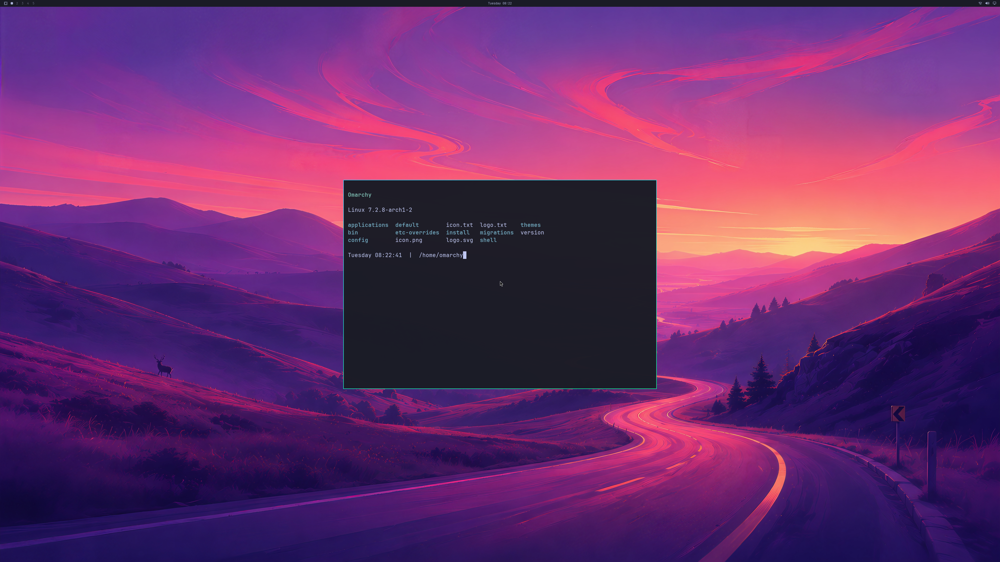

# Native input-device discovery with the NVIDIA desktop

Two fresh owned QEMU/WHPX guests, runs **88 and 89**, pass the complete NVIDIA
desktop, UWSM session, frame-byte and live-cleanup audits while Hyprland enumerates
QEMU's virtual keyboard and tablet through libseat/logind and libinput.

**This verifies guest-side device discovery.** It does not verify typed input,
pointer delivery from the Windows window, normal launcher integration or an
interactive desktop product.

The actual 3840×2160 capture includes the shipped wallpaper, Omarchy bar and
readable Alacritty window. The separate Windows diagnostic client is 1280×720;
physical 4K scanout and every-frame display remain unverified.

## Implementation

The owned read-only-root VM now has virtio keyboard and tablet devices. A
root-owned diagnostic marker enables the native input layer only in the private
fixture, including its bounded UWSM environment. The source disk remains
read-only and all guest changes live in the RAM overlay.

The pinned Aquamarine layer reuses the input session left by unsuccessful DRM
probing. Opening a replacement session while the original still owned its
devices caused actual logind "Device already taken" failures. Initial libinput
device dispatch is deferred through Aquamarine's idle event mechanism: Hyprland
initializes its input manager after backend startup, so emitting the first
keyboard synchronously during startup caused a compositor crash.

Bounded diagnostics record the actually loaded library, actual libseat/libinput
messages and Hyprland's device snapshot. Each accepted guest has one logind seat,
the real virtio keyboard and tablet, and three keyboards/two pointers in total.
The keyboard reports English (US). These observations are correlated with the
existing authenticated compositor and real PAM/logind session.

The patch application tool verifies the exact render, capture, logging and
input layers before mutation, rejects foreign/partial sources and preserves
exact bytes across platforms. The capture layer pins a previously private
legacy CPU-capture hook; it is gated separately and is not used for ordinary
GPU handoffs. Existing published patches and GPU auditors remain unchanged.

The new fixture dismisses the previous repaint notification before creating
another. Two stacked test notifications had covered wallpaper sample pixels;
the independent pixel tolerances and sampled coordinates have not changed.
The supervisor also creates the guest crash-report directory and can preserve
a bounded report for the known UWSM primary. This is diagnostic support, not
verified general crash recovery.

## Verified results

| Per fresh guest | Run 88 | Run 89 |
| --- | ---: | ---: |
| Native GPU commands retired | 1,167 | 1,248 |
| GPU application launch/close cycles | 5 | 5 |
| GPU handoffs / full frame audits | 12 / 2 | 12 / 2 |
| Peak reported GPU usage, bytes | 1,042,407,424 | 1,042,767,872 |
| Guest keyboards / pointers | 3 / 2 | 3 / 2 |
| Non-primary wire objects reclaimed live | 2,355 | 2,338 |
| Remaining primary objects reclaimed | 1 | 1 |
| Retained actors / objects at disconnect | 0 / 0 | 0 / 0 |
| Mappings or native children deferred to VM exit | 0 | 0 |

Both guests exit naturally and preserve the complete source-image digest.
Hyprland, Quickshell and all five application processes use authenticated NVIDIA
renderers. Complete first/last backbuffers match native digests; wallpaper samples
and application glyphs pass. Ten ordinary handoffs avoid CPU upload/readback.

The 192 MiB CPU mapped-data and 1 GiB GPU-VA/reported-usage guards are unchanged.
Both runs use all three staging textures. A hard whole-process physical GPU quota
and near-native performance remain unverified.

Strict default/4K MSVC builds and strict guest-helper builds pass. The pinned
Aquamarine library builds, eight patch-application controls and **396 milestone
regressions** pass locally. The seven new evidence tests reconstruct the raw
frames and reject missing/foreign devices, wrong keymaps, replayed identities,
altered source/library receipts, duplicate seat ownership, removed GPU witnesses,
CPU scans and altered pixels. Source, binary, image and auditor digests are bound
in the [reconstructable evidence](evidence/OMARCHY-4K-NATIVE-INPUT-DISCOVERY-2026-10-20.json).

## Retained failures and remaining work

Runs 83–86 retain their empty device snapshots. Run 86's actual backend messages
identify duplicate session/device ownership. Run 85 also retains its unedited
wallpaper rejection caused by stacked diagnostic notifications. Run 87 retains
the early-dispatch crash, four native GPU commands and zero captured frames.
None is relabeled as passing.

The next integration step is actual key/pointer delivery from the owned Windows
window, with application PTY, cursor and focus witnesses. Normal first-boot,
supported device integration, continuous multi-window display, resize/fullscreen,
long runs, bounded memory/recovery, general OpenGL, Vulkan, CUDA, video, NVIDIA
features, concurrent host/guest workloads and ≥93% matched-native performance
remain open. Counts remain **4/8 backend stages and 0/4 desktop product gates**.
