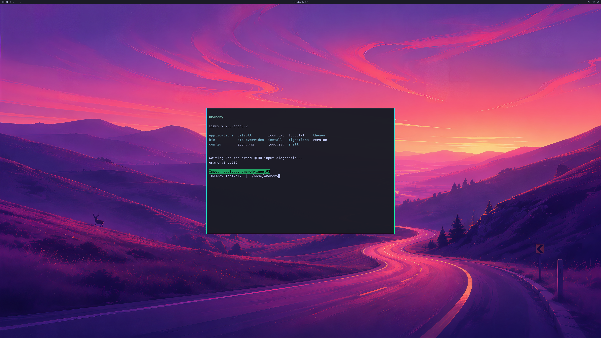

# QEMU input delivery and the rendered application response

Owned QEMU/WHPX guest **run 93** receives a fixed keyboard sequence in a real
Alacritty PTY, moves its cursor to the independently expected absolute position,
and renders the terminal's confirmation in the actual **3840×2160 NVIDIA
backbuffer**. The complete GPU, UWSM/PAM session, pixels and live-cleanup audit
passes for this run.

**The fresh repeat, run 94, fails the existing 1 GiB GPU-usage guard during
shutdown.** It requires VM termination and defers backing-resource reclamation
until VM exit. This is one accepted input-response run, not repeated stability
acceptance. The next optimization is GPU memory pressure and allocation overlap;
the guard is unchanged.

The keyboard sequence is synthetic at the input-channel boundary. It is sent
through QEMU's documented `input-send-event` operation to the real guest seat.
**Physical Windows-window keyboard/pointer delivery, button behavior, normal
launcher integration and an interactive desktop product remain unverified.**
The separate Windows diagnostic client is 1280×720; physical 4K scanout and
every-frame display remain unverified.

## Implementation

An explicit `--driver-window-input` flag enables the owned desktop window's
keyboard, absolute pointer, button and wheel handlers. They enqueue bounded
events without waiting for GPU mapping requests or QMP replies. Input has its
own QMP connection and worker. Both control connections verify the socket peer's
actual process identity against the retained owned QEMU process, then verify
the random machine identity.

The 256-event queue coalesces adjacent pointer motion without reordering key or
button edges. Focus loss clears pending input and releases held state; queue
overflow is a failure, and transport failure attempts conservative key release.
The input worker is joined before the owned runtime stops. Input logs contain
lifecycle/count metadata, not arbitrary user keystrokes.

`--driver-input-self-test` adds the fixed disposable-guest sequence after the
first GPU frame. This mode suppresses unrelated Windows-window input and keeps
the window from activating. Normal window input remains a separate mode.
The test sequence produces exactly **33 acknowledged QMP input commands**.

The actual terminal script checks `omarchyinput93`, prints its confirmation,
and atomically publishes its PTY receipt. The fixture holds its remaining
handoffs after frame two while the compositor and input event loops continue.
After the receipt and at least three further compositor commits, it resumes
the bounded handoffs and audits the final buffer. This diagnostic barrier is
not continuous-display acceptance.

The independent pixel check finds the terminal's true-color confirmation band
inside the authenticated application's bounds. The first buffer has none;
the final buffer contains **9,143 matching pixels**. Complete buffer hashes,
shipped-wallpaper samples, application glyph checks and GPU identity witnesses
remain mandatory and unchanged. The color check does not claim exact glyph OCR.

## Results and retained failures

| Per owned guest | Run 93 | Repeat 94 |
| --- | ---: | ---: |
| Complete input-response audit | Pass | **Rejected** |
| Native GPU commands retired | 1,158 | 1,195 |
| GPU application launch/close cycles | 5 | 5 started; shutdown acceptance fails |
| GPU handoffs / complete buffer audits | 12 / 2 | 12 / 2 |
| Input command acknowledgements | 33 | 33 |
| Peak reported GPU usage, bytes | 971,374,592 | **1,077,608,448** |
| Existing GPU-usage limit, bytes | 1,073,741,824 | 1,073,741,824 |
| Natural owned VM exit | Yes | **No** |
| Source disk unchanged | Yes | Yes |

Run 93 preserves application focus while the cursor moves from (1920, 1080) to
(2343, 1318). Both staging textures and all actors, mappings and native children
are reclaimed before disconnect/VM exit. Ten ordinary handoffs avoid CPU
upload/readback; the first and last use complete diagnostic GPU readback.

Run 94's post-residency guard observes 3,866,624 bytes above the limit. Final
forced teardown releases all objects, but that does not satisfy live-cleanup
acceptance. The failure is retained and does not count as a passing repeat.

Earlier run 90 has zero captured frames: the observer rejected a valid cursor
JSON reply's leading newline. Run 91 passes the older GPU/discovery audit and
receives the token, but unrelated Windows-window events mix with the fixed
sequence: 144 acknowledgements and the wrong final cursor position cause its
combined input audit to fail. Run 92 passes isolated QMP/PTY delivery and GPU
audits, but its final buffer still shows the earlier waiting prompt. It remains
a delivery-only baseline, not a rendered-response proof.

Strict default/4K MSVC builds and strict guest-helper builds pass. Linux and
Windows input controls cover ordering, pointer coalescing, overflow, focus reset,
held-key release, failed transport and socket-owner rejection. Eight new evidence
regressions replay the raw buffers, source/build receipts and retained failures.
All **404 local milestone regressions** pass; the existing GPU auditors remain
unchanged.

[Reconstructable evidence, including the failed repeat and earlier attempts](evidence/OMARCHY-4K-QMP-INPUT-RESPONSE-2026-10-20.json)
contains logs and complete raw-buffer deltas. Private driver binaries, initramfs
and disks are not published. The base image remains read-only; guest changes
exist only in the RAM overlay.

Counts remain **4/8 backend verification stages and 0/4 desktop product gates**.
Memory pressure, physical Windows input, sustained multi-window display, normal
first-boot/launcher, resize/fullscreen, long workloads and recovery remain open.
General OpenGL, Vulkan, CUDA, video, broader NVIDIA features, concurrent
host/guest workloads and ≥93% matched-native performance still need their own
implementation and real-application acceptance.
