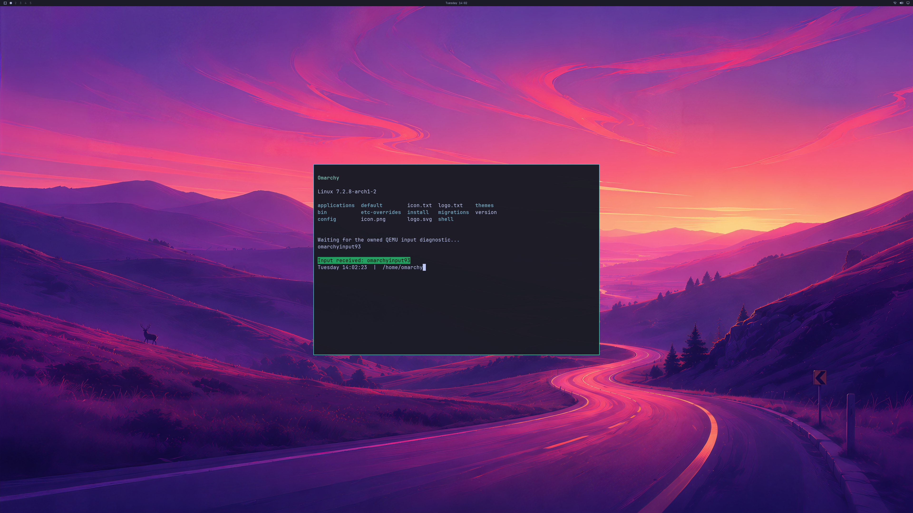

# GPU staging reclamation under residency pressure

Two fresh QEMU/WHPX guests, **runs 95 and 96**, pass the complete NVIDIA
input-response audit after adding safe reclamation of idle presentation staging.
Each renders the shipped Omarchy wallpaper, bar and readable Alacritty application
at **3840×2160**, receives the fixed QMP keyboard sequence in the real PTY, moves
the cursor to the expected position and captures the terminal's green response.

Each run actually releases **33,423,360 bytes (31.875 MiB)** of staging before a
native residency request. Reported GPU usage drops by exactly that amount at the
observed reclamation point. The existing **1 GiB reported-usage guard is unchanged**.

## Change and ownership rules

The earlier [input-response repeat, run 94](LIVE-UWSM-QMP-INPUT-RESPONSE.md),
crosses the reported-usage limit after a native residency call, requires VM
termination and fails live-cleanup acceptance. Its original evidence and auditors
remain unchanged.

Before a residency request, the bridge now checks whether reported headroom is
below a 64 MiB reserve. It can release idle auxiliary staging textures until that
reserve is recovered or no safe candidate remains. It re-queries reported usage
before residency; the existing post-residency guard also remains in force.
This is opportunistic reclamation, not a physical GPU quota or a guarantee that
every residency request will fit.

The three-slot ring retains its capacity. Slot zero remains allocated for the
audit footprint. Slots one and two qualify only after previous use, when
unoccupied and after **both actual input-copy and output-copy GPU fences**
retire. The serialized request path holds the slot mutex throughout selection
and release. Command allocators/lists are reset and closed before the texture
reference is dropped. Device loss or reset failure fails closed; failed release
retains ownership/accounting. Reclamation adds no GPU wait to the ordinary
frame path.

Allocation generations and separate historical/live-byte ledgers distinguish
a later allocation in the same slot from its previous resource. The unit
controls exercise that reuse, but **neither hardware run reallocates a trimmed
slot**: both reclaim after their twelve handoffs. Continued rendering through
repeated hardware trim/reallocation remains a required next test.

## Actual results

| Per fresh owned guest | Run 95 | Run 96 |
| --- | ---: | ---: |
| Complete GPU/input-response audit | Pass | Pass |
| Native GPU commands retired | 1,236 | 1,284 |
| GPU application launch/close cycles | 5 | 5 |
| 4K GPU handoffs / complete buffer audits | 12 / 2 | 12 / 2 |
| QMP input acknowledgements | 33 | 33 |
| Confirmation pixels in final GPU buffer | 9,143 | 9,143 |
| Peak reported GPU usage, bytes | 1,010,925,568 | 1,009,164,288 |
| Observed usage after trim, bytes | 977,502,208 | 975,740,928 |
| Staging bytes actually released under pressure | 33,423,360 | 33,423,360 |
| Staging textures created / trimmed / eventually released | 2 / 1 / 2 | 2 / 1 / 2 |
| Hardware staging reallocations | 0 | 0 |
| Natural VM exit and host exit zero | Yes | Yes |
| Mappings or native children deferred to VM exit | 0 | 0 |
| Source disk unchanged | Yes | Yes |

Each guest runs Hyprland through UWSM in an independently verified PAM/logind
session. Hyprland, Quickshell and all five application processes retain their
NVIDIA renderer/resource witnesses. Every actor, including the compositor, is
reclaimed before disconnect; every backing mapping/native child is reclaimed
before VM exit. Ten ordinary handoffs avoid CPU upload/readback. The first and
last retain complete diagnostic GPU-buffer readback and independent wallpaper,
application glyph, renderer, source/build and lifecycle checks.

Strict default and 4K Windows builds pass with the shared reclamation control;
the same selector control also passes on Linux. Six new raw-evidence regressions
replay both complete GPU runs, verify exact build/image/auditor provenance and
reject occupied slots, pending copy fences, stale generations, missing GPU
witnesses, changed pixels, altered usage guards and invalid input ownership.
Six separate synthetic-ledger controls cover admission, trim/reallocation
accounting and incomplete teardown; they are not hardware proof.

[Reconstructable raw frames, logs, source/build receipts and prior-failure link](evidence/OMARCHY-4K-STAGING-RECLAIM-2026-10-20.json)
bind the new immutable auditor to these exact builds. The public PNG is a direct
conversion of run 96's final complete GPU backbuffer without pixel edits.
Private driver binaries, initramfs and disks are not published. The source
Omarchy disk remains read-only and guest changes exist only in the RAM overlay.

## Scope still open

This establishes **two passing bounded input-response/reclamation runs**. It
does not establish long-run memory stability, hardware reallocation while
rendering, continuous display or a usable product. Input enters through QMP's
documented channel and is isolated from physical Windows events. Physical
keyboard/mouse input, button behavior and normal launcher integration remain
unverified. The diagnostic Windows client is 1280×720; physical 4K scanout and
all-frame display remain unverified.

The fixture uses a disposable seeded account, dedicated UWSM entry and headless
compositor output. Normal account setup, supported guest-device integration,
multiple simultaneous application windows, resize/fullscreen, long workloads
and recovery remain open. General OpenGL, Vulkan, CUDA, video, broader NVIDIA
features, concurrent host/guest workloads and **≥93% matched-native performance**
still require their own implementation and real-application acceptance.
Counts remain **4/8 backend verification stages and 0/4 desktop product gates**.
