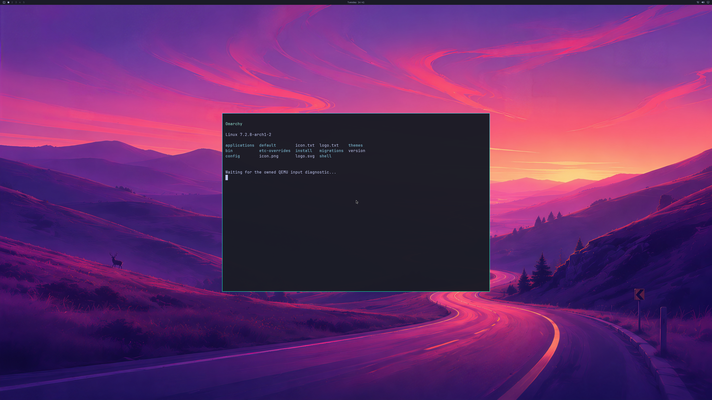
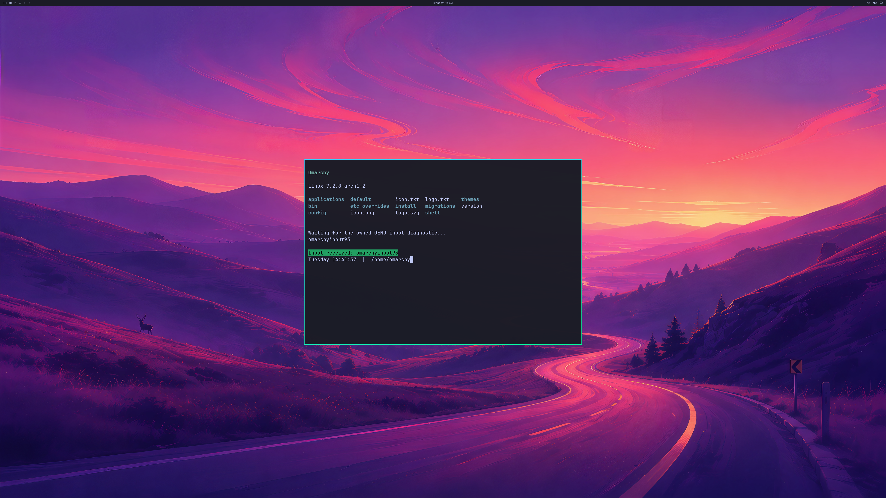

# 300-frame NVIDIA desktop with real application resizing

Two fresh QEMU/WHPX guests, **runs 99 and 100**, pass a complete 300-frame
Omarchy GPU workload while the same Alacritty application grows and returns to
its original layout. Both retain the shipped wallpaper, bar, authenticated
NVIDIA renderers, QMP input response and live-cleanup checks. The source disk
remains read-only.

The output buffers are **3840×2160**. The first full GPU capture shows the
application at **1440×960**; the last shows its restored **1200×800** bounds.
The application also reaches **1600×1000** during the stream, verified through
its actual compositor identity and geometry; that middle size has no separate
complete pixel capture.

## Workload and independent checks

The opt-in `WDDM_BRIDGE_DESKTOP_RESIZE_PROBE` diagnostic requires the real scene
and at least 200 handoffs. It first resizes the authenticated terminal to
1440×960 before the initial capture, grows it to 1600×1000 after handoff 50 and
restores 1200×800 after handoff 150. Each phase checks the same application PID,
identity, visible floating window, centered bounds and at least three further
compositor commits.

Ordinary GPU handoffs continue during the two stream-time operations. Only the
final audit is held until the application returns to its expected layout.
Five handoffs advance during each operation in run 99; three and four advance
respectively in run 100. The exact counts appear below.

A regular grid of **328 probes**, fixed before the resize captures, checks the
first enlarged panel's interior margins against the application's configured
background. Every probe matches in both runs. The same coordinates in the
final buffer must match an independently decoded shipped wallpaper reference:
mean RGB error is about **0.80**. These pixels lie outside the restored window.
This proves actual enlarged/restored GPU scene content, rather than accepting
window metadata alone.

Every one of the **300** guest replies, input GPU copies, native Present
submissions, output receipts and frame-latency waits is checked in sequence.
All share one owned presenter identity with advancing timing and accepted
Present results. **298 ordinary handoffs avoid CPU upload/readback**; the first
and last retain complete tiled GPU readback, full-buffer hashes, wallpaper,
application glyphs and renderer/resource witnesses. This audits each native
handoff; it does not establish that every frame reached physical scanout.

## Results

| Per fresh resize guest | Run 99 | Run 100 |
| --- | ---: | ---: |
| Complete GPU/resize/input-response audit | Pass | Pass |
| Native GPU commands retired | 2,208 | 2,187 |
| GPU application launch/close cycles | 5 | 5 |
| GPU handoffs / complete backbuffer audits | 300 / 2 | 300 / 2 |
| Handoffs across the 1600×1000 resize | 50 → 55 | 50 → 53 |
| Handoffs across restoration to 1200×800 | 150 → 155 | 150 → 154 |
| Enlarged-panel background probes matching | 328 / 328 | 328 / 328 |
| Restored-wallpaper mean RGB error | 0.798 | 0.798 |
| QMP acknowledgements / final confirmation pixels | 33 / 9,143 | 33 / 9,143 |
| Peak reported GPU usage, bytes | 1,009,025,024 | 1,009,582,080 |
| Existing reported-usage guard, bytes | 1,073,741,824 | 1,073,741,824 |
| Idle staging textures trimmed | 1 | 1 |
| Hardware staging reallocations | 0 | 0 |
| Natural VM exit, host exit zero and live cleanup | Pass | Pass |
| Mappings/native children deferred to VM exit | 0 | 0 |
| Source disk unchanged | Yes | Yes |

The one staging trim in each resize run occurs **after all 300 handoffs**.
Neither run reallocates a trimmed slot while rendering. The resource-pressure
reclamation fix remains useful, but these results do not close that coverage gap.

The earlier **300-frame input-response baselines, runs 97 and 98**, also pass
complete GPU, UWSM/PAM, input and live-cleanup audits. They retire 2,235 and 2,169
native commands respectively. Run 97 trims one idle staging texture after its
stream; run 98 has no pressure observation or trim. Neither baseline exercises
the new application-resize mode or hardware staging reallocation.

Strict compilation passes for the new resize guest and the existing default
and twelve-frame guest-hook modes. The native C++ sources and Native68 binary
are unchanged from the [published reclamation checkpoint](LIVE-UWSM-STAGING-RECLAIM.md).
Eight new evidence regressions replay both resize runs and both baselines,
verify source/build/image provenance and reject missing or mixed frames,
ordinary CPU readback, wrong geometry/identity, stale panel pixels, missing GPU
witnesses and altered memory guards.

[Reconstructable complete buffers, logs, source/build receipts and pixel reference](evidence/OMARCHY-4K-SUSTAINED-RESIZE-2026-10-20.json)
preserve all four outcomes. The previous reclamation and failed input-response
evidence stays unchanged. The two public PNGs are direct conversions of run
100's complete GPU buffers without edits. Private driver binaries, initramfs
and disks are not published.
Existing published auditors remain unchanged. The legacy runtime verifier keeps
rejecting this root-desktop fixture; the new auditor accepts only the bounded
GPU/resize scope described here.

## Remaining acceptance work

This is a bounded compositor/application workload, not a long-run stability or
performance benchmark. It still uses the disposable seeded account, UWSM entry,
RAM overlay and headless compositor output. Input is synthetic at the QMP
channel boundary. Physical Windows-window input, Windows app-window resizing,
normal account/launcher integration, continuous multi-window display, physical
4K scanout and every-frame display remain unverified.

The product integration should retain the official launcher's keyboard/cursor
logic and QEMU SDL input path, including its existing QMP reserved-key routing.
Our fixed QMP self-test remains diagnostic. The
[verified upstream source map](UPSTREAM-INPUT-GRAPHICS-INTEGRATION.md) defines
the graphics integration boundary.

Next are hardware staging trim/reallocation during continued rendering,
simultaneous application windows, graphics integration with the upstream
launcher/frontend and its existing input handling, longer workloads and
recovery. General OpenGL, Vulkan, CUDA, video, broader NVIDIA features,
concurrent host/guest GPU workloads and **≥93% matched-native performance**
still require their own implementation and real-application acceptance.
Counts remain **4/8 backend stages and 0/4 desktop product gates**.
