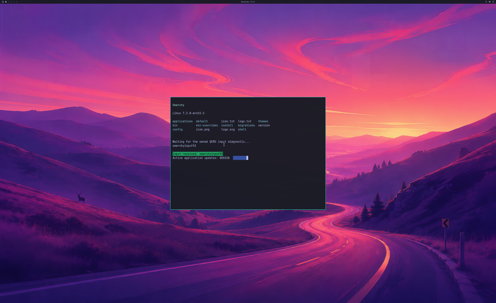

# Live graphics diagnostics through virtio-serial

The existing graphics session emitted detailed NVIDIA, compositor, broker and
controller diagnostics synchronously over the emulated UART. Moving the same
live diagnostics to a dedicated virtio-serial port substantially shortens the
CPU handoff intervals in the bounded 4K Omarchy fixture. The guest GPU libraries,
animated application, compositor handoff workload and official input code are
unchanged. This change is explicitly selected with `--driver-virtio-trace`; it
is not enabled by the released launcher.

## Hardware comparison

Every run uses Native77, the same instrumented QEMU/SDL artifact, NVIDIA GPU,
read-only source disk, RAM overlay and 300-frame active workload. The guest's
active application updates its real PTY with a 60 Hz target. Fixed steady windows
`[20,45]`, `[80,140]`, `[200,280]` were chosen before these candidates, excluding
diagnostic readbacks, input barriers and resize phases. Each accepted run supplies
168 steady timing records and 165 adjacent frame intervals.

| Run | Live diagnostic carrier | Median interval | p95 interval | Median fence setup / queue round trip / total |
| --- | --- | --- | --- | --- |
| 116 | UART baseline | 43.12 ms | 128.07 ms | 3.86 / 3.20 / 7.38 ms |
| 118 | Virtio candidate | 16.73 ms | 24.55 ms | 0.34 / 0.80 / 1.17 ms |
| 120 | Virtio repeat | 16.65 ms | 37.79 ms | 0.29 / 0.78 / 1.14 ms |
| 121 | UART baseline repeat | 43.77 ms | 134.28 ms | 3.97 / 3.27 / 7.78 ms |

Both candidate medians are about 61–62% shorter than the adjacent valid UART
baseline. This is a CPU wall-clock measurement in a short, instrumented fixture.
The comparison is sequential and not randomized. It does not measure GPU execution
time, physical display cadence, end-to-end input latency, uninstrumented application
throughput or matched-native performance. A 16.7 ms median does not prove that
every frame is displayed at 60 FPS; the p95 intervals remain above that target.

**All four accepted runs** independently pass 300 GPU handoffs; exact complete
3840×2160 source pixels; full 2560×1566 SDL pixels within one code value of an
independent GL_LINEAR reference under the fixed tolerance of two; UWSM/PAM session
checks; wallpaper, bar and readable application; five application lifecycles;
resize and rendered QMP input response; producer/consumer fences; live SDL detach;
natural VM exit and zero live native/backing mappings. Ordinary frames avoid CPU
texture upload and readback. Only the first and final frames use diagnostic captures.



This image is the actual SDL pre-swap backbuffer, decoded as RGBA and oriented
vertically. Its source is a 4K GPU-rendered Omarchy frame. Physical 4K scanout
is still unverified.

## Complete live trace, separate from GPU and input

The host reserves an exclusive trace file, adds a dedicated virtio-serial port
`org.7wdev.graphics.trace` at port 2 and leaves UART boot/kernel diagnostics
available. The guest verifies the exact sysfs port name and device identity,
opens only `/dev/vport0p2`, and checks its character-device number.

Linux permits a single opener on this port, so one root collector copies an
ordered FIFO shared by the graphics actors to the host. The FIFO lives in a
root-owned directory and is group-write-only for the disposable session account.
The supervisor, broker, journal follower and compositor service share this
carrier. The service uses `StandardOutput=file:` with inherited stderr. Standard
input, libinput devices, QEMU SDL keyboard/cursor code and the reserved-key QMP
route are unchanged. The Linux port behavior and service output mechanism are
documented in the [Linux virtio-console source](https://github.com/torvalds/linux/blob/master/drivers/char/virtio_console.c)
and [systemd execution documentation](https://www.freedesktop.org/software/systemd/man/latest/systemd.exec.html).

The collector checks short writes and interruptions, caps the payload at 64 MiB,
and records a final byte count and FNV-1a checksum only after complete EOF. The
supervisor requires a successful bounded collector exit before accepting its
final result. Host observations show the file growing at frames 1, 100, 200 and
300 in both candidates. Neither diagnostic filtering nor deferred replay is used.
Raw UART and virtio bytes remain separately reconstructable. The merged view
keeps explicit graphics-session boundaries; it does not claim a total clock
ordering of unrelated kernel/systemd records across two channels.

The candidate payload differs from the baseline in exactly three entries:
the supervisor binary, trace source receipt and trace marker. Original guest
source inventories also record different host-only files from Native74/77;
the exact versions are retained rather than attributing those to guest GPU code.

## Retained failures and remaining work

Run **119** stopped after two handoffs: the guest input-response check failed and
no PTY input token was recorded. Although the host and VM exited naturally with
normal cleanup, it fails the full desktop audit and is excluded from timing
comparisons. Its cause remains unconfirmed. The supervisor's generic exit code
alone does not certify a successful graphics workload; the independent validator
requires every frame and the input response.

Attempt **117** failed a duplicate UART-only controller payload assertion before
starting a VM or GPU work. The corrected controller retains explicit, separate
payload hashes for both carriers. Its original source and rejection are archived.
Earlier device-loss and all-zero SDL failures remain open. The prior synthetic
failure-teardown controls apply to Native76; genuine GPU device-loss recovery
and fault-path behavior with the new collector remain unverified.

Backend stages remain **4/8**, desktop product gates **0/4**, scene elements **3/3**.
Next acceptance work is continuous displayed cadence and official physical input,
normal launcher/account integration, simultaneous windows, resource churn,
recovery, broader GPU APIs and a matched-native benchmark. The 93% performance
target remains unverified.

## Reconstructable evidence and checks

[Lossless evidence](evidence/OMARCHY-VIRTIO-TRACE-DESKTOP-2026-10-21.json), SHA-256
`34db6019cab6c704f374f4b6726611838dc2f3f4790a7176f51632fffeef6dbf`,
retains all five hardware attempts, preflight failure, raw logs/traces, full
captured buffers, exact Native77 compiled source/build inputs, original and
generated guest sources, decoder and private controller sources. Shared blobs
reference the independently checksummed earlier evidence. No private NVIDIA/WSL
binaries, disk or initramfs are published.

Strict MSVC default/4K builds, existing startup guards, ten new trace-flag guard
checks, and the portable strict-C identity/checksum/overflow control pass.
The 466 milestone regression tests pass. Six additional evidence replay and
rejection checks cover the complete cohort, raw trace integrity, live growth,
failed input response, compiled provenance, official input and cleanup:

```text
python -m unittest discover -s experimental/windows-native-gpu -p test_virtio_trace_desktop_milestone.py -v
```
