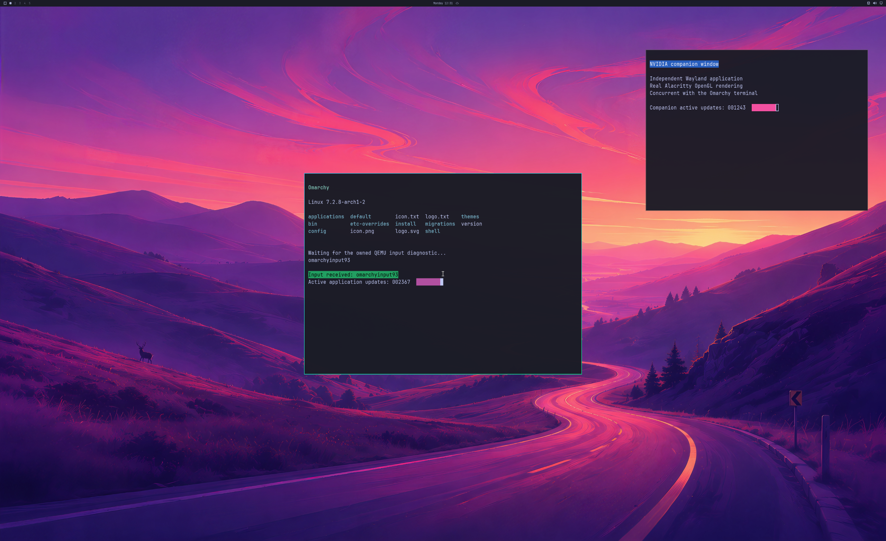

# Application memory-pressure admission

An owner-only pilot rejects mapped first-residency batches before calling the
Windows driver when their estimated charge would cross the existing 1 GiB
reported-usage guard. It contains an observed failure that previously stopped
the owned VM. Chromium browsing and recovery with a usable desktop remain open.

Enable `--driver-mapped-residency-admission` with explicit
`--driver-actor-slots 8`, `--driver-resource-reference-slots 32` and
`--driver-deferred-residency`. Existing checks restrict these options to the
owned, coordinated, read-only-root SDL desktop. Defaults remain off; ordinary
applications cannot enable this policy. No memory limit is raised.

The estimate uses mapped pages for allocations without an existing native
residency reference. Existing references are not charged twice. CPU-mapped and
unknown extents remain unknown. Checked arithmetic rejects overflow. A mapping
can be a subrange or shared storage, so this is **not a physical-size decoder or
hard allocation quota**. It can overestimate or miss a charge. The post-native
guard remains necessary and can still stop the owned VM.

The entire requested batch is checked before native submission or increments
to its native/logical residency references. A refusal returns `STATUS_NO_MEMORY`,
zero allocation count, zero paging fence and an estimated bytes-to-trim hint.
Existing retained-reference/staging reclamation can precede this check; the
ownership guarantee applies to the requested batch. There is no post-native
eviction rollback or new private paging queue. Failed budget queries remain
failures, with an explicit indication that usage is unknown.

## Hardware observations

| Run | Result |
| --- | --- |
| 194, observer only | A single 8,128-page batch adds 33,292,288 reported bytes, crossing the guard after native residency succeeds. The owner forces VM shutdown. |
| 196, pilot enabled | Four actual refusals reach the guest as ENOMEM before native MakeResident. Chromium restarts its GPU process and navigation fails with `net::ERR_ABORTED`. Native resources retire before natural VM exit. No desktop frame or usable live recovery is accepted. |
| 197, default off | The existing 4K desktop regression passes: 1,800 handoffs, 5,849 native submissions and 5,842 successful device-health queries, with full pixels and live cleanup. |
| 198, pilot enabled | The unchanged guest regression passes: 1,800 handoffs, 5,471 native submissions and 5,464 successful health queries. Complete source/SDL pixels have maximum channel error one. There is no admission refusal in this workload. |

Both desktop regressions include wallpaper, input response, resize, focus,
application replacement, live cleanup and natural VM exit. Runs 196 and 198 are
separate tests. They establish refusal containment and a normal desktop
regression, not recovery during sustained interactive use. Source-disk and
installed-driver guards pass. Independent browser shader, sandbox and displayed
window acceptance remain open.

The GPU source is 3840×2160; this actual SDL capture is 2560×1566. It shows the
diagnostic desktop with two terminal applications, not the normal launcher/account
or arbitrary application acceptance.

[Structured observations and raw-stream hashes](evidence/MAPPED-RESIDENCY-ADMISSION-2026-10-26.json)
retain failures and regressions. Raw streams and proprietary assets remain
private; this summary is not a complete replay archive. Strict Windows default/4K
builds and 27 CLI rejection cases per build pass. Portable mock checks cover the
observed overrun, boundary arithmetic, unknown/CPU-mapped extents, repeated
references and whole-batch refusal.

Backend stages stay **4/8**, desktop product gates **0/4**. Next work includes
Chromium's presentable GBM buffers, usable pressure recovery, normal launcher and
account integration, broader applications and sustained performance.
