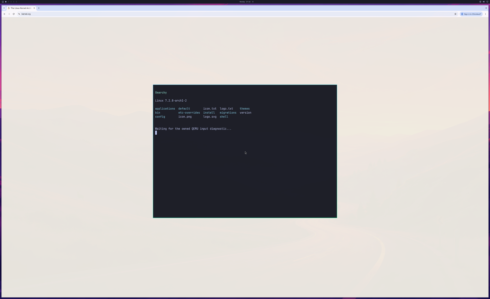

# Sandboxed Chromium shader observation

**Later result:** [run 231 displays a readable GPU-composited page and shader](GPU-COMPOSITED-BROWSER-FRAME.md). Its input/sustained acceptance still fails. The earlier missing-page results below remain retained.

On October 26, 2026, private integration run 225 loads the Linux Kernel Archives
over secure public HTTPS and renders a real NVIDIA/ANGLE/D3D12 WebGL shader while
Chromium reports its GPU sandbox active. All 16 observed GPU threads have
Seccomp 2, NoNewPrivs 1 and UID 1000. The shader center pixel is
**[128, 128, 64, 255]**, with GL error zero and no context loss. The actual GPU PID
is authenticated as native actor 9 and has native command and queue-signal work.

This passes the combined shader/sandbox observation that earlier runs could not
establish together. It does **not** pass browsing or daily-use acceptance.

## Actual shader image

Follow-up run 227 captures this 512×256 PNG directly from the real WebGL canvas
after the shader and all 16 observed GPU threads pass the sandbox checks. It is
the actual canvas readback, without redrawing the gradient on the CPU. The GPU
PID is independently authenticated and has native command work. This image is
separate from the desktop capture below. The same follow-up explicitly rejects
disabled GPU compositing and does not accept a displayed browser frame.
[Image receipt, exact pixels and stream hashes](evidence/SANDBOXED-WEBGL-SHADER-IMAGE-2026-10-26.json).

## Actual first window capture — incomplete page

The capture is a 2560×1566 QEMU SDL window from a 3840×2160 GPU source. Its full
viewport matches the source after QEMU's compiled GL_LINEAR operation, with
maximum channel error one. GL readback's row origin is normalized when saving
the PNG. No browser contents were composited into this image afterward.

The browser window's page body is missing in this captured frame. Chromium
reports **gpu_compositing=disabled_software**, even though its hardware WebGL
shader succeeds. Two handoffs complete; the 1,800-handoff desktop test fails and
the general verifier remains exit 1. Input response, scrolling, tabs, readable
page contents, browser reopen and sustained use are not accepted by this run.
The exact point where visible page content is lost remains under investigation.
The shader canvas is not visible in this screenshot.

## Boundaries and cleanup

The private GPU-child helper prepares trusted graphics code, the render-device
descriptor and 64 original libdrm metadata allocations before sandbox entry.
Each metadata allocation is transferred at most once for the observed VM device;
fields are not invented and normal libdrm deallocation remains in use. The exact
D3D12-core thread-priority request receives EPERM, without issuing a replacement
scheduling syscall or reporting success. The kernel render-only identity check,
Chromium sandbox policy and official input implementation are unchanged.
This bounded experiment is not a finished browser integration or an unbounded
metadata cache suitable for daily use.

The host completes 722 native submissions and 747 successful device-health
queries, with zero failed health queries. Browser GPU retirement is witnessed,
the VM exits naturally, and native/aperture resources release before VM exit.
Source-disk, installed-driver, native compile-input and QEMU guards pass.
Earlier failed and forced-exit trials remain retained separately.

The public host runtime is unchanged. Private Mesa, presentation and helper
overlays, proprietary libraries, guest images and raw research streams remain
excluded. [Structured observations and stream hashes](evidence/SANDBOXED-BROWSER-SHADER-2026-10-26.json)
are an audit summary, not a complete replay archive.

Counts remain **backend 4/8, desktop product 0/4, diagnostic scene 3/3**.
Next acceptance is correct visible page content with GPU compositing, followed
by input, scrolling, resize, close/reopen and sustained multi-window use.
